<p align="center">
  
</p>

<h1 align="center">ai-security-monitor</h1>

<p align="center"><a href="./README.md">繁體中文</a> · <b>English</b></p>

<p align="center">
  <a href="https://github.com/markku636/ai-security-monitor/actions/workflows/ci.yml"></a>
  
  
</p>

Install it and it tells you who your computer is talking to, which connections look suspicious and what isn't set up safely, then asks an AI to explain it all in plain language.
Every "suspicious" comes with a reason and a source (which public blocklist, which odd behavior), so it is never a black-box score.
Use it on just your own computer, or bring every computer in the office into one web page.

<p align="center">
  <picture>
    <source media="(prefers-color-scheme: dark)" srcset="docs/images/windows-desktop-hero-dark.png">
    
  </picture>
</p>

<p align="center"><sub>The Windows desktop app's overview page (demo data). Closing the window keeps it running in the system tray.</sub></p>

## How it started

Last night before bed, I had AI build a fun little project:
an app written in Rust that collects and analyzes unusual connections on client machines for threat analysis.
Since AI arrived, system vulnerabilities have become glaringly obvious; if the attackers are AI, AI also knows very well how to defend.

**Architecture**

```
Client Agent → periodic reports → Server analysis → AI risk assessment → Dashboard
```

## Why it exists (you've probably been here too)

- **Your computer gets hacked and you have no idea.**
  A lot of malware never pops up a window or slows anything down; it just quietly phones home to the attacker. The antivirus stays quiet, so you assume all is well.
  👉 It checks who your computer is talking to every minute, flags known-bad addresses straight away and tells you which program is connecting.
- **The connection list is just a wall of numbers.**
  Even if you know `netstat`, hundreds of IPs don't tell you which ones are normal and which are not.
  👉 Every connection is labelled safe / suspicious / dangerous with a reason (e.g. "this IP is on a botnet list"), plus the country and the program.
- **With many office computers, nobody can keep up.**
  Checking them one by one is impossible, and problems are found only after something breaks.
  👉 Every computer reports to one web page (the Hub); the riskiest one is obvious at a glance, and alerts go to email, Slack or Teams.
- **Professional security tools are expensive and hard work.**
  SIEM and EDR products cost money and need someone to run them; small companies and individuals can't afford that.
  👉 Free and open source: install one program and it works; for the whole office, the Hub starts with one Docker command.
- **You see a warning and have no idea what to do.**
  "CVE-2025-xxxx", "SMBv1 enabled"… so what?
  👉 Every problem comes with a plain explanation and the fix; you can also ask an AI (Claude Code, Codex) to talk you through it and tell you what to do first.
- **Attackers are using AI now.**
  Finding holes and writing malware is much faster than before; reviewing everything by hand can't keep up.
  👉 So defend with AI: it reads the data, judges the risk and turns it into a report you can understand.

## Who is it for?

- **Your own computer**: you want to know whether your Windows / Mac / Linux machine talks to strange places, is missing updates, or has a security setting switched off. Install the desktop app.
- **Several computers in an office**: IT (or the boss) wants one web page for every computer, to deal with problems together and, when needed, approve "block this IP" from the browser. Run the Hub.
- **Servers** (including Windows Server, Server Core, domain controllers and Linux): no desktop needed. Install it as a background service that starts at boot, checks on a schedule and reports in. Use the command-line version.

A few words you will see a lot:

| Word | In plain terms |
|---|---|
| agent | The small program on each computer that does the checking, i.e. `ai-security-monitor` itself |
| threat intel | Public lists of known bad actors that other people maintain (known botnet servers, IPs currently brute-forcing logins, …) |
| Hub (Security Hub) | The web page where you see all your computers; you host it yourself (Docker) |
| hardening | Security settings of the system, such as disk encryption, antivirus, Remote Desktop protection |
| MCP | A standard way for AI tools like Claude Code and Codex to look things up; here it only allows reading, never changing settings |

## Which one do I install?

Everything is on the [latest release](https://github.com/markku636/ai-security-monitor/releases/latest).

| You want to | Install | File |
|---|---|---|
| Look at your own computer in a window | **Desktop app** (double-click to install) | Windows 10 / 11: `AI-Security-Monitor-<version>-windows-x64-setup.exe`<br>Mac (M1 and later): `…-macos-arm64.dmg`; Mac (Intel): `…-macos-x64.dmg`<br>Linux: `…-linux-x64.AppImage` (no install) or `…-linux-amd64.deb` |
| Run it on a server, without a desktop, or from scripts | **Command-line version** | The one-line installer below is easiest (it verifies the checksum for you). You can also download `ai-security-monitor-<version>-<platform>` directly, but it runs in a terminal; double-clicking only shows a help screen |
| See every computer in the company on one page | **Security Hub** | Docker image `ghcr.io/markku636/ai-security-monitor-hub`; nothing to download |
| (You see `asa-<version>-*`) | Ignore it | Used by old 0.1.x installs to update themselves; same content as the command-line version |
| (You see `SHA256SUMS`) | Checksums | A fingerprint of every file; the install scripts and `self-update` check it and refuse tampered files |

The desktop app and the command-line version can live on the same computer; they share the same settings and scan results.

## Get started in 5 minutes

### Scenario A: I just want to check my own computer (Windows)

1. Download `AI-Security-Monitor-<version>-windows-x64-setup.exe` from [Releases](https://github.com/markku636/ai-security-monitor/releases/latest).
2. Double-click it. If a blue "Windows protected your PC" box appears, click "**More info**", then "**Run anyway**".
   This happens because the installer has no paid code-signing certificate, so Windows does not recognise the publisher; it does not mean the file is bad. If you want to be sure, compare it with `SHA256SUMS` first.
3. It installs for the current user; no administrator needed. Open "AI Security Monitor" from the Start menu.
   The first time, it opens Settings → Company Security Hub (設定 → 公司的 Security Hub) and looks for your company's Hub. If it's just for your own computer, click the link at the bottom of that section, "Not now, use it on this computer only" (先不要，只在這台電腦使用).
4. On the "Overview" page click "**Update intel**" (downloads the blocklists), then "**Scan now**". (The app itself is in Traditional Chinese: 更新情資 and 立即掃描.)
5. Read the results:
   - Overview: the security score and the connections that need attention most.
   - Connections: where this computer is connected right now and why something is marked suspicious; click an IP to see its country and which lists include it.
   - Scan results: vulnerabilities, missing updates and weak security settings, each with how to fix it.
   - AI analysis: if Claude Code or Codex CLI is installed and signed in on this computer, one click asks the AI to explain the findings in plain language (using your own account).

Closing the window only hides it to the system tray; choose "結束" (Quit) in the tray menu to really exit.
To have it check in the background on a schedule, turn on "Report in the background after startup / sign-in" (開機／登入後在背景自動回報) on the Settings page. macOS and Linux steps are under [Install](#install).

### Scenario B: I manage several computers in an office

**Step 1: run the Hub** (on a computer or server that is always on and has Docker)

```bash
git clone https://github.com/markku636/ai-security-monitor && cd ai-security-monitor
cp .env.example .env    # edit .env: set AI_SECURITY_MONITOR_HUB_ADMIN_SECRET (your sign-in secret), AI_SECURITY_MONITOR_HUB_DB_PASSWORD,
                        # and AI_SECURITY_MONITOR_HUB_PUBLIC_URL (the address other computers use, e.g. http://<this machine's IP>:8088)
docker compose -f docker/compose.yml --env-file .env up -d
```

Open `http://<this machine's IP>:8088` in a browser and sign in with the `AI_SECURITY_MONITOR_HUB_ADMIN_SECRET` you just set.
Just trying it on your own machine? Use `compose.standalone.yml` instead of `compose.yml`; it only listens on `http://127.0.0.1:8088`.
To run [protective DNS](docs/dns-server.en.md) (a DNS server that blocks malicious domains) as well, use `compose.dns.yml` (standalone: `compose.standalone.dns.yml`) and also set `AI_SECURITY_MONITOR_HUB_DNS_TOKEN` in `.env`.

**Step 2: add computers**

**Option 1: computers find the Hub themselves and an admin clicks "Approve" (recommended, no keys to hand out)**

1. The admin opens "Add a host" in the Hub sidebar and notes the **Hub fingerprint** at the top (a code like `72AS-YEXT-VNGO-NLC5-W2NM` that proves it's your company's Hub and not an impostor).
2. On each computer, one of:
   - **Desktop app**: on first start it looks for the company Hub by itself in Settings → Company Security Hub (設定 → 公司的 Security Hub). If the fingerprint matches what the admin told you, click "**Request to join**" (申請加入). If nothing is found, type in the address the admin gave you in the same section; joining, switching or leaving a Hub later also happens there.
   - **Command line**: run `ai-security-monitor enroll --auto`, check the fingerprint and send the request, then `ai-security-monitor service install --yes` (you can install it before approval; it keeps waiting in the background).
   - **Not installed yet**: give colleagues the "Keyless install commands" from the "Add a host" page; the Hub address is already filled in.
3. The admin compares the host name and check code (the computer shows the same code) under "Add a host → Hosts waiting for approval" and clicks "**Approve**". Done.
   Tired of clicking one by one? Set "Auto-approved networks", e.g. your office LAN `192.168.10.0/24`.

Computers find the Hub through an SRV record in the company DNS or a local-network broadcast (mDNS). A Hub running in Docker Desktop can't broadcast to the LAN;
then run `ai-security-monitor hub advertise --url <Hub URL>` to advertise it, or just hand out the address. Details in [Automatic Hub discovery and keyless enrollment](docs/enrollment.en.md).

**Option 2: an enroll key**

- Create an enroll key on the "Add a host" page; it gives you one-line install commands with the address and key filled in (Windows, macOS and Linux). Paste one on the computer you want to add.
- On a computer that already has the command-line version:

  ```bash
  ai-security-monitor enroll http://<Hub IP>:8088 --key asa_ek_…
  ai-security-monitor service install --yes    # report automatically after login; use --system on servers
  ```

- Desktop app: Settings page → "I have an enroll key" (我有註冊金鑰).

Within a few minutes the computer shows up on the Hub's "Host" page. From then on it reports connections every minute and a full report every 10 minutes; if the Hub is unreachable, reports are kept and sent once it is back.

### Scenario C: servers / Windows Server

Windows Server (2016 to 2025, including Server Core), in PowerShell opened with "Run as administrator":

```powershell
irm https://github.com/markku636/ai-security-monitor/releases/latest/download/install.ps1 | iex
```

Linux, macOS:

```bash
curl -fsSL https://github.com/markku636/ai-security-monitor/releases/latest/download/install.sh | sh
```

Open a **new** terminal window, then:

```bash
ai-security-monitor doctor                          # check permissions, intel and Hub connection
ai-security-monitor intel update                    # download threat intel
ai-security-monitor scan                            # run a full check once
ai-security-monitor service install --system --yes  # install as a service that starts at boot (prefix sudo on Linux / macOS)
```

Without `--yes`, commands that change the system (`service install`, blocking an IP, …) only print what they would do and change nothing; add `--yes` once you've read it.
To report to a Hub, join it as in [scenario B](#scenario-b-i-manage-several-computers-in-an-office) (`enroll --auto` works on servers too).

## FAQ

<details>
<summary><b>I double-click the .exe and it closes right away?</b></summary>

You probably downloaded the command-line version, `ai-security-monitor-<version>-windows-x64.exe`. It is meant for a terminal; double-clicking only shows one page of help (where the desktop app is, how to install in one line) and closes when you press Enter.
For the windowed app, download `AI-Security-Monitor-<version>-windows-x64-setup.exe`. To use the command-line version, run it from PowerShell, e.g. `ai-security-monitor doctor`.
</details>

<details>
<summary><b>SmartScreen says "Windows protected your PC"?</b></summary>

The installer has no paid code-signing certificate, so Windows does not recognise the publisher. Click "More info" → "Run anyway".
To make sure the file wasn't altered, run `Get-FileHash .\AI-Security-Monitor-<version>-windows-x64-setup.exe` in PowerShell and compare it with the value in `SHA256SUMS` on the release.
On a Mac, the first time you open it right-click it in Applications → "Open"; see [Install](#install).
</details>

<details>
<summary><b>The AI assistant says "Please run /login"?</b></summary>

Claude Code isn't signed in yet. AI analysis uses your own Claude Code or Codex CLI account; this project does not provide any AI credits.

- **Desktop app, command line**: on the same computer open a terminal, run `claude`, type `/login` and follow the prompts, then `/exit`. For Codex, run `codex` and sign in. `ai-security-monitor ai status` shows whether each is installed and signed in.
- **AI assistant in the Hub web UI**: the AI runs inside the Hub container, so sign in there: click **Sign in** under *AI accounts* at the top of the AI assistant page (Claude: open the authorization page and paste the code back; Codex: enter the code on OpenAI's site). You can sign out there too. Steps and manual commands: [docs/ai-login.en.md](docs/ai-login.en.md).
</details>

<details>
<summary><b>Does it send my data anywhere?</b></summary>

Nothing is sent to us; the project has no telemetry and nothing reports back to the author. The only outside connections are:

- **Downloading threat intel** from list providers such as abuse.ch and Spamhaus (from your own Hub first, if you have one). These are downloads; your connections are not uploaded.
- **Vulnerability checks**: on Linux, installed package names and versions are looked up on OSV.dev (turn off with `--no-online`).
- **Update checks**: the desktop app and the background service check GitHub Releases once a day by default (they only read the latest version number; `update.mode off`, or "Off" under the desktop app's automatic updates, stops it); `self-update` and `version --check` ask too; the Hub also checks for new versions and shows a banner to admins (`AI_SECURITY_MONITOR_HUB_UPDATE_CHECK=0` turns it off).
- **When you click**: online IP reputation lookups (`intel lookup --online`, or "Look up external intel" in the Hub, with API keys you provide; private ranges are never sent), and the desktop app's VirusTotal / AbuseIPDB links (they just open the web page in your browser).
- **AI analysis** goes through the Claude Code / Codex CLI on your own computer, under your account's terms with Anthropic / OpenAI.
- **Your own Hub**: once enrolled, reports go only to the Hub you chose. Looking for a Hub only queries your company DNS and asks on the local network.
</details>

<details>
<summary><b>How do I update? How do I turn automatic updates off?</b></summary>

The default is "notify me when a new version is out": it checks GitHub once a day and tells you (the Hub's host list also shows "New version"); it **does not install anything by itself**.

- **Desktop app**: Settings → "Background reporting and automatic updates": choose Off, Notify me, or Update automatically. "Check for updates" shows the current and latest versions; "Update now" downloads, verifies the signature, installs and reopens the app. With automatic updates the new version is downloaded in the background and installed the next time you quit or reopen the app. Background reporting runs the desktop app itself, so it is updated with it.
- **Command line**: `ai-security-monitor config set update.mode off` / `notify` (default) / `auto` (the background service downloads, checks SHA256, replaces itself and restarts). By hand: `ai-security-monitor version --check`, then `ai-security-monitor self-update --yes`; the background service is restarted on the new version (the system service needs an administrator). If you installed it with apt, Homebrew, Scoop, winget or another package manager, update it there.
- To use your own mirror, set `AI_SECURITY_MONITOR_UPDATE_URL` (command line).

See [docs/install.en.md](docs/install.en.md#updating).
</details>

<details>
<summary><b>How do I upload to the Hub right now?</b></summary>

The background service already reports on a schedule (a full scan every 10 minutes and a connection snapshot every minute by default). To see results immediately:

- **Desktop app**: on the Overview page, the "Upload to Security Hub" card has "Scan now and upload to the Hub". The card also shows when the last upload happened and how many reports are waiting to be resent (they are queued while the Hub is unreachable); "Upload again" resends them first.
- **Command line**: `ai-security-monitor upload` resends queued reports, then uploads a connection snapshot, a full scan report and a heartbeat, and prints "Uploaded; the Hub received N findings".
</details>

<details>
<summary><b>Why can't my computer find the company Hub?</b></summary>

The automatic search in the desktop app's Settings → Company Security Hub (and `enroll --auto` on the command line) relies on an SRV record in the company DNS or on LAN advertising (mDNS). It usually fails for one of three reasons:

1. **The Hub is only open to its own computer**: the standalone edition binds 127.0.0.1 by default, so other office computers can neither reach nor find it. Ask the administrator to switch to the server edition, or add `AI_SECURITY_MONITOR_HUB_BIND=0.0.0.0` and `AI_SECURITY_MONITOR_HUB_PUBLIC_URL=http://<its LAN IP>:8088` to the Hub's `.env` (always with an admin key, and only on the company network).
2. **The Hub runs in Docker Desktop**: its LAN advertising cannot leave Docker. On the computer running the Hub, turn on desktop app Settings → "Let computers on the LAN find the Hub on this computer", or run `ai-security-monitor config set hub.advertise_url http://<its LAN IP>:8088`; the background service then advertises it.
3. **You are on a different subnet**: LAN advertising does not cross routers; the administrator needs to add an `_aisecmon._tcp` SRV record to the company DNS (the Hub's "Add a host" page has ready-made commands).

If nothing works, ask the administrator for the Hub URL: enter it under "Or enter the Hub URL your administrator gave you" in the desktop app, or run `ai-security-monitor enroll --hub <url>`. On the Hub, "Add a host → Can office computers find this Hub?" tells the administrator in plain words which step is missing.
</details>

<details>
<summary><b>Can I use it commercially for free?</b></summary>

The code is MIT licensed, so yes. Some threat intel sources, however, only allow non-commercial use (DShield, URLhaus, ThreatFox, the free AbuseIPDB plan, …). The desktop app asks on first launch whether it is for company / business or personal / non-commercial use: company uses only sources licensed for commercial use, personal also turns on the non-commercial-only ones; change it later under Settings → Threat intel licensing. On the command line use `ai-security-monitor config set intel.usage commercial` (or `noncommercial`); the Hub has the same setting under Threat intel → Threat intel licensing (business use by default). See [Data sources and licenses](#data-sources-and-licenses).
</details>

<details>
<summary><b>How do I uninstall it?</b></summary>

- **Desktop app**: on Windows, Settings → Apps → Installed apps → "AI Security Monitor" → Uninstall; on a Mac drag it from Applications to the Trash; on Linux remove the deb with your software manager (or `sudo apt remove` with the package name shown by `apt list --installed`), or just delete the AppImage.
- **Command line**: stop the background service with `ai-security-monitor service uninstall --yes` (add `--system` for the system service), run `ai-security-monitor unenroll` if it was enrolled with a Hub, then delete the executable (on Windows `%LOCALAPPDATA%\ai-security-monitor\bin` by default, or `%ProgramFiles%\ai-security-monitor` for the system service; on Linux / macOS `/usr/local/bin` or `~/.local/bin`).
- **Settings and scan history**: `ai-security-monitor config path` shows the folder; delete it if you don't need it.
- **Hub**: `docker compose -f docker/compose.yml --env-file .env down`; add `-v` to delete its data too.
</details>

## Screenshots

**Desktop app (Windows)**

| | |
|---|---|
|  Connections: verdict, reasons and intel source for every connection; search and filter; type an IP and click *Search* or click an IP and a side panel shows its country, organisation and which lists include it |  AI analysis: the local Claude Code / Codex looks things up through read-only tools and explains in plain language |
|  Scan results: sorted by severity, expand for detail and how to fix |  Dark mode follows the Windows setting |
| 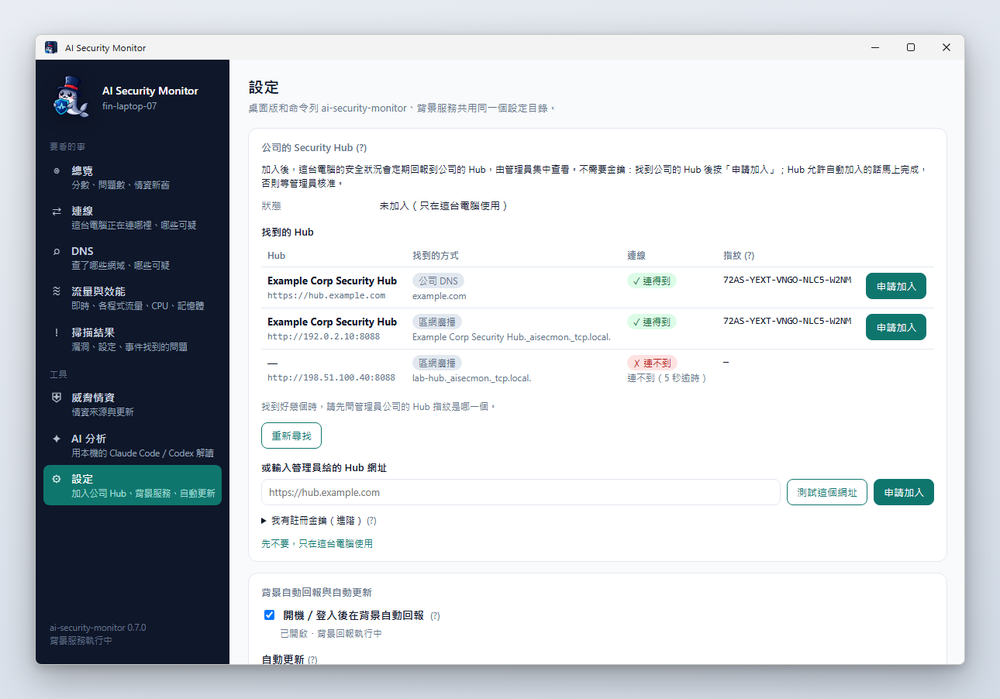 Settings → Company Security Hub: finds the company Hub by itself; check the fingerprint and click *Request to join* | 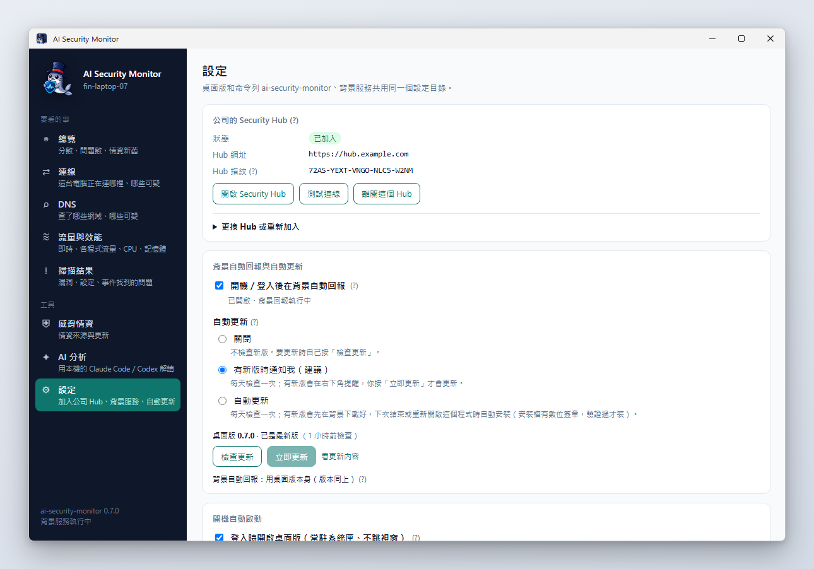 Settings: the joined Hub, background reporting, automatic updates |
| 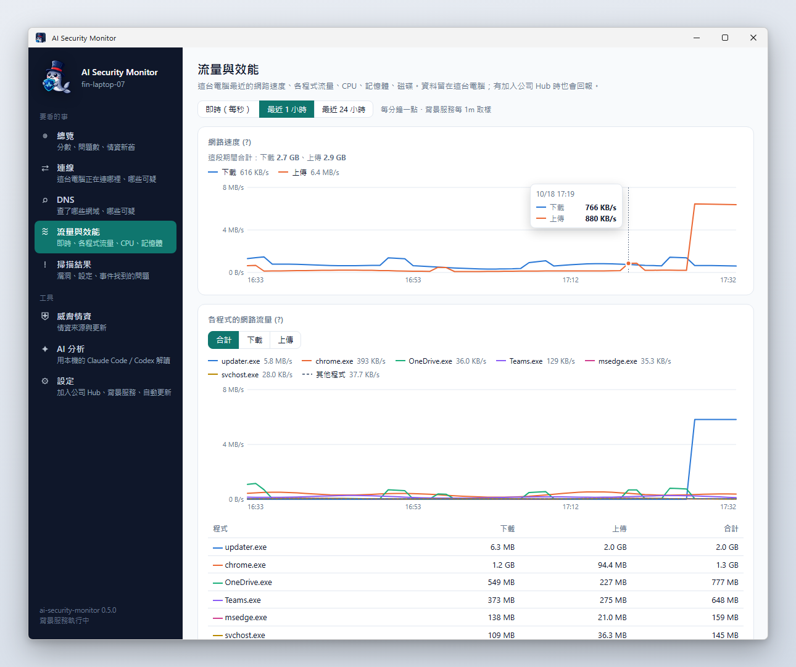 Traffic & performance: network speed over the last hour and which programs use the most (also live and last 24 hours) | 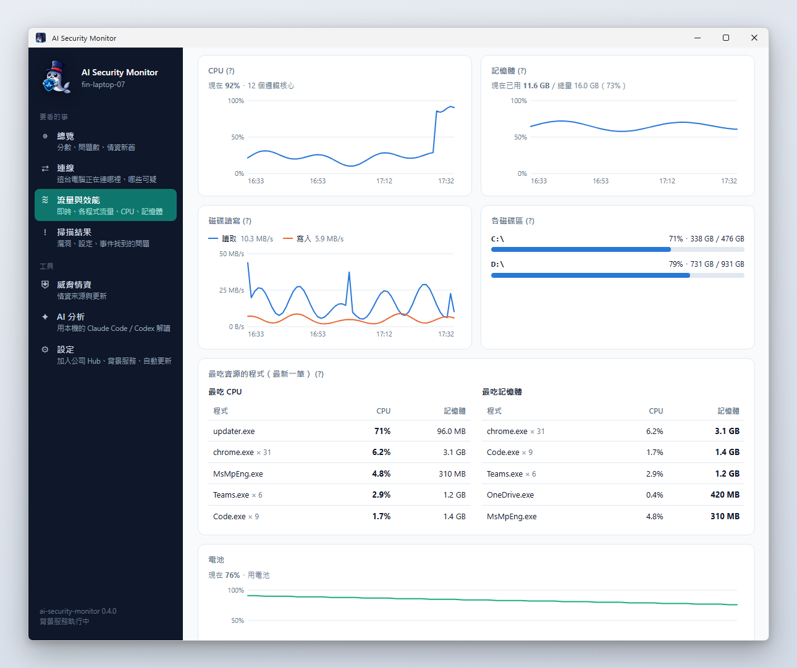 With performance collection on: CPU, memory, disk, top programs, battery |
| 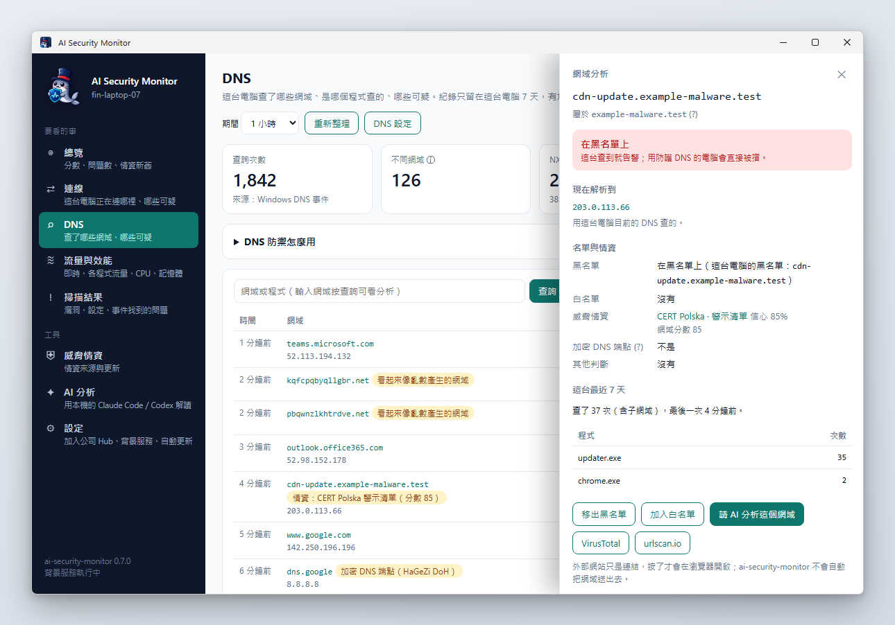 DNS: which domains this computer looks up, which program asked, what looks suspicious; type a domain and click *Search* (or click a domain) for domain analysis: where it resolves, threat intel, which programs looked it up, one-click blocklist/allowlist | 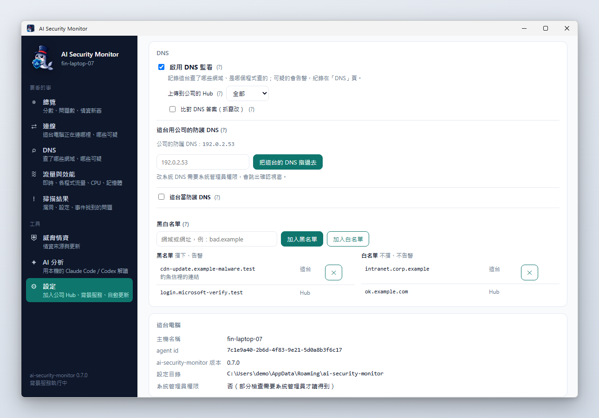 Settings → DNS: DNS monitoring on/off, upload to the Hub, use the company protective DNS, run protective DNS here, blocklist/allowlist |
| 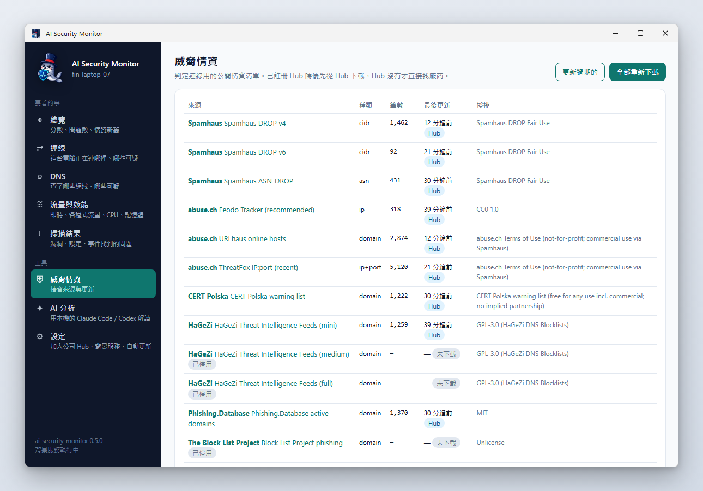 Threat intel: entries, last update and licence of each list, update now | |

**Security Hub (web)**

| | |
|---|---|
|  Overview: scores, open findings and dangerous connections for every computer |  Connections: direction, verdict, process, country / org, reasons and intel sources |
|  A single host: five scores, trends, dangerous destinations it has contacted |  Findings: filter by device, status and severity, handle them in bulk |
|  Windows Server: domain controller dc-01 (Server Core) |  Vulnerabilities & updates: OS support dates, exploited vulnerabilities, vulnerable software |
|  Hardening: the most commonly failed checks and per-host scores |  Crashes & events: bugcheck codes and likely causes, brute-force sources |
|  Threat intel: list freshness per host, licenses, hits |  Add a host: create an enroll key and get a one-line install command |
|  Traffic: fleet bandwidth chart, which hosts and programs use the most, per network card |  Host "Performance" tab (opt-in): CPU, memory, disk, battery, top programs |
| 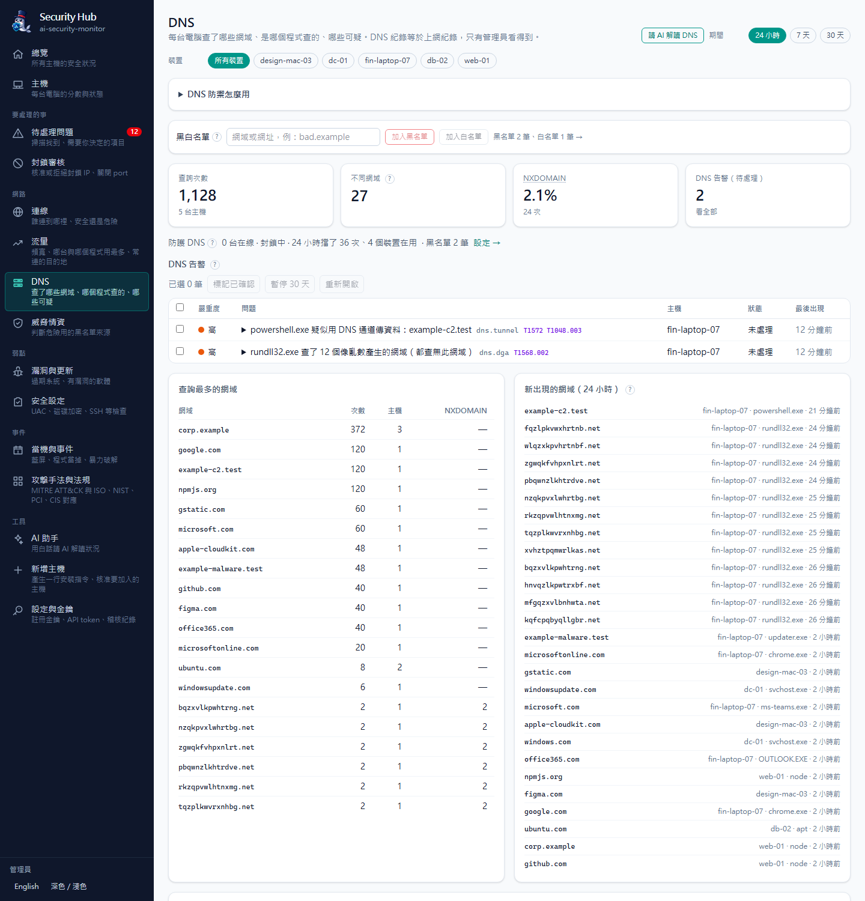 DNS: which domains each computer looks up and which program asked, DNS alerts, newly seen domains, add to blocklist/allowlist right there | 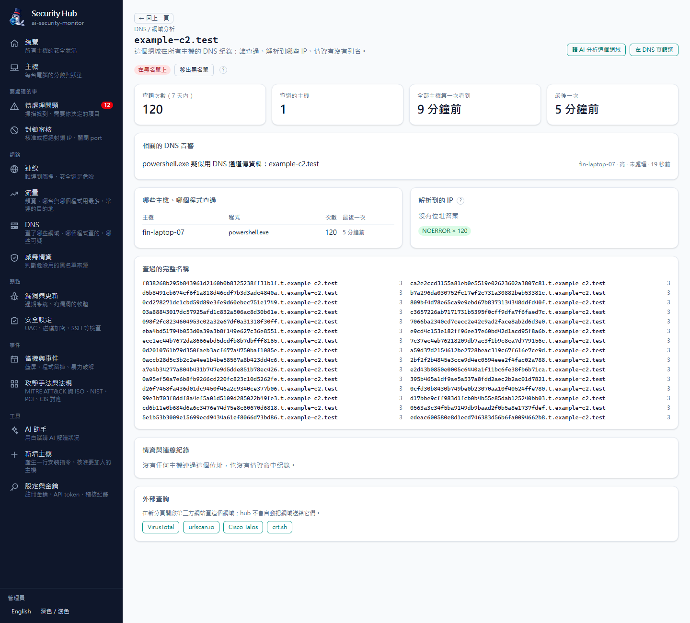 Domain analysis: who looked it up, where it resolved, related alerts, one-click blocklist or allowlist |
| 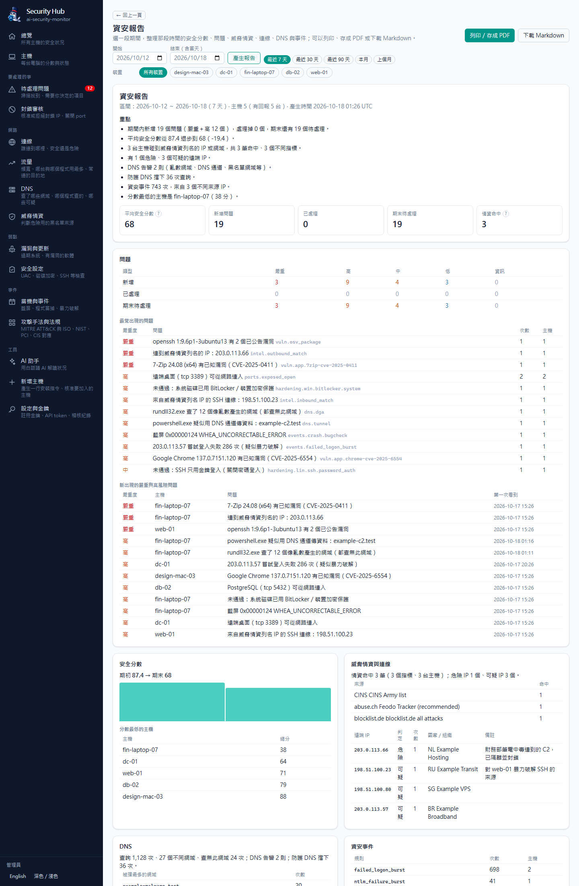 Security report: scores, findings, threat intel, connections, DNS and events for a chosen period; print or save as PDF | 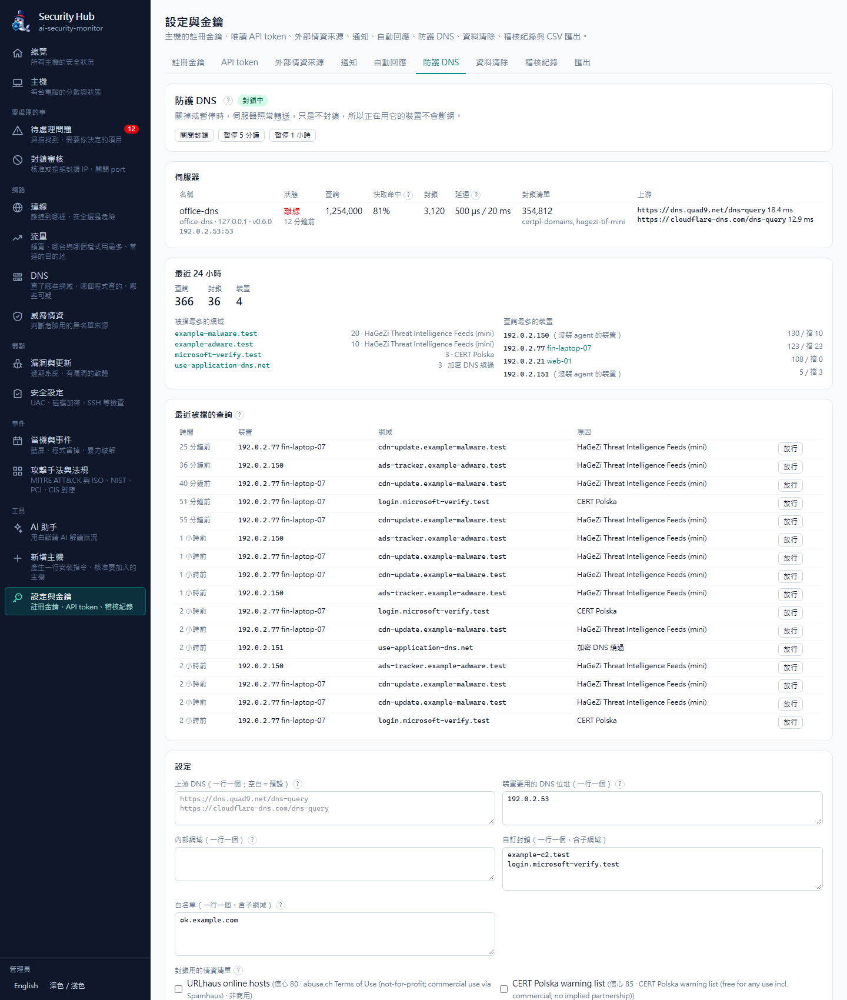 Protective DNS: blocking switch and pause, server status, most blocked domains, one-click allow, blocklist/allowlist |
| 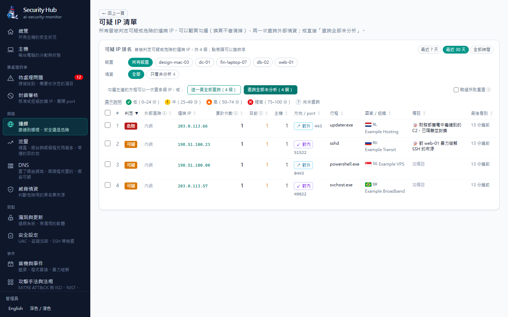 Suspicious IP list: full ranking, external intel risk, notes editable inline | |

> All screenshots use demo data (fictional hosts, documentation-only IP ranges, example.com): the Hub is seeded by `scripts/demo-seed.mjs` and the desktop shots come from `scripts/capture-desktop-screenshots.mjs`. The UI is shown in Traditional Chinese; the Hub also has English. More desktop screens in [docs/desktop.en.md](docs/desktop.en.md).

## What it does for you

- **Shows your connections**: who this computer is talking to, which program, which country; suspicious ones are flagged with a reason and a source, never a black-box score.
- **Checks against blocklists**: downloads 20-odd public threat-intel lists (botnets, IPs attacking others, phishing sites…) and warns you the moment something matches.
- **Blocks bad IPs**: one command, or "Approve" in the Hub, blocks it in the firewall; undo is just as easy.
- **Finds vulnerabilities and missing updates**: is the OS out of support, how long since the last update, does any installed software have known holes.
- **Checks security settings**: antivirus, disk encryption, remote desktop protection… 60-odd checks, with how to fix anything that fails.
- **Watches DNS (which addresses were looked up)**: which program looked up what, with alerts for phishing or malicious domains; add your own block / allow lists.
- **Guards important files**: know immediately when the hosts file or a startup program is tampered with.
- **Traffic and performance**: which program uses the most network, CPU and memory, in simple charts.
- **Crashes and security events**: why the blue screen happened, and whether someone keeps guessing your password.
- **AI explains it**: with your own Claude Code or Codex, one click asks the AI to tell you in plain words whether to worry and what to do first.
- **The Hub for offices**: every computer in one place, alerts, automatic blocking of attackers (off by default), one-click security reports (save as PDF), plus MITRE ATT&CK and ISO 27001 / NIST mappings.
- **Windows, Mac and Linux**: the desktop app installs with a double-click; servers (including Windows Server and Server Core) use the command-line version.

Which lists it uses, how verdicts work and performance figures: see [technical details](docs/technical.en.md#feature-details).

## Install

Full steps for every platform. If you just want to get going, [Get started in 5 minutes](#get-started-in-5-minutes) is enough.

**System requirements**

| | Requirement |
|---|---|
| Desktop app, Windows | Windows 10 / 11 (x64); needs Microsoft Edge WebView2 (built into Windows 10 / 11; the installer downloads it if missing) |
| Desktop app, macOS | macOS 10.13 or later (Apple Silicon or Intel) |
| Desktop app, Linux | x64, Ubuntu 22.04 / Debian 12 or later (glibc 2.35+); the deb pulls in WebKitGTK 4.1; the tray icon needs AppIndicator support |
| Command line | Windows 10 / 11, Windows Server 2016 / 2019 / 2022 / 2025 (including Server Core), x64 or ARM64; macOS 11+; Linux x64 / ARM64 (statically linked, any distribution) |
| Security Hub | Docker 24+ (with Compose v2), amd64 or arm64 |
| Protective DNS (optional) | anywhere the command-line version runs, or the Docker image `ghcr.io/markku636/ai-security-monitor-dns` (amd64/arm64) |

**Desktop app: Windows**: see [scenario A](#scenario-a-i-just-want-to-check-my-own-computer-windows). If you had the old "AI Security Agent" (0.1.x), uninstall it first in Settings → Apps; the new version does not replace it.
Once installed the window opens on the overview and the AI Security Monitor icon sits in the system tray.

**Desktop app: macOS**

The desktop app has no Apple developer signature, so Gatekeeper blocks a dmg downloaded in a browser. **The easiest way** is to paste this line into Terminal (0.7.1 and later): it downloads the dmg for your chip, verifies its SHA256 and installs it into Applications, and the app then opens without being blocked:

```bash
curl -fsSL https://github.com/markku636/ai-security-monitor/releases/latest/download/install.sh | sh -s -- --desktop
```

To install by hand:

1. On Apple Silicon (M1, M2, …) download `AI-Security-Monitor-<version>-macos-arm64.dmg`; on Intel `…-macos-x64.dmg`. Not sure? Apple menu → "About This Mac", look at "Chip" or "Processor".
2. Open the dmg and drag "AI Security Monitor" to Applications.
3. The first launch says it can't be opened: click "Done", then go to System Settings → Privacy & Security, scroll down and click "Open Anyway" (enter your password). On macOS 14 and earlier you can also right-click it in Applications → "Open".
4. If it says the app "is damaged and can't be opened" (the file is fine; common with 0.7.0 and earlier on Apple Silicon), run this in Terminal, then open it again:
   `xattr -dr com.apple.quarantine "/Applications/AI Security Monitor.app"`

**Desktop app: Linux**

- AppImage (any distribution, no install): `chmod +x AI-Security-Monitor-<version>-linux-x64.AppImage && ./AI-Security-Monitor-<version>-linux-x64.AppImage`
- deb (Debian / Ubuntu): `sudo apt install ./AI-Security-Monitor-<version>-linux-amd64.deb`, then open it from the applications menu.

**Command line: Windows, Windows Server**

1. Open PowerShell. To install the service that starts at boot, use "Run as administrator".
2. Run `irm https://github.com/markku636/ai-security-monitor/releases/latest/download/install.ps1 | iex`. It installs to `%LOCALAPPDATA%\ai-security-monitor\bin` by default and adds it to your PATH.
3. Open a **new** PowerShell window and run `ai-security-monitor version`; it should print the version number.
4. (Optional) start at login: `ai-security-monitor service install --yes`; start at boot on a server: `ai-security-monitor service install --system --yes` (administrator). Check with `ai-security-monitor service status`.

**Command line: Linux, macOS**

1. Run `curl -fsSL https://github.com/markku636/ai-security-monitor/releases/latest/download/install.sh | sh`. It installs to `/usr/local/bin`, or `~/.local/bin` without permission.
2. Check with `ai-security-monitor version` and `ai-security-monitor doctor`.
3. (Optional) `ai-security-monitor service install --yes` to start at login; on servers `sudo ai-security-monitor service install --system --yes`.

The install scripts verify the release's `SHA256SUMS` and stop on a mismatch. Options for a specific version, install location, internal mirror or enrolling with a Hub during install are in [docs/install.en.md](docs/install.en.md).

**Security Hub (Docker)**

1. Start it as in [scenario B](#scenario-b-i-manage-several-computers-in-an-office). The standalone `docker/compose.standalone.yml` only listens on `http://127.0.0.1:8088`; the server version `docker/compose.yml` lets other computers report in.
2. Check: `curl http://127.0.0.1:8088/api/health` returns `"db":"ok"` and the web page shows the sign-in screen.
3. (Optional) make the Hub's "AI assistant" work: Claude Code and Codex are already in the image but need to be signed in once ("Please run /login" means they aren't). Either:
   - **Sign in on the web page** (easiest): Hub *AI assistant* → *AI accounts* → **Sign in**; for Claude open the authorization page and paste the code back, for Codex enter the code on OpenAI's site. Sign out there too. See [docs/ai-login.en.md](docs/ai-login.en.md).
   - **Sign in with a command**: run `docker compose -f docker/compose.yml --env-file .env exec hub claude auth login` (use `compose.standalone.yml` for the standalone Hub), open the URL in a browser and authorise, then paste the code back; sign out with `… exec hub claude auth logout`.
   - **Use a token or API key** (no need to enter the container): run `claude setup-token` on your own computer to create a long-lived token and add `CLAUDE_CODE_OAUTH_TOKEN=…` to `.env`; or use `ANTHROPIC_API_KEY=…`; for Codex `OPENAI_API_KEY=…`. Then run `up -d` again.

   The sign-in is stored in the `hubdata` volume and survives image updates and container rebuilds. The AI only gets read-only tools: it can see Hub data but not change it.

More in [docs/docker.en.md](docs/docker.en.md).

**Upgrading**: for the command line run `ai-security-monitor self-update --yes` (on 0.1.x, `asa self-update --yes`), then `ai-security-monitor service install --yes` once more (add `--system` for the system service); for the desktop app just install the new version (uninstall the 0.1.x "AI Security Agent" first). See [Upgrading from asa / ai-security-agent](docs/technical.en.md#upgrading-from-asa--ai-security-agent).

## For technical readers

How it works (architecture diagram, reporting intervals, signing and host identity), the command-line cheat sheet, upgrading from asa, the repository layout and building from source are in [technical details](docs/technical.en.md).

## Docs

[Verdicts & threat intel](docs/intel.en.md) · [Firewall & blocking](docs/firewall.en.md) · [Install & update](docs/install.en.md) · [Automatic Hub discovery & keyless enrollment](docs/enrollment.en.md) · [Start at boot](docs/service.en.md) · [Desktop app](docs/desktop.en.md) · [Docker](docs/docker.en.md) · [MCP & AI](docs/mcp.en.md) · [Traffic](docs/traffic.en.md) · [Traffic statistics & performance](docs/metrics.en.md) · [DNS defense](docs/dns.en.md) · [Protective DNS server](docs/dns-server.en.md) · [Events & crashes](docs/events.en.md) ·
[Vulnerabilities](docs/vuln.en.md) · [Hardening](docs/hardening.en.md) · [Agent ↔ Hub contract](docs/hub-contract.en.md) · [Changelog](CHANGELOG.md)

## Data sources and licenses

This project is MIT licensed. Threat intel, vulnerability and geo data come from their providers under their own licenses (for example DShield is non-commercial and only alerts by default; DB-IP requires attribution);
every hit links to its source. See [THIRD_PARTY_NOTICES.md](./THIRD_PARTY_NOTICES.md) for the full list.

MIT © 2026 mark.ku (markku636)
