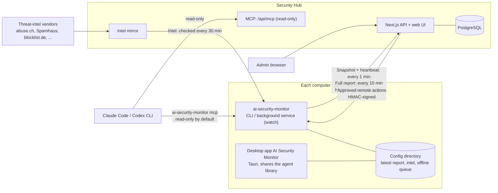

<p align="center">
  
</p>

<h1 align="center">ai-security-monitor</h1>

<p align="center"><a href="./README.md">繁體中文</a> · <b>English</b></p>

<p align="center">
  <a href="https://github.com/markku636/ai-security-monitor/actions/workflows/ci.yml"></a>
  
  
</p>

A defensive security agent, **`ai-security-monitor`** (Rust, single binary, Windows / Windows Server / macOS / Linux), plus a **Security Hub** (Next.js + Tailwind + PostgreSQL).
It finds unusual outbound and inbound connections, rates them **safe / unknown / suspicious / dangerous** from public threat intel with the source of every hit,
checks the firewall, open ports, vulnerabilities and system hardening, summarizes traffic and Windows events / crash causes, and hands them to **Claude Code / Codex CLI** for a plain-language read. Both the agent and the Hub are **MCP servers**.


## Why

Last night before bed I had AI build a fun little project:
a Rust app that collects and analyzes unusual connections on client machines and assesses threats.
Since AI arrived, system vulnerabilities have become very visible; if the attackers are AI, AI also knows a lot about defending.

**Architecture**

```
Client Agent → periodic reports → Server analysis → AI risk assessment → Dashboard
```

`#cross-platform` (Windows / Windows Server / macOS / Linux)

## What it is

| | |
|---|---|
| **ai-security-monitor** (agent) | Runs on the computer or server you want to protect (including Windows Server 2016–2025, Server Core and domain controllers). Scans connections, intel, firewall, ports, vulnerabilities, hardening, events and traffic. Use it on its own (CLI, MCP, AI analysis) or enroll it with a Hub to report periodically and accept approved remote blocks. Starts at boot (system service or at user login). |
| **Desktop app** (optional) | AI Security Monitor, a windowed client: lives in the system tray and shows this computer's connection verdicts (click an IP to analyze it), scan results and intel status, with one-click scan / intel update and AI analysis through the Claude Code / Codex CLI you are signed in to. Shares the config directory with the CLI and background service. See [docs/desktop.en.md](docs/desktop.en.md). |
| **Security Hub** | One place for every host: connection verdicts, findings, vulnerabilities, hardening scores, crashes and security events, threat-intel hits, block review, AI analysis and MCP. Standalone (local only) or server (all hosts report to one place), deployed with Docker. |

## Screenshots

| | |
|---|---|
|  Connections: direction, verdict, process, country/org, reasons and intel sources |  One host: five scores, trend, dangerous destinations seen |
|  Windows Server: domain controller dc-01 (Server 2022 Datacenter, Server Core) |  Findings from every host, filtered by device, status and severity, with bulk actions |
|  Vulnerabilities & updates: OS support lifetime, KEV, vulnerable software |  Hardening: most common failures and scores by host |
|  Events & crashes: bugcheck codes with likely causes, brute-force sources, account lockouts |  Threat intel: intel freshness per host, source licenses, confidence and hits |
|  Dark mode: each check's current value, expected value and fix |  Add a host: create an enroll key and get one-line install commands |

**Desktop app** (AI Security Monitor, the windowed client)

| | | |
|---|---|---|
|  Overview: this computer's scores, finding counts, intel freshness and suspicious connections |  Connections: verdicts, reasons and intel sources; click an IP for country / ASN and matching lists |  AI analysis: the local Claude Code / Codex reads suspicious connections through read-only tools |

> Screenshots use demo data (fictional hosts, documentation IP ranges): the Hub is filled by `scripts/demo-seed.mjs`, and the desktop app gets fake Tauri responses injected by `scripts/capture-desktop-screenshots.mjs`, without reading any real config. More desktop screens in [docs/desktop.en.md](docs/desktop.en.md). The Hub UI is available in Traditional Chinese and English.

## Features

- **Connections and threat intel**: every connection gets a direction (outbound / inbound / listening / local). Open feeds — Spamhaus DROP, abuse.ch (Feodo, URLhaus, ThreatFox), blocklist.de, CINS, ET, DShield, Tor, IPsum, FireHOL and more —
  are combined with behavior anomalies (processes in temp dirs, shells with network connections, risky ports, periodic beacons, new destinations) into safe / unknown / suspicious / dangerous; every hit carries vendor, confidence, license and source URL. Optional online lookups via AbuseIPDB / GreyNoise / CrowdSec (bring your own key).
- **Firewall and exposure**: reads Windows Firewall, macOS pf / application firewall, Linux nftables / firewalld / ufw / iptables, and works out whether each listening port is really reachable from the network;
  `ai-security-monitor fw block` and `ai-security-monitor fw sync-blocklist` turn high-confidence intel into block rules (preview, confirm, reversible; non-commercial feeds only alert by default).
- **Vulnerabilities and updates**: software inventory, OS support lifetime (including Windows Server 2008–2025), days since the last Windows update, pending Linux security updates, known-vulnerable versions of common software (WinRAR, 7-Zip, Chrome, …), OSV for Linux packages; CISA KEV matches become critical.
- **System hardening**: 60 cross-platform checks (UAC, Defender, BitLocker, SMBv1, RDP NLA, SSH, kernel settings, AppArmor/SELinux, FileVault, Gatekeeper, …) that tell Windows clients, Server, Server Core and domain controllers apart, with a severity-weighted score, customizable in YAML.
- **Traffic**: see which process talks to whom without packet capture (flow-lite); analyze Wireshark / tcpdump pcap/pcapng files: DNS, TLS SNI, plaintext protocols, large uploads, periodic connections.
- **Events and crashes**: Windows event logs, minidump bugcheck codes, WER; Linux journal and macOS crash reports — with likely causes and fixes — plus security events such as brute force (including Kerberos and NTLM), account lockouts, Remote Desktop logons from the internet, new accounts, new services and cleared audit logs.
- **AI and MCP**: `ai-security-monitor ai ask|analyze` hands off to Claude Code or Codex CLI (read-only tools only); `ai-security-monitor mcp` lets Claude Code / Codex / Cursor / VS Code query this computer directly; the Hub has MCP across all hosts and AI analysis in the browser.
- **Hub**: overview, hosts, connections, findings (bulk actions), vulnerabilities, hardening, traffic, events, intel, block review (HMAC-signed, host identity pinning), enroll keys, read-only API tokens, audit log, CSV export, Chinese/English, dark mode, mobile layout.
- **Deploy and update**: start at boot (Windows service / systemd / launchd or per-user), `ai-security-monitor self-update` (verified against SHA256SUMS), one-line install scripts, Hub Docker image (amd64/arm64) and compose files.

## Architecture



- **Scheduled reports**: `ai-security-monitor watch` (the background service started at boot) takes a connection snapshot (with intel verdicts) and sends a heartbeat every minute, and runs a full scan every 10 minutes.
  Tune them with `ai-security-monitor config set scan.snapshot_interval` / `scan.interval`; the Hub can also ask for slower snapshots. Uploads use HTTPS (plain http only for localhost or private networks)
  with the client key from enrollment plus this host's own agent token (pinned by the Hub on first sight, so another machine cannot impersonate it).
- **Offline queue**: when the Hub is down or the network is out, full reports wait in `outbox/` in the config directory (up to 50) and are sent in order once the Hub is reachable again.
- **Remote actions**: after an admin submits and approves a block in the Hub, the agent learns from its heartbeat that something is pending and fetches it. Every action carries an HMAC-SHA256 signature;
  the agent verifies it and checks expiry and guardrails before running it and reporting back. Hosts enrolled without `--accept-remote-actions` never fetch actions.
- **Threat intel**: the Hub downloads the lists in `feeds/registry.json` from each vendor and caches them (intel mirror). Agents check every 30 minutes, take lists from the Hub first when enrolled, and go to the vendor only for what the Hub lacks.
- **Desktop app**: links the agent's Rust library directly and reads the same config directory, so it sees the background service's latest report, intel and Hub enrollment; reporting to the Hub stays with the background service.
- **AI**: `ai-security-monitor mcp` (stdio or `--http`) lets Claude Code / Codex query this computer with read-only tools by default (actions such as blocking appear only with `--allow-actions`);
  the Hub's `/api/mcp` covers every host and is entirely read-only. `ai-security-monitor ai`, the desktop app and the Hub's web AI analysis all run the Claude Code / Codex CLI you are signed in to, with these read-only tools.

## Install

**Agent (ai-security-monitor)**

```bash
# Linux / macOS
curl -fsSL https://github.com/markku636/ai-security-monitor/releases/latest/download/install.sh | sh
```

```powershell
# Windows / Windows Server (PowerShell)
irm https://github.com/markku636/ai-security-monitor/releases/latest/download/install.ps1 | iex
```

The script checks the release's `SHA256SUMS` and stops on a mismatch. You can also download the binaries from [Releases](https://github.com/markku636/ai-security-monitor/releases). See [docs/install.en.md](docs/install.en.md).

**Security Hub (Docker)**

```bash
git clone https://github.com/markku636/ai-security-monitor && cd ai-security-monitor
cp .env.example .env    # set AI_SECURITY_MONITOR_HUB_ADMIN_SECRET and AI_SECURITY_MONITOR_HUB_DB_PASSWORD
docker compose -f docker/compose.standalone.yml --env-file .env up -d   # standalone: http://127.0.0.1:8088
# server: docker compose -f docker/compose.yml --env-file .env up -d
```

The image is `ghcr.io/markku636/ai-security-monitor-hub`. Sign in, open "Add a host" to create an enroll key, and copy the one-line command for each platform. See [docs/docker.en.md](docs/docker.en.md).

## Quick start

```bash
ai-security-monitor doctor                       # environment check: privileges, intel freshness, external tools, Hub connection
ai-security-monitor intel update                 # download threat intel (ai-security-monitor watch keeps it fresh afterwards)
ai-security-monitor connections --intel          # current connections and verdicts
ai-security-monitor scan                         # full scan (connections, intel, firewall, ports, events, vulnerabilities, hardening)
ai-security-monitor fw sync-blocklist --dry-run  # preview which high-confidence intel IPs would be blocked
ai-security-monitor ai ask "Is this computer talking to anything dangerous?"   # let Claude Code / Codex explain
ai-security-monitor enroll https://hub.example.com --key asa_ek_…
ai-security-monitor service install --yes        # report automatically after boot/login (add --system on servers)
```

Every command that changes the system (block an IP, close a port, install a service, update) only previews without `--yes`.

## CLI

| Command | Purpose |
|---|---|
| `scan`, `connections`, `ports` | Full scan, connection verdicts, port reachability |
| `intel` | Update intel, sources and licenses, look up an IP/domain |
| `fw` | Firewall status, audit, block/unblock, intel sync |
| `vuln`, `harden` | Vulnerabilities and updates, system hardening |
| `traffic`, `events` | Traffic and pcap analysis, events and crash causes |
| `ai`, `mcp` | Claude Code / Codex analysis, MCP server and one-step client setup |
| `enroll`, `status`, `watch`, `service` | Hub enrollment, resident reporting, start at boot |
| `self-update`, `version`, `doctor` | Updates and environment checks |
| `allowlist`, `baseline`, `config` | Allowlist, baseline (only show what is new), settings |

Run `ai-security-monitor --help` or `ai-security-monitor <command> --help` for every option; `--lang en` for English, `--json` for scripts.

## Upgrading from asa / ai-security-agent

From 0.2.0 the project is called ai-security-monitor (the `asa` executable is now `ai-security-monitor`; the old GitHub URL redirects). No need to re-enroll:

- **Migrated automatically**: on first run the config directory `…/ai-security-agent` moves to `…/ai-security-monitor` (`agent_id`, Hub enrollment, allowlist, baseline and intel included) and the `asa` keychain entry is copied to the new name;
  `ai-security-monitor service install` replaces the old `asa` service / Run value / unit / plist with the new names (moving the system config directory too), and `ai-security-monitor mcp install` replaces the old `asa` MCP entry. Old installs can upgrade with `asa self-update --yes`.
- **Environment variables**: the new prefix is `AI_SECURITY_MONITOR_*` (`AI_SECURITY_MONITOR_HUB_*` for the Hub); the old `ASA_*` / `ASA_HUB_*` names still work, so an `.env` with only the old names needs no changes.
- **Intentionally unchanged**: firewall object names (Windows group `ASA`, `ASA: …` rules, nft `table inet asa`, ipsets `asa_*`, pf anchor `com.asa`, `fw unblock --all-asa`), the `x-asa-*` headers, the `asa_` / `asa_ek_` token prefixes, the `asa_hub` database and the compose project names, so existing rules and data are still recognised.
- **Desktop app**: its application identifier changed, so the new version does not replace the old one. Uninstall "AI Security Agent" in Settings → Apps first, then install the new version (see [docs/desktop.en.md](docs/desktop.en.md)).
- **Hub image**: now `ghcr.io/markku636/ai-security-monitor-hub`; the old `ghcr.io/markku636/ai-security-agent-hub` keeps being published for a transition period.

See [docs/install.en.md](docs/install.en.md#upgrading-from-asa-01x), [docs/service.en.md](docs/service.en.md#upgrading-from-asa-01x) and the [changelog](CHANGELOG.md).

## Docs

[Verdicts & threat intel](docs/intel.en.md) · [Firewall & blocking](docs/firewall.en.md) · [Install & update](docs/install.en.md) · [Start at boot](docs/service.en.md) · [Desktop app](docs/desktop.en.md) · [Docker](docs/docker.en.md) · [MCP & AI](docs/mcp.en.md) · [Traffic](docs/traffic.en.md) · [Events & crashes](docs/events.en.md) ·
[Vulnerabilities](docs/vuln.en.md) · [Hardening](docs/hardening.en.md) · [Agent ↔ Hub contract](docs/hub-contract.en.md) · [Changelog](CHANGELOG.md)

## Repository layout

```text
ai-security-monitor/
├── agent/                 Rust agent: the ai-security-monitor binary + library (the desktop app links this library too)
│   ├── src/
│   │   ├── bin/           Binary entry point
│   │   ├── cli/           Commands (scan, connections, fw, intel, ai, mcp, enroll, watch, service, ...)
│   │   ├── scan/          Full-scan pipeline and scoring
│   │   ├── connections/   Connection snapshots, verdicts, connection history and beacon detection
│   │   ├── intel/         Intel download, parsing, matching, country / ASN lookup
│   │   ├── firewall/      Per-platform firewall reading, block plans and execution
│   │   ├── ports/         Listening ports and real reachability
│   │   ├── vuln/          Software inventory, OS support lifetime, OSV / known-vulnerability matching
│   │   ├── hardening/     Hardening checks (rules from feeds/policies)
│   │   ├── events/        Windows event logs, minidumps, journal, macOS crash reports
│   │   ├── traffic/       flow-lite traffic view and pcap analysis
│   │   ├── hub/           Hub client: uploads, offline queue (outbox), remote-action verification, watch parts
│   │   ├── actions/       Preview and execution of actions such as blocking
│   │   ├── mcp/           MCP server (stdio / HTTP) and tool definitions
│   │   ├── ai/            Running the Claude Code / Codex CLI and parsing their event streams
│   │   ├── service/       Start at boot (Windows service, systemd, launchd)
│   │   ├── update/        self-update (verified against SHA256SUMS)
│   │   ├── model/         Data model: report, finding, connection, allowlist, baseline
│   │   ├── elevate/       Administrator / root detection
│   │   ├── locales/       English translations
│   │   └── util/          Shared helpers
│   ├── prompts/           Prompts for AI analysis
│   └── tests/fixtures/    Test data
├── hub/                   Security Hub (Next.js + Tailwind)
│   ├── app/               Pages (hosts, connections, findings, vulnerabilities, hardening, events, intel, action review, ...) and APIs (/api/v1, /api/mcp, /api/ai)
│   ├── components/        UI components
│   ├── lib/               DB queries, report ingest, remote actions and signing, intel mirror, IP intel, MCP tools, AI, auth
│   ├── drizzle/           PostgreSQL schema and migrations
│   ├── messages/          English translations
│   ├── scripts/           i18n and client-import checks
│   └── tests/             Unit and API route tests
├── desktop/               Desktop app AI Security Monitor (Tauri 2)
│   ├── src-tauri/         Rust shell: Tauri commands, tray, single instance
│   └── ui/                Plain HTML / CSS / JS UI, no front-end build step
├── contract/              agent <-> Hub JSON Schemas (register, report, snapshot, remote action)
├── feeds/                 Data embedded in the binary
│   ├── registry.json      Threat-intel sources (URL, format, confidence, license)
│   ├── known-good.json    Known-good services and ranges
│   ├── policies/          Windows / macOS / Linux hardening rules (YAML)
│   ├── vuln/              OS support lifetimes, known-vulnerable software, risky ports
│   └── events/            Bugcheck codes and event ID descriptions
├── docker/                Hub Dockerfile and compose files (standalone, server, dev database)
├── scripts/               One-line installers, demo data, screenshots, version and changelog checks
├── docs/                  Topic docs and README screenshots (docs/images)
└── .github/workflows/     CI and release workflows
```

## Build from source

```bash
# agent (Rust 1.85+)
cd agent && cargo build --release && ./target/release/ai-security-monitor doctor

# Hub (Node 22+)
cd hub && npm ci && npm run dev:db && npm run dev    # http://localhost:3000
npm run verify                                        # typecheck, i18n, tests, build

# Desktop app (Tauri 2; the UI in desktop/ui is plain HTML/JS)
cd desktop && npm ci && npx tauri build              # builds the NSIS installer
```

Demo data: `node scripts/demo-seed.mjs --hub http://127.0.0.1:3000 --admin <admin secret>`; screenshots: `node scripts/capture-screenshots.mjs --hub http://127.0.0.1:3000 --admin <admin secret>`.

## Data sources and licenses

This project is MIT licensed. Threat intel, vulnerability and geo data come from their providers under their own licenses (for example DShield is non-commercial and only alerts by default; DB-IP requires attribution);
every hit links to its source. See [THIRD_PARTY_NOTICES.md](./THIRD_PARTY_NOTICES.md) for the full list.

MIT © 2026 mark.ku (markku636)
