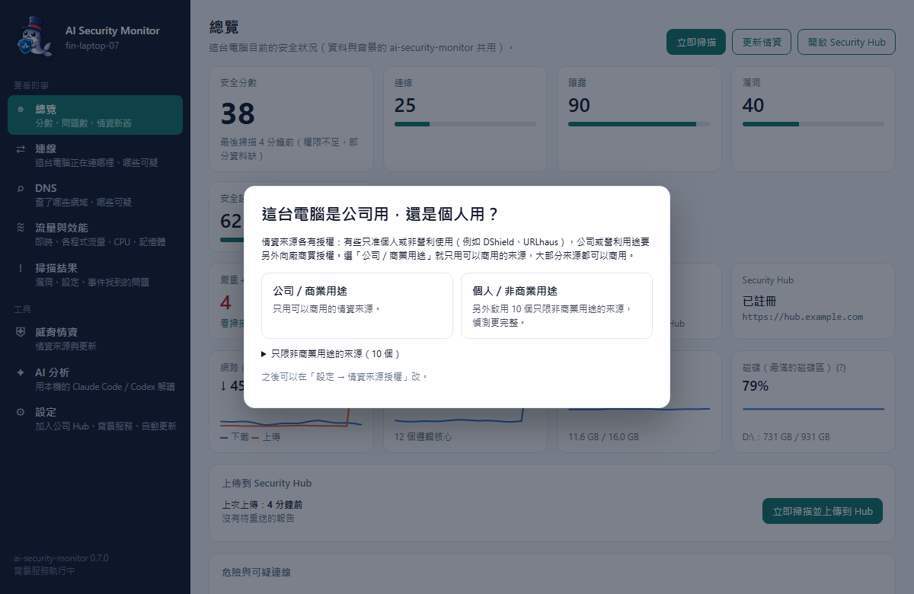

<p align="center">
  
</p>

<h1 align="center">ai-security-monitor</h1>

<p align="center"><b>繁體中文</b> · <a href="./README.en.md">English</a></p>

<p align="center">
  <a href="https://github.com/markku636/ai-security-monitor/actions/workflows/ci.yml"></a>
  
  
</p>

裝上去之後，它會告訴你這台電腦在跟誰講話、哪些連線可疑、哪裡沒設好，再請 AI 用白話解釋給你聽。
每一個「可疑」都會附上理由和出處（哪一份公開的壞人名單、哪一種奇怪的行為），不是黑箱打分數。
可以只看自己這台，也可以把辦公室裡好幾台電腦集中到一個網頁看。

### v0.8.1 更新重點

- 掃描結果可以把單一問題加入白名單排除，並要求填寫備註；之後可查看排除原因、顯示已排除項目或取消排除。
- 「設定」用「同網段的 Security Hub」引導尋找與加入，操作集中在同一區並按需展開；DNS 設定緊接在 Hub 設定下方。
- 新增「關於 AI Security Monitor」視窗，可查看版本、專案與授權資訊。
- Agent 預設啟用 Sigma，並提供可選的 YARA-X 掃描引擎支援。

<p align="center">
  <picture>
    <source media="(prefers-color-scheme: dark)" srcset="docs/images/windows-desktop-hero-dark.png">
    
  </picture>
</p>

<p align="center"><sub>Windows 桌面版的總覽頁（示範資料）。關掉視窗後會縮到右下角的系統匣繼續待命。</sub></p>

## 緣起

昨天睡前，讓 AI 做了一個有趣的小專案：
用 Rust 寫的應用，蒐集並分析用戶端的異常連線，做威脅分析。
AI 出現後，系統漏洞變得很明顯；既然攻擊者是 AI，AI 也很懂得怎麼防禦。

**架構**

```
Client Agent → 定時回報 → Server 分析 → AI 判斷風險 → Dashboard 呈現
```

## 為什麼做這個？（你可能也遇過）

- **電腦被駭了，自己卻完全不知道。**
  很多惡意程式不會跳視窗、也不會讓電腦變慢，只是安靜地連回駭客的伺服器。防毒沒叫，你就以為沒事。
  👉 它每分鐘看一次這台電腦在跟誰連線，連到已知的壞人位址就馬上標出來，還告訴你是哪個程式在連。
- **打開連線清單，一堆數字看不懂。**
  就算會用 `netstat`，看到幾百個 IP 也分不出哪個正常、哪個有鬼。
  👉 每條連線直接告訴你「安全／可疑／危險」和理由（例如「這個 IP 在殭屍網路的名單上」），還有對方在哪個國家、是哪個程式。
- **公司電腦一多，根本顧不過來。**
  一台一台檢查不可能，往往出事了才發現。
  👉 所有電腦集中到一個網頁（Hub），哪台最危險一眼就看到；有狀況會發通知到 Email、Slack、Teams。
- **專業資安工具又貴又難搞。**
  SIEM、EDR 這類產品動輒要錢、還要專人維護，小公司和個人很難負擔。
  👉 免費開源，電腦裝一個程式就能用；公司要集中管理，Hub 用 Docker 一行指令就能架起來。
- **看到警告也不知道該怎麼辦。**
  「CVE-2025-xxxx」「SMBv1 已啟用」……然後呢？
  👉 每個問題都附白話說明和修正步驟；也可以請 AI（Claude Code、Codex）像聊天一樣解釋給你聽，告訴你先做哪一件。
- **駭客也開始用 AI 了。**
  找漏洞、寫惡意程式都比以前快很多，靠人慢慢看跟不上。
  👉 那就用 AI 來防守：AI 幫你讀資料、判斷風險，整理成看得懂的報告。

## 適合誰？

- **個人電腦**：想知道自己的 Windows／Mac／Linux 有沒有連到奇怪的地方、有沒有該更新沒更新、安全設定有沒有漏掉。裝桌面版就好。
- **辦公室好幾台電腦**：IT 或老闆想在一個網頁看全部電腦的狀況，有問題可以一起處理，必要時在網頁上核准「封鎖這個 IP」。用 Hub。
- **伺服器**（含 Windows Server、Server Core、網域控制站、Linux）：沒有桌面也能用，裝成開機就跑的背景服務，定時檢查並回報。用命令列版。

幾個會一直出現的詞，先講清楚：

| 詞 | 白話 |
|---|---|
| agent | 裝在每台電腦上、負責檢查的小程式，也就是 `ai-security-monitor` 本身 |
| 威脅情資 | 別人整理好、公開的壞人名單（例如已知的殭屍網路主機、正在暴力破解的 IP） |
| Hub（Security Hub） | 集中看所有電腦的網頁，自己架在公司裡（Docker） |
| 硬化 | 系統安全設定，例如有沒有開磁碟加密、防毒、遠端桌面的保護 |
| MCP | 讓 Claude Code、Codex 這類 AI 工具可以「查資料」的標準接口；這裡只開放查詢，不能改設定 |

## 我該裝哪一個？

所有檔案都在 [Releases（最新版）](https://github.com/markku636/ai-security-monitor/releases/latest)。

| 你想要 | 裝這個 | 下載的檔案 |
|---|---|---|
| 在自己電腦上用視窗看 | **桌面版**（雙擊安裝） | Windows 10／11：`AI-Security-Monitor-<版本>-windows-x64-setup.exe`<br>Mac（M1 以後）：`…-macos-arm64.dmg`；Mac（Intel）：`…-macos-x64.dmg`<br>Linux：`…-linux-x64.AppImage`（免安裝）或 `…-linux-amd64.deb` |
| 伺服器、沒有桌面、或想用指令和自動化 | **命令列版** | 用下面的一行安裝指令最省事（會自動比對校驗碼）。也可以直接下載 `ai-security-monitor-<版本>-<平台>`，但它要在終端機裡執行，雙擊只會跳出說明 |
| 一個網頁看全公司的電腦 | **Security Hub** | Docker 映像 `ghcr.io/markku636/ai-security-monitor-hub`，不用下載檔案 |
| （看到 `asa-<版本>-*`） | 不用理它 | 給 0.1.x 舊版自動升級用的，內容和命令列版一樣 |
| （看到 `SHA256SUMS`） | 校驗碼 | 每個檔案的指紋；安裝腳本和 `self-update` 會自動比對，被竄改就不裝 |

桌面版和命令列版可以裝在同一台電腦，兩個會共用同一份設定和掃描結果。

## 5 分鐘上手

### 情境 A：我只想看自己的電腦（Windows）

1. 到 [Releases](https://github.com/markku636/ai-security-monitor/releases/latest) 下載 `AI-Security-Monitor-<版本>-windows-x64-setup.exe`。
2. 雙擊安裝檔。如果跳出藍色的「Windows 已保護您的電腦」，按「**其他資訊**」，再按「**仍要執行**」。
   這是因為安裝檔沒有付費的程式碼簽章，Windows 認不得發行者，不代表檔案有問題；不放心可以先比對 `SHA256SUMS`。
3. 安裝到目前使用者，不需要系統管理員。裝好後從開始功能表打開「AI Security Monitor」。
   第一次開啟會先帶到「設定 → 公司的 Security Hub」自動尋找公司的 Hub；只用在自己電腦的話，按這一區最下面的「先不要，只在這台電腦使用」。
4. 在「總覽」頁先按「**更新情資**」（下載壞人名單），再按「**立即掃描**」。
5. 看結果：
   - 「總覽」：安全分數和最需要注意的連線。
   - 「連線」：這台電腦現在連到哪裡、為什麼被判可疑；點 IP 可以看它在哪個國家、被哪些名單列入。
   - 「掃描結果」：漏洞、沒裝的更新、沒設好的安全設定，每一條都附修正方式。
   - 「AI 分析」：如果這台電腦已經裝好並登入 Claude Code 或 Codex CLI，按一下就會請 AI 用白話解讀（用的是你自己的帳號）。

關掉視窗只是縮到右下角的系統匣，從系統匣選單按「結束」才會真的離開。
想讓它在背景定時檢查，到「設定」頁打開「開機／登入後在背景自動回報」。Mac 和 Linux 的安裝步驟見下方「[安裝](#安裝)」。

### 情境 B：我要管辦公室好幾台

**第一步：架 Hub**（找一台一直開著、有裝 Docker 的電腦或伺服器）

```bash
git clone https://github.com/markku636/ai-security-monitor && cd ai-security-monitor
cp .env.example .env    # 打開 .env，填 AI_SECURITY_MONITOR_HUB_ADMIN_SECRET（登入密碼）、AI_SECURITY_MONITOR_HUB_DB_PASSWORD，
                        # 以及 AI_SECURITY_MONITOR_HUB_PUBLIC_URL（其他電腦連這台用的網址，例如 http://<這台的 IP>:8088）
docker compose -f docker/compose.yml --env-file .env up -d
```

用瀏覽器打開 `http://<這台的 IP>:8088`，用剛剛填的 `AI_SECURITY_MONITOR_HUB_ADMIN_SECRET` 登入。
只想在自己這台試試看的話，把 `compose.yml` 換成 `compose.standalone.yml`，就只開在 `http://127.0.0.1:8088`。
要一起跑[防護 DNS](docs/dns-server.md)（擋惡意網域的 DNS 伺服器）就改用 `compose.dns.yml`（單機版 `compose.standalone.dns.yml`），`.env` 另外設 `AI_SECURITY_MONITOR_HUB_DNS_TOKEN`。
要[掃自己的網站](docs/webscan.md)就改用 `compose.webscan.yml`（單機版 `compose.standalone.webscan.yml`），`.env` 另外設 `AI_SECURITY_MONITOR_HUB_WEBSCAN_TOKEN`。

**第二步：把電腦加進來**

**方法一：讓電腦自己找到 Hub，管理員按「核准」（建議，不用發金鑰）**

1. 管理員打開 Hub 左側的「新增主機」，記下最上面的 **Hub 指紋**（一串像 `72AS-YEXT-VNGO-NLC5-W2NM` 的代碼，用來確認是自己公司的 Hub，不是別人架的假貨）。
2. 同事那邊擇一：
   - **桌面版**：第一次開啟就會在「設定 → 公司的 Security Hub」自動找公司的 Hub。看到的指紋和管理員說的一樣，就按「**申請加入**」。找不到的話，可以在同一區輸入管理員給的網址；之後要加入、更換或離開 Hub 也都在這裡。
   - **命令列版**：執行 `ai-security-monitor enroll --auto`，核對指紋後送出申請，再執行 `ai-security-monitor service install --yes`（還沒核准也可以先裝，它會在背景等）。
   - **還沒裝的電腦**：把「新增主機」頁上的「免金鑰安裝指令」給同事貼上執行，網址已經填好。
3. 管理員在「新增主機 → 待核准的主機」核對主機名稱和核對碼（電腦端也會顯示同一組），按「**核准**」就完成。
   嫌一台一台按太麻煩，可以設定「自動核准的網段」，例如公司內網 `192.168.10.0/24`。

電腦是靠公司 DNS 的 SRV 紀錄或區網廣播（mDNS）找到 Hub 的。Hub 跑在 Docker Desktop 裡時廣播出不了區網，
這時用 `ai-security-monitor hub advertise --url <Hub 網址>` 代為廣播，或直接給網址；細節見 [自動尋找 Hub、免金鑰加入](docs/enrollment.md)。

**方法二：用註冊金鑰**

- 在「新增主機」頁建立一把註冊金鑰，頁面會產生已經填好網址和金鑰的一行安裝指令（Windows、macOS、Linux 各一行），到要加入的電腦上貼上執行。
- 已經裝好命令列版的電腦：

  ```bash
  ai-security-monitor enroll http://<Hub 的 IP>:8088 --key asa_ek_…
  ai-security-monitor service install --yes    # 登入後自動回報；伺服器改用 --system
  ```

- 桌面版：「設定」頁按「我有註冊金鑰」。

幾分鐘內，Hub 的「主機」頁就會出現這台電腦。之後每 1 分鐘回報一次連線、每 10 分鐘一份完整報告；Hub 暫時連不上時，報告會先存著，連上再補送。

### 情境 C：伺服器／Windows Server

Windows Server（2016 到 2025，含 Server Core）用「以系統管理員身分執行」的 PowerShell：

```powershell
irm https://github.com/markku636/ai-security-monitor/releases/latest/download/install.ps1 | iex
```

Linux、macOS：

```bash
curl -fsSL https://github.com/markku636/ai-security-monitor/releases/latest/download/install.sh | sh
```

開一個**新的**終端機視窗，然後：

```bash
ai-security-monitor doctor                          # 看權限、情資、Hub 連線是否正常
ai-security-monitor intel update                    # 下載威脅情資
ai-security-monitor scan                            # 完整檢查一次
ai-security-monitor service install --system --yes  # 裝成開機就跑的系統服務（Linux／macOS 前面加 sudo）
```

沒加 `--yes` 的話，`service install`、封鎖 IP 這類會改系統的指令只會先列出「我打算做什麼」，不會真的動手，看過再加 `--yes`。
要回報到 Hub，照[情境 B](#情境-b我要管辦公室好幾台) 加入即可（伺服器上同樣可以用 `enroll --auto`）。

## 公司用還是個人用？（情資來源的授權）

**程式本身是 MIT 授權，公司、個人都可以免費用。** 但它拿來判斷「這個 IP／網域是不是壞的」的威脅情資，是向各家廠商下載的，**每家有自己的授權**：大部分可以商用，有幾家只准個人或非營利使用。

所以桌面版第一次打開時會問你一次：



| 你選 | 會發生什麼 |
|---|---|
| **公司／商業用途** | 只用可以商用的來源（預設開啟的有 19 個，例如 abuse.ch Feodo Tracker、Spamhaus DROP、CISA KEV、Emerging Threats compromised、CINS Army、HaGeZi、CERT.PL）。下面那些只限非商用的來源**不下載、不比對、不封鎖、不線上查詢**。 |
| **個人／非商業用途** | 另外開啟下面這些只限非商用的來源，抓得更完整。 |
| 還沒選（命令列版、伺服器） | 當作公司用。 |

**哪些算「非商業」？** 一般來說：自己家裡的電腦、學生做作業或研究、非營利組織，算非商業。**公司的電腦、自己開的工作室、接案用的電腦都算商業**，請選公司用。各家定義不完全一樣，拿不準就選公司用，或直接問廠商。（這是整理，不是法律意見；條款可能變，正式商用前請再確認一次。）

**只限非商用的來源，以及為什麼：**

| 來源 | 它提供什麼 | 為什麼只限非商用 | 公司要用怎麼辦 |
|---|---|---|---|
| **DShield**（SANS Internet Storm Center） | 最近最常在網路上掃描、攻擊別人的網段 | 授權是 CC BY-NC-SA 2.5，「NC」就是不能商用，**光是拿來告警也算使用** | 向 SANS ISC 洽詢 |
| **URLhaus**（abuse.ch） | 正在散播惡意程式的網址與主機 | abuse.ch 從 2025-11-04 起條款改成只限非營利使用 | 向 Spamhaus 訂閱商用版 |
| **ThreatFox**（abuse.ch） | 惡意程式連回去的位址（IP:port，例如駭客的中控伺服器） | 同上 | 向 Spamhaus 訂閱商用版 |
| **AbuseIPDB 免費版** | 線上查一個 IP 被多少人回報過攻擊 | 免費方案（每天 1,000 次）條款寫明不得商用 | 買 AbuseIPDB 付費方案 |
| **FireHOL level1** | 好幾個來源彙整的封鎖清單 | 裡面**包含 DShield**，所以整份跟著 DShield 只限非商用 | 改用個別來源（Spamhaus DROP、Feodo 等，已預設開啟） |
| Emerging Threats block list（預設關閉） | 彙整的封鎖清單 | 同樣包含 DShield | 同上 |
| Phishing Army（預設關閉） | 釣魚網站網域 | 授權限非商業使用 | 向 Phishing Army 洽詢 |
| GreyNoise Community、CrowdSec CTI、AlienVault OTX（預設關閉，要自己申請金鑰） | 線上查 IP 名聲 | 免費／社群方案限非商業使用 | 買各家的商用方案 |

**在哪裡改：**

- **桌面版**：「設定 → 情資來源授權」。威脅情資頁會在這些來源旁標「非商用」，選公司用時標「未使用（只限非商用）」。
- **命令列版／伺服器**：`ai-security-monitor config set intel.usage commercial`（或 `noncommercial`）。
- **Security Hub**：「威脅情資 → 情資來源授權」。Hub **預設是個人／非商業用途**（把只限非商用的來源也鏡像給各台電腦）；**公司部署請改成公司用**，Hub 就只鏡像可以商用的來源。Hub 和每台電腦是分開設定的：電腦選公司用時，就算 Hub 有鏡像也不會用。
- **Docker 部署直接選版本**：在原本的 compose 後面多疊一個檔（伺服器版、單機版、含防護 DNS 的版本都可以），網頁上就鎖定不能改：

  ```bash
  # 公司／商業用途
  docker compose -f docker/compose.yml -f docker/compose.commercial.yml --env-file .env up -d
  # 個人／非商業用途
  docker compose -f docker/compose.yml -f docker/compose.noncommercial.yml --env-file .env up -d
  ```

  也可以在 `.env` 設 `AI_SECURITY_MONITOR_HUB_INTEL_USAGE=commercial`（或 `noncommercial`），效果一樣。
- **有付費（可商用）金鑰**：**AbuseIPDB** 和 **CrowdSec CTI** 的付費方案跟免費版用同一把金鑰、同一個 API。在桌面版「威脅情資」頁的「線上查詢金鑰」貼上金鑰、勾「付費方案（可商用）」，選公司用途時也會用它查（命令列：`ai-security-monitor intel key set abuseipdb <金鑰> --paid`）。GreyNoise 的商用版是另一套 API、URLhaus／ThreatFox 的商用版是 Spamhaus 另外的 API、DShield 沒有付費金鑰，這幾家目前沒辦法用金鑰改成可商用。
- **其他來源有買商用授權**：選「個人／非商業用途」把這些來源打開，再用 `ai-security-monitor intel disable <id>` 關掉沒買的那幾家。

## 常見問題

<details>
<summary><b>雙擊 .exe 一下就關掉？</b></summary>

你下載到的可能是命令列版 `ai-security-monitor-<版本>-windows-x64.exe`。它是給終端機用的，雙擊只會顯示一頁說明（告訴你桌面版在哪、怎麼一行安裝），按 Enter 就關閉。
要視窗介面請下載 `AI-Security-Monitor-<版本>-windows-x64-setup.exe`；要用命令列版，請在 PowerShell 裡執行，例如 `ai-security-monitor doctor`。
</details>

<details>
<summary><b>SmartScreen 擋住，說「Windows 已保護您的電腦」？</b></summary>

安裝檔沒有付費的程式碼簽章，所以 Windows 不認得發行者。按「其他資訊」→「仍要執行」即可。
想確認檔案沒被動過，可以在 PowerShell 執行 `Get-FileHash .\AI-Security-Monitor-<版本>-windows-x64-setup.exe`，和 Releases 上 `SHA256SUMS` 裡的值比對。
Mac 第一次打開要在「應用程式」裡對它按右鍵 →「打開」，見下方「[安裝](#安裝)」。
</details>

<details>
<summary><b>AI 助手說「Please run /login」？</b></summary>

代表 Claude Code 還沒登入。AI 分析用的是你自己的 Claude Code 或 Codex CLI 帳號，本專案不提供 AI 額度。

- **桌面版、命令列版**：在同一台電腦開終端機執行 `claude`，輸入 `/login` 照指示登入，完成後輸入 `/exit`。Codex 則執行 `codex` 登入。`ai-security-monitor ai status` 可以看兩者有沒有裝好、登入了沒。
- **Hub 網頁上的 AI 助手**：AI 跑在 Hub 的容器裡，要登入容器裡的那一份：到「AI 助手」最上面的「AI 帳號」按「登入」（Claude 開授權頁面、貼回代碼；Codex 到 OpenAI 網站輸入代碼），也可以在那裡登出。步驟與手動指令見 [docs/ai-login.md](docs/ai-login.md)。
</details>

<details>
<summary><b>會不會把我的資料送出去？</b></summary>

不會送給我們，本專案沒有任何遙測或回報給作者的功能。會連到外面的只有這些：

- **下載威脅情資**：向 abuse.ch、Spamhaus 等名單提供者下載清單（有 Hub 就先向你自己的 Hub 拿）。這是「下載」，不會上傳你的連線。
- **檢查漏洞**：Linux 會拿已安裝套件的名稱和版本去問 OSV.dev（不想要可以加 `--no-online`）。
- **檢查新版本**：桌面版與背景服務預設每天查一次 GitHub Releases（只是讀取最新版本號，`update.mode` 設 `off` 或桌面版「自動更新」選「關閉」就不查）；`self-update`、`version --check` 也會查；Hub 也會查有沒有新版並在管理頁顯示（`AI_SECURITY_MONITOR_HUB_UPDATE_CHECK=0` 關閉）。
- **你主動按的時候**：IP 線上名譽查詢（`intel lookup --online`，或 Hub 上按「查詢外部情資」，要自己填 API 金鑰；私有網段一律不送）、桌面版的 VirusTotal／AbuseIPDB 連結（只是用瀏覽器打開網頁）。
- **AI 分析**：透過你自己電腦上的 Claude Code／Codex CLI，資料只會照你和 Anthropic／OpenAI 之間的帳號條款處理。
- **你自己的 Hub**：註冊後，報告只送到你指定的 Hub。自動找 Hub 時，只會查公司 DNS 和在區網裡廣播詢問。
</details>

<details>
<summary><b>怎麼更新？自動更新怎麼關？</b></summary>

預設是「有新版時通知我」：每天到 GitHub 查一次，有新版就提醒你（Hub 的主機清單也會標「有新版」），**不會自己裝**。

- **桌面版**：「設定 → 背景自動回報與自動更新」選「關閉」「有新版時通知我」或「自動更新」。按「檢查更新」看目前和最新版本、「立即更新」馬上更新（下載、驗證簽章後安裝，裝完自動重新開啟）。選「自動更新」時，新版會先在背景下載好，下次結束或重新開啟時安裝。背景自動回報用的就是桌面版本身，會跟著一起更新。
- **命令列版**：`ai-security-monitor config set update.mode off`（關閉）／`notify`（預設）／`auto`（背景服務自動下載、比對 SHA256、替換並重新啟動）。手動更新：`ai-security-monitor version --check` 看有沒有新版，`ai-security-monitor self-update --yes` 更新，背景服務會自動重新啟動成新版（系統服務要用系統管理員執行）。用 apt、Homebrew、Scoop、winget 等套件管理員裝的，請用套件管理員更新。
- 公司要用自己的鏡像：設 `AI_SECURITY_MONITOR_UPDATE_URL`（命令列版）。

細節見 [docs/install.md](docs/install.md#更新)。
</details>

<details>
<summary><b>怎麼手動上傳到 Hub？</b></summary>

背景服務本來就會定時回報（預設每 10 分鐘完整掃描、每分鐘連線快照）。想馬上看到結果時：

- **桌面版**：總覽頁的「上傳到 Security Hub」卡片按「立即掃描並上傳到 Hub」。卡片也會顯示上次上傳是多久以前、有幾份報告在等重送（Hub 連不上時先暫存），按「重新上傳」就會先補送。
- **命令列版**：`ai-security-monitor upload`——先補送暫存的報告，再上傳連線快照、完整掃描報告與心跳，最後顯示「已上傳，Hub 收到 N 筆」。
</details>

<details>
<summary><b>為什麼找不到公司的 Hub？</b></summary>

桌面版「設定 → 公司的 Security Hub」的自動尋找（和命令列 `enroll --auto`）靠公司 DNS 的 SRV 紀錄或區網廣播（mDNS）。找不到通常是這三種情況：

1. **Hub 只開放給它自己那台電腦**：單機版預設只綁 127.0.0.1，辦公室其他電腦連不到也找不到。請管理員改用伺服器版，或在 Hub 的 `.env` 加 `AI_SECURITY_MONITOR_HUB_BIND=0.0.0.0` 與 `AI_SECURITY_MONITOR_HUB_PUBLIC_URL=http://<那台的區網 IP>:8088`（一定要有管理員金鑰，只在公司內網使用）。
2. **Hub 跑在 Docker Desktop 裡**：它的區網廣播出不了 Docker。在跑 Hub 的那台電腦打開桌面版「設定 → 讓區網裡的電腦找到這台的 Hub」，或執行 `ai-security-monitor config set hub.advertise_url http://<那台的區網 IP>:8088`，由背景服務幫忙廣播。
3. **不在同一個網段**：區網廣播過不了路由器，要請管理員在公司 DNS 加 `_aisecmon._tcp` 的 SRV 紀錄（Hub「新增主機」頁有現成指令）。

都不行時，直接跟管理員要 Hub 網址：桌面版填在「或輸入管理員給的 Hub 網址」，命令列 `ai-security-monitor enroll --hub <網址>`。Hub「新增主機」頁的「辦公室的電腦找得到這個 Hub 嗎？」會用白話告訴管理員現在卡在哪一步。
</details>

<details>
<summary><b>可以免費商用嗎？</b></summary>

程式碼是 MIT 授權，可以免費商用。但部分威脅情資來源本身只允許非商業使用（DShield、URLhaus、ThreatFox、AbuseIPDB 免費版、FireHOL level1 等）。桌面版第一次打開時會問你是「公司／商業用途」還是「個人／非商業用途」：選公司就只用可以商用的來源，選個人才會另外開啟那些只限非商用的來源。Hub 預設是個人／非商業用途，公司部署請改成公司用（Docker 用 `docker/compose.commercial.yml`）。每個來源為什麼只限非商用、公司要用怎麼辦、在哪裡改，見「[公司用還是個人用？](#公司用還是個人用情資來源的授權)」。
</details>

<details>
<summary><b>怎麼移除？</b></summary>

- **桌面版**：Windows 到「設定 → 應用程式 → 已安裝的應用程式」找「AI Security Monitor」解除安裝；Mac 把它從「應用程式」拖到垃圾桶；Linux deb 從軟體管理員移除（或 `sudo apt remove` 加上 `apt list --installed` 裡看到的套件名稱），AppImage 直接刪掉檔案。
- **命令列版**：先停掉背景服務 `ai-security-monitor service uninstall --yes`（系統服務加 `--system`），加入過 Hub 的話執行 `ai-security-monitor unenroll` 刪掉金鑰，最後刪掉執行檔（Windows 預設在 `%LOCALAPPDATA%\ai-security-monitor\bin`，系統服務在 `%ProgramFiles%\ai-security-monitor`；Linux／macOS 在 `/usr/local/bin` 或 `~/.local/bin`）。
- **設定和掃描紀錄**：`ai-security-monitor config path` 會告訴你在哪個資料夾，不要了就整個刪掉。
- **Hub**：`docker compose -f docker/compose.yml --env-file .env down`；連資料一起清掉加 `-v`。
</details>

## 畫面預覽

**桌面版（Windows）**

| | |
|---|---|
|  連線：每條連線的判定、理由和情資出處，可以搜尋與篩選，輸入 IP 按「查詢」或點 IP，右邊滑出國家、組織和被哪些名單列入 |  AI 分析：本機的 Claude Code／Codex 透過唯讀工具查資料，再用白話解釋 |
|  掃描結果：依嚴重程度排序，展開看細節和修正方式 |  深色模式：跟著 Windows 的設定 |
|  設定 → 公司的 Security Hub：自動找到公司的 Hub，核對指紋後按「申請加入」 |  設定：已加入的 Hub、背景自動回報、自動更新 |
|  流量與效能：最近 1 小時的網路速度、哪個程式用最多（也有即時與最近 24 小時） |  開啟效能蒐集後：CPU、記憶體、磁碟、最吃資源的程式、電池 |
|  DNS：這台查了哪些網域、是哪個程式查的、哪些可疑；輸入網域按「查詢」（或點網域）看網域分析：解析到哪、情資、哪個程式查過，一鍵加黑白名單 |  設定 → DNS：DNS 監看開關、上傳到 Hub、用公司的防護 DNS、這台當防護 DNS、黑白名單 |
|  威脅情資：每份名單的筆數、最後更新、授權，可以立即更新 | |

**Security Hub（網頁）**

| | |
|---|---|
|  總覽：所有電腦的分數、待處理問題和危險連線 |  連線：方向、判定、程式、國家／組織、理由與情資來源 |
|  單台主機：五項分數、趨勢、連過的危險目的地 |  待處理問題：依裝置、狀態、嚴重度篩選，批次處理 |
|  Windows Server：網域控制站 dc-01（Server Core） |  漏洞與更新：作業系統支援期限、已被利用的漏洞、有漏洞的軟體 |
|  安全設定：最常沒通過的檢查與各主機分數 |  當機與事件：藍屏代碼與可能原因、暴力破解來源 |
|  威脅情資：每台主機的名單新舊、授權、命中 |  新增主機：建立註冊金鑰並產生一行安裝指令 |
|  流量：所有主機的頻寬圖、哪台與哪個程式用最多、各網卡 |  主機「效能」分頁（可選開啟）：CPU、記憶體、磁碟、電池、最吃資源的程式 |
|  DNS：每台查了哪些網域、哪個程式查的、DNS 告警、新出現的網域，直接加黑白名單 |  網域分析：誰查過、解析到哪、相關告警，一鍵加入黑名單或白名單 |
|  資安報告：選一段期間整理分數、問題、情資、連線、DNS 與事件，可列印或存成 PDF |  防護 DNS：封鎖開關與暫停、伺服器狀態、被擋最多的網域、擋錯一鍵放行、黑白名單 |
|  可疑 IP 清單：完整排名、外部情資風險，備註直接點著改 | |

> 上面的截圖都是示範資料（虛構主機、文件專用的保留 IP、example.com），Hub 由 `scripts/demo-seed.mjs` 灌資料，桌面版由 `scripts/capture-desktop-screenshots.mjs` 產生。更多桌面版畫面見 [docs/desktop.md](docs/desktop.md)。

### 網站掃描報告（選用）

掃自己的網站後，各掃描器的發現會併成一份依嚴重度排序的清單。下圖是對**本專案自有網站** `esim.226network.com` 的一次實測（被動指紋、TLS 設定、發現的問題），細節見 [網站掃描](docs/webscan.md)：

<p align="center"></p>

## 它能幫你做什麼

- **看連線**：這台電腦在跟誰講話、是哪個程式、對方在哪個國家；可疑的直接標出來，附理由和出處，不是黑箱打分數。
- **比對壞人名單**：自動下載 20 幾份公開的威脅情資（殭屍網路、正在攻擊別人的 IP、釣魚網站……），一連到就提醒你。
- **擋掉壞 IP**：一個指令，或在 Hub 網頁上按「核准」，就幫你在防火牆擋掉；擋錯了也能撤銷。
- **找漏洞、提醒更新**：系統是不是已經過了支援期限、多久沒更新、裝的軟體有沒有已知漏洞。
- **檢查安全設定**：防毒、磁碟加密、遠端桌面的保護……60 幾項檢查，沒設好的會告訴你怎麼改。
- **看 DNS（查了哪些網址）**：哪個程式查了哪個網址，碰到釣魚或惡意網域就告警；也可以自己加黑白名單。
- **盯重要檔案**：hosts 檔、開機自動執行的程式被人偷改，馬上知道。
- **流量與效能**：哪個程式最吃網路、CPU、記憶體，看圖就懂。
- **當機與資安事件**：藍屏是什麼原因、有沒有人一直在試你的密碼。
- **AI 幫你解讀**：用你自己的 Claude Code 或 Codex，一鍵請 AI 用白話告訴你「要不要擔心、該先做什麼」。
- **公司版 Hub**：所有電腦集中看、出事發通知、自動封鎖攻擊來源（預設關）、一鍵產生資安報告（可存 PDF），也能對照 MITRE ATT&CK 和 ISO 27001、NIST 等法規。
- **掃自己的網站**：先證明網站是你的，再用 nuclei、testssl.sh 等開源掃描器找漏洞、憑證過期與設定問題，下次掃描自動比對修好了沒（選用，見 [網站掃描](docs/webscan.md)）。
- **Windows、Mac、Linux 都能用**：桌面版雙擊安裝；伺服器（含 Windows Server、Server Core）用命令列版。

用了哪些名單、怎麼判定、效能數字等細節，見 [技術說明](docs/technical.md#功能細節)。

## 安裝

這一段是每個平台的完整步驟；只想快速開始的話看上面的「[5 分鐘上手](#5-分鐘上手)」就夠了。

**系統需求**

| | 需求 |
|---|---|
| 桌面版 Windows | Windows 10／11（x64）；需要 Microsoft Edge WebView2（Windows 10／11 內建，沒有的話安裝檔會自動下載） |
| 桌面版 macOS | macOS 10.13 以上（Apple Silicon 或 Intel） |
| 桌面版 Linux | x64，Ubuntu 22.04／Debian 12 以上（glibc 2.35 以上）；deb 會自動裝 WebKitGTK 4.1，系統匣圖示需要桌面支援 AppIndicator |
| 命令列版 | Windows 10／11、Windows Server 2016／2019／2022／2025（含 Server Core），x64 或 ARM64；macOS 11 以上；Linux x64／ARM64（靜態連結，不挑發行版） |
| Security Hub | Docker 24 以上（含 Compose v2），amd64 或 arm64 |
| 防護 DNS（選用） | 命令列版能跑的平台都可以；或 Docker 映像 `ghcr.io/markku636/ai-security-monitor-dns`（amd64／arm64） |
| 網站掃描端（選用） | Docker 映像 `ghcr.io/markku636/ai-security-monitor-webscan`（amd64／arm64，內含 httpx、tlsx、nuclei、testssl.sh）；建議 1 GB 記憶體 |

**桌面版：Windows**：見[情境 A](#情境-a我只想看自己的電腦windows)。裝過舊的「AI Security Agent」（0.1.x）要先到「設定 → 應用程式」解除安裝，新版不會覆蓋它。
裝好後視窗會出現「總覽」，右下角系統匣有 AI Security Monitor 圖示。

**桌面版：macOS**

桌面版沒有 Apple 的開發者簽章，從瀏覽器下載的 dmg 會被 Gatekeeper 擋。**最簡單的做法**是打開「終端機」貼上這行（0.7.1 起），它會依你的晶片下載 dmg、比對 SHA256、裝進「應用程式」，打開時不會被擋：

```bash
curl -fsSL https://github.com/markku636/ai-security-monitor/releases/latest/download/install.sh | sh -s -- --desktop
```

想手動安裝：

1. Apple Silicon（M1、M2…）下載 `AI-Security-Monitor-<版本>-macos-arm64.dmg`，Intel 下載 `…-macos-x64.dmg`。不確定的話：蘋果選單 →「關於這台 Mac」，看「晶片」或「處理器」。
2. 打開 dmg，把「AI Security Monitor」拖到「應用程式」。
3. 第一次打開會說「無法打開」：按「完成」，到「系統設定 → 隱私權與安全性」往下捲，按「強制打開」並輸入密碼。macOS 14 以前也可以在「應用程式」對它按右鍵 →「打開」。
4. 如果顯示「已損毀，無法打開」（檔案其實沒壞，0.7.0 以前的版本在 Apple Silicon 上常見），在終端機執行這行再打開：
   `xattr -dr com.apple.quarantine "/Applications/AI Security Monitor.app"`

**桌面版：Linux**

- AppImage（各發行版通用，免安裝）：`chmod +x AI-Security-Monitor-<版本>-linux-x64.AppImage && ./AI-Security-Monitor-<版本>-linux-x64.AppImage`
- deb（Debian／Ubuntu）：`sudo apt install ./AI-Security-Monitor-<版本>-linux-amd64.deb`，之後從應用程式選單開啟。

**命令列版：Windows、Windows Server**

1. 開 PowerShell。要裝成開機就啟動的系統服務，請用「以系統管理員身分執行」。
2. 執行 `irm https://github.com/markku636/ai-security-monitor/releases/latest/download/install.ps1 | iex`，預設裝到 `%LOCALAPPDATA%\ai-security-monitor\bin` 並加進 PATH。
3. 開一個**新的** PowerShell 視窗，執行 `ai-security-monitor version`，應該印出版本號。
4. （選用）登入後自動啟動：`ai-security-monitor service install --yes`；伺服器開機就啟動：`ai-security-monitor service install --system --yes`（系統管理員）。`ai-security-monitor service status` 可以確認。

**命令列版：Linux、macOS**

1. 執行 `curl -fsSL https://github.com/markku636/ai-security-monitor/releases/latest/download/install.sh | sh`，預設裝到 `/usr/local/bin`，沒有權限就裝到 `~/.local/bin`。
2. 執行 `ai-security-monitor version` 和 `ai-security-monitor doctor` 確認。
3. （選用）`ai-security-monitor service install --yes` 登入後啟動；伺服器用 `sudo ai-security-monitor service install --system --yes`。

安裝腳本會比對 Release 的 `SHA256SUMS`，不符就停止。指定版本、安裝位置、內部鏡像、安裝時順便註冊 Hub 等選項見 [docs/install.md](docs/install.md)。

**Security Hub（Docker）**

1. 照[情境 B](#情境-b我要管辦公室好幾台) 啟動。單機版 `docker/compose.standalone.yml` 只開在本機 `http://127.0.0.1:8088`；伺服器版 `docker/compose.yml` 讓其他電腦回報。
2. 確認：`curl http://127.0.0.1:8088/api/health` 回 `"db":"ok"`，網頁看得到登入頁。
3. （選用）讓 Hub 的「AI 助手」能用：映像裡已經裝好 Claude Code 與 Codex，但要先登入一次（畫面出現「Please run /login」就是還沒登入）。擇一：
   - **在網頁上登入**（最簡單）：Hub「AI 助手」最上面的「AI 帳號」→「登入」，Claude 開授權頁面、把代碼貼回來；Codex 到 OpenAI 網站輸入代碼。要登出也在這裡。詳見 [docs/ai-login.md](docs/ai-login.md)。
   - **用指令登入**：執行 `docker compose -f docker/compose.yml --env-file .env exec hub claude auth login`（單機版換成 `compose.standalone.yml`），把網址貼到瀏覽器授權 → 把授權碼貼回來；登出用 `… exec hub claude auth logout`。
   - **用 token 或 API key**（不用進容器）：在自己電腦跑 `claude setup-token` 產生長效 token，在 `.env` 加 `CLAUDE_CODE_OAUTH_TOKEN=…`；或用 `ANTHROPIC_API_KEY=…`；Codex 用 `OPENAI_API_KEY=…`。改完再執行一次 `up -d`。

   登入資料存在 `hubdata` volume，更新映像或重建容器都會保留。AI 只拿到唯讀工具，看得到 Hub 的資料但不能改。

細節見 [docs/docker.md](docs/docker.md)。

**從舊版升級**：命令列版執行 `ai-security-monitor self-update --yes`（0.1.x 用 `asa self-update --yes`），再執行一次 `ai-security-monitor service install --yes`（系統服務加 `--system`）；桌面版直接裝新版（0.1.x 的「AI Security Agent」要先解除安裝）。見「[從 asa／ai-security-agent 升級](docs/technical.md#從-asaai-security-agent-升級)」。

## 給技術人員

運作原理（架構圖、回報頻率、簽章與身分綁定）、命令列速查、從舊版 asa 升級、資料夾結構、從原始碼建置，都整理在 [技術說明](docs/technical.md)。

## 文件

[連線判定與威脅情資](docs/intel.md) · [防火牆與封鎖](docs/firewall.md) · [安裝與更新](docs/install.md) · [自動尋找 Hub、免金鑰加入](docs/enrollment.md) · [開機自動啟動](docs/service.md) · [桌面版](docs/desktop.md) · [Docker](docs/docker.md) · [MCP 與 AI](docs/mcp.md) · [流量](docs/traffic.md) · [流量統計與效能](docs/metrics.md) · [DNS 防禦](docs/dns.md) · [防護 DNS 伺服器](docs/dns-server.md) · [網站掃描](docs/webscan.md) · [事件與當機](docs/events.md) ·
[漏洞與更新](docs/vuln.md) · [系統硬化](docs/hardening.md) · [Agent ↔ Hub 契約](docs/hub-contract.md) · [變更紀錄](CHANGELOG.md)

## 資料來源與授權

本專案程式碼以 MIT 授權。威脅情資、漏洞與地理資料**不隨本專案散佈**，由 agent／Hub 執行時向各提供者下載或查詢，授權以各來源為準；
每一筆命中都附廠商、授權與來源網址，完整清單見 [THIRD_PARTY_NOTICES.md](./THIRD_PARTY_NOTICES.md)。

**可商用、無附帶條件**：abuse.ch（Feodo、URLhaus、ThreatFox，CC0）、CISA KEV（美國政府公有領域）、IPsum（Unlicense）、blocklist.de、Tor 出口清單（僅供參考，永不自動封鎖）。

**可商用、需標註來源**：Spamhaus DROP（Fair Use，保留檔頭並標註 Spamhaus）、DB-IP Lite（CC BY 4.0，顯示國家／ASN 處標註「IP Geolocation by DB-IP」）、FIRST EPSS、NIST NVD、OSV.dev。

**僅限非商用**——在公司或任何商業環境部署時請關閉：

| 來源 | 說明 |
|---|---|
| DShield（SANS ISC） | CC BY-NC-SA 2.5。預設只告警不封鎖，但非商用指的是「完全不能商用」，告警也算使用。 |
| FireHOL level1 | 彙整清單，**內含 DShield**（另含 Spamhaus DROP、Feodo、bogons），商用環境請關閉或改用其他來源。 |
| Emerging Threats block list | 同樣彙整了 DShield 與 Spamhaus DROP（預設關閉）。 |
| AbuseIPDB 免費方案 | 條款明定免費方案不得商用，商用需付費方案。 |
| GreyNoise Community、CrowdSec CTI、AlienVault OTX 社群金鑰 | 社群方案為非商用。 |

**Hub 外部 IP 查詢**（IP 分析頁按「查詢外部情資」才送出，私有網段一律不送）：金鑰由使用者自備，使用量與用途受各家條款約束。
IPinfo Lite 為 CC BY-SA 4.0，需標註「IP address data powered by IPinfo」；proxycheck.io 不允許原封不動公開整份 API 回應，金鑰也不能分享到組織外。

**其他**：強化檢查規則與 Windows 事件說明為本專案自行撰寫，未複製 CIS Benchmark 內容。
程式依賴的 Rust／npm 套件皆為 MIT、Apache-2.0、BSD、ISC、Unicode-3.0、MPL-2.0（未修改）等授權，沒有 GPL／AGPL。

以上為授權條款整理，不構成法律意見；條款可能變動，正式商用前請自行確認各來源最新條款。

MIT © 2026 mark.ku（markku636）
