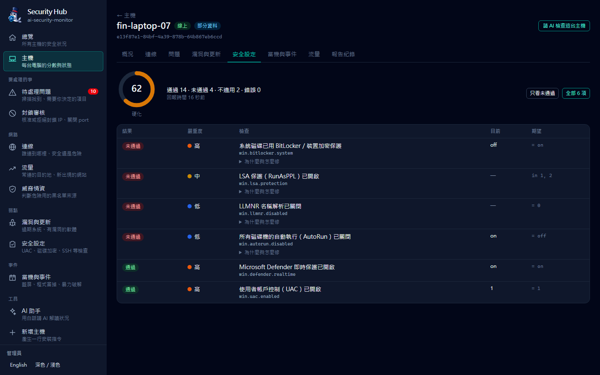
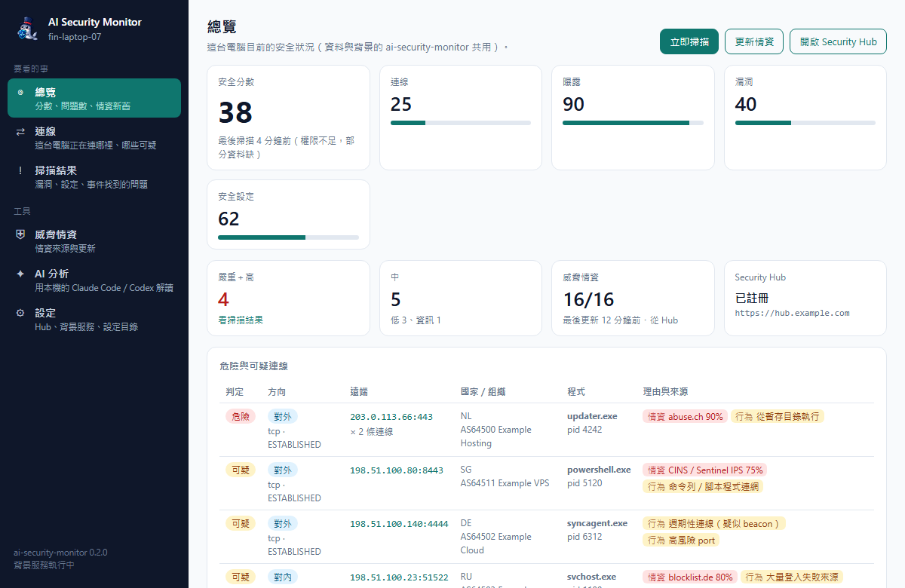
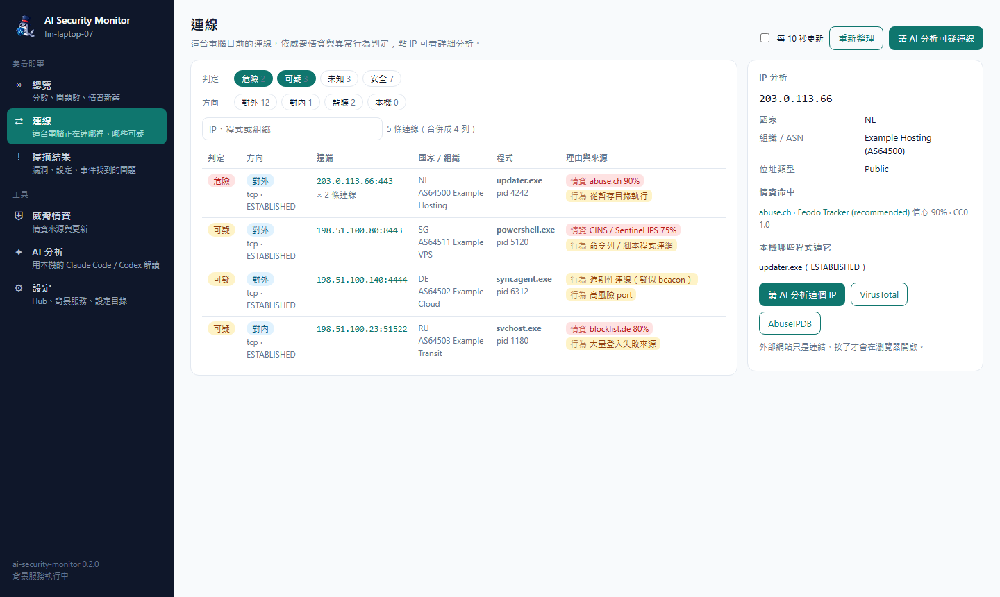
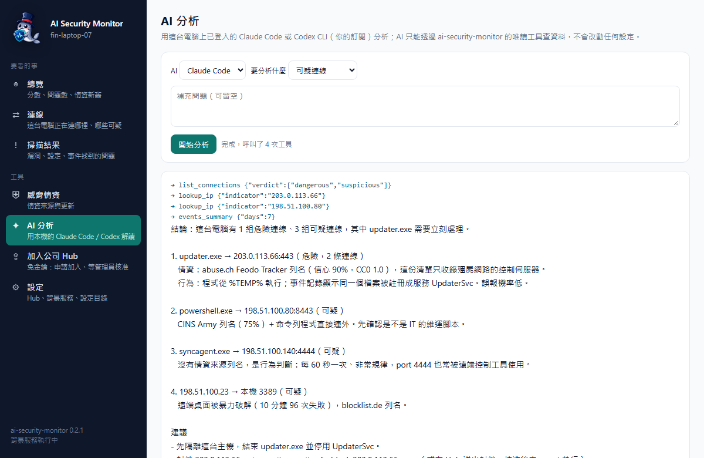
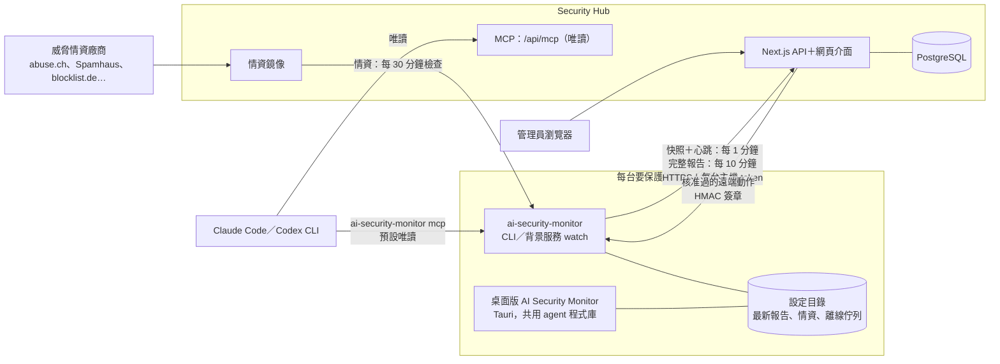

<p align="center">
  
</p>

<h1 align="center">ai-security-monitor</h1>

<p align="center"><b>繁體中文</b> · <a href="./README.en.md">English</a></p>

<p align="center">
  <a href="https://github.com/markku636/ai-security-monitor/actions/workflows/ci.yml"></a>
  
  
</p>

防禦型資安 agent **`ai-security-monitor`**（Rust，單一執行檔，Windows／Windows Server／macOS／Linux）＋ **Security Hub**（Next.js＋Tailwind＋PostgreSQL）。
抓出對外與對內的異常連線、用公開威脅情資判定**安全／未知／可疑／危險**並附上每一筆來源，
檢查防火牆、開放 port、漏洞與系統硬化，整理流量與 Windows 事件／當機原因，再交給 **Claude Code／Codex CLI** 用白話解讀；agent 與 Hub 都是 **MCP server**。


## 緣起

昨天睡前，讓 AI 做了一個有趣的小專案：
用 Rust 寫的應用，蒐集並分析用戶端的異常連線，做威脅分析。
AI 出現後，系統漏洞變得很明顯；既然攻擊者是 AI，AI 也很懂得怎麼防禦。

**架構**

```
Client Agent → 定時回報 → Server 分析 → AI 判斷風險 → Dashboard 呈現
```

`#支援跨平台`（Windows／Windows Server／macOS／Linux）

## 這是什麼

| | |
|---|---|
| **ai-security-monitor**（agent） | 裝在要保護的電腦或伺服器上（含 Windows Server 2016–2025、Server Core 與網域控制站）。掃描連線、情資、防火牆、port、漏洞、硬化、事件與流量；可以單獨用（CLI、MCP、AI 分析），也可以註冊到 Hub 定期回報、接受核准過的遠端封鎖。開機自動啟動（系統服務或使用者登入時）。 |
| **桌面版**（選用） | 用戶端的視窗介面 AI Security Monitor：系統匣常駐，看這台電腦的連線判定（點 IP 分析）、掃描結果、情資狀態，一鍵掃描／更新情資，並用本機已登入的 Claude Code／Codex 做 AI 分析。和命令列、背景服務共用同一個設定目錄。見 [docs/desktop.md](docs/desktop.md)。 |
| **Security Hub** | 集中看所有主機：連線判定、待處理問題、漏洞、安全設定分數、當機與資安事件、情資來源命中、封鎖審核、AI 分析與 MCP。單機版（只綁本機）或伺服器版（所有主機回報到同一台），Docker 部署。 |

## 畫面預覽

| | |
|---|---|
|  連線：方向、判定、行程、國家／組織、理由與情資來源 |  單台主機：五項分數、趨勢、看過的危險目的地 |
|  Windows Server：網域控制站 dc-01（Server 2022 Datacenter，Server Core） |  待處理問題：所有主機回報的問題，可依裝置、狀態、嚴重度篩選與批次處理 |
|  漏洞與更新：作業系統支援期限、KEV、已知漏洞軟體 |  安全設定：最常未通過的檢查與各主機分數 |
|  當機與事件：藍屏代碼與可能原因、暴力破解來源、帳號鎖定 |  威脅情資：每台主機的情資新舊、來源授權、信心與命中 |
|  深色模式：每條檢查的目前值、期望值與修正方式 |  新增主機：建立註冊金鑰並產生一行安裝指令 |

**桌面版**（AI Security Monitor，用戶端視窗介面）

| | | |
|---|---|---|
|  總覽：這台電腦的分數、問題數、情資新舊與可疑連線 |  連線：判定、理由與情資來源，點 IP 看國家／ASN 與命中清單 |  AI 分析：本機的 Claude Code／Codex 透過唯讀工具解讀可疑連線 |

> 截圖用的是示範資料（虛構主機、文件保留網段 IP）：Hub 由 `scripts/demo-seed.mjs` 灌資料，桌面版由 `scripts/capture-desktop-screenshots.mjs` 注入假的 Tauri 回應，不讀任何真實設定。更多桌面版畫面見 [docs/desktop.md](docs/desktop.md)。

## 功能一覽

- **連線與威脅情資**：每條連線判斷方向（對外／對內／監聽／本機），綜合 Spamhaus DROP、abuse.ch（Feodo、URLhaus、ThreatFox）、blocklist.de、CINS、ET、DShield、Tor、IPsum、FireHOL 等開源情資，
  加上異常行為（暫存目錄行程、shell 對外連線、高風險 port、週期性 beacon、新目的地），判定安全／未知／可疑／危險；每個命中都附廠商、信心、授權與來源網址。可選 AbuseIPDB／GreyNoise／CrowdSec 線上查詢（自備 key）。
- **防火牆與曝露**：讀 Windows 防火牆、macOS pf／應用程式防火牆、Linux nftables／firewalld／ufw／iptables，算出每個監聽 port 實際能不能從網路連入；
  `ai-security-monitor fw block`、`ai-security-monitor fw sync-blocklist` 把高信心情資同步成封鎖規則（預演、確認、可撤銷，非商用授權的來源預設只告警）。
- **漏洞與更新**：軟體清單、作業系統支援期限（含 Windows Server 2008–2025）、Windows 多久沒更新、Linux 待裝安全性更新、常見軟體的已知漏洞版本（WinRAR、7-Zip、Chrome…），Linux 套件查 OSV，CISA KEV 命中升為嚴重。
- **系統硬化**：60 條跨平台檢查（UAC、Defender、BitLocker、SMBv1、RDP NLA、SSH、核心參數、AppArmor／SELinux、FileVault、Gatekeeper…），自動分辨 Windows 用戶端、Server、Server Core 與網域控制站，嚴重度加權分數，可用 YAML 自訂。
- **流量**：不抓封包也能看各行程連到哪裡（flow-lite）；分析 Wireshark／tcpdump 的 pcap／pcapng：DNS、TLS SNI、明文協定、大量上傳、週期性連線。
- **事件與當機**：Windows 事件記錄、minidump 藍屏代碼、WER；Linux journal、macOS 當機報告；整理出可能原因與處置，以及暴力破解（含 Kerberos、NTLM）、帳號鎖定、公網遠端桌面登入、新帳號、新服務、清除稽核等資安事件。
- **AI 與 MCP**：`ai-security-monitor ai ask|analyze` 交給 Claude Code 或 Codex CLI（只開唯讀工具）；`ai-security-monitor mcp` 讓 Claude Code／Codex／Cursor／VS Code 直接查這台電腦；Hub 也有所有主機層級的 MCP 與網頁上的 AI 分析。
- **Hub**：總覽、主機、連線、待處理問題（批次處理）、漏洞、安全設定、流量、事件、情資、封鎖審核（HMAC 簽章、主機身分釘選）、註冊金鑰、唯讀 API token、稽核、CSV 匯出、中英文、深色模式、手機版面。
- **部署與更新**：開機自動啟動（Windows 服務／systemd／launchd 或使用者層）、`ai-security-monitor self-update`（比對 SHA256SUMS）、一行安裝腳本、Hub Docker 映像（amd64／arm64）與 compose。

## 架構



- **定時回報**：`ai-security-monitor watch`（開機自動啟動的背景服務）每 1 分鐘拍一次連線快照（含情資判定）並送心跳，每 10 分鐘跑一次完整掃描；
  間隔可用 `ai-security-monitor config set scan.snapshot_interval`／`scan.interval` 調整，Hub 也能要求快照放慢。上傳走 HTTPS（http 只允許本機或私網），
  帶註冊時拿到的 client 金鑰和這台主機自己的 agent token（Hub 第一次看到就釘選，別台冒用會被擋）。
- **離線佇列**：Hub 停機或網路斷線時，完整報告先存在設定目錄的 `outbox/`（最多 50 份），下次連得上再依序補送。
- **遠端動作**：管理員在 Hub 送出封鎖並核准後，agent 從心跳得知有待處理的動作才去領取；每個動作都帶 HMAC-SHA256 簽章，agent 驗章、檢查期限與護欄後才執行並回報結果。
  註冊時沒加 `--accept-remote-actions` 的主機完全不領取。
- **情資**：Hub 依 `feeds/registry.json` 向各廠商下載清單並快取（情資鏡像），agent 每 30 分鐘檢查一次，已註冊就先向 Hub 拿，Hub 沒有的才直接找廠商。
- **桌面版**：直接連結 agent 的 Rust 程式庫，讀同一個設定目錄，所以看得到背景服務的最新報告、情資與 Hub 註冊；回報 Hub 仍由背景服務負責。
- **AI**：`ai-security-monitor mcp`（stdio 或 `--http`）讓 Claude Code／Codex 查這台電腦，預設只有唯讀工具（封鎖等動作要加 `--allow-actions` 才會出現）；
  Hub 的 `/api/mcp` 查所有主機，全部唯讀。`ai-security-monitor ai`、桌面版和 Hub 網頁上的 AI 分析，都是呼叫你已登入的 Claude Code／Codex CLI 並掛上這些唯讀工具。

## 安裝

目前版本 **v0.2.1**。所有檔案都在 [Releases（最新版）](https://github.com/markku636/ai-security-monitor/releases/latest)，每個檔案都列在 `SHA256SUMS`。

### 下載哪一個？

| 你的情況 | 用哪個 | 檔案 |
|---|---|---|
| 一般使用者，想要視窗介面 | **桌面版**（雙擊安裝） | Windows 10／11：`AI-Security-Monitor-<版本>-windows-x64-setup.exe`<br>macOS Apple Silicon（M1 以後）：`AI-Security-Monitor-<版本>-macos-arm64.dmg`<br>macOS Intel：`AI-Security-Monitor-<版本>-macos-x64.dmg`<br>Linux：`AI-Security-Monitor-<版本>-linux-x64.AppImage`（免安裝）或 `…-linux-amd64.deb`（Debian／Ubuntu） |
| 伺服器（含 Windows Server、Server Core）、自動化、沒有桌面環境 | **命令列版**，用一行安裝指令（會比對 SHA256、可順便設定開機自動啟動） | 見下方步驟 4、5；也可以直接下載 `ai-security-monitor-<版本>-<平台>`（`windows-x64.exe`、`windows-arm64.exe`、`linux-x64`、`linux-arm64`、`macos-arm64`、`macos-x64`）。這是命令列工具，要在終端機裡執行，**雙擊只會顯示說明** |
| 要在一個網頁集中看多台主機 | **Security Hub**（Docker） | 映像 `ghcr.io/markku636/ai-security-monitor-hub`，見步驟 6 |
| `asa-<版本>-*` | 不用下載 | 給 0.1.x 的 `asa self-update` 自動使用，內容和命令列版一樣，請忽略 |
| `SHA256SUMS` | 校驗碼 | 所有檔案的 SHA256；安裝腳本與 `self-update` 會自動比對 |

**系統需求**

| | 需求 |
|---|---|
| 桌面版 Windows | Windows 10／11（x64）；需要 Microsoft Edge WebView2（Windows 10／11 內建，沒有時安裝檔會自動下載） |
| 桌面版 macOS | macOS 10.13 以上（Apple Silicon 或 Intel） |
| 桌面版 Linux | x64，Ubuntu 22.04／Debian 12 以上（glibc 2.35 以上）；deb 會自動安裝 WebKitGTK 4.1，系統匣圖示需要桌面支援 AppIndicator |
| 命令列版 | Windows 10／11、Windows Server 2016／2019／2022／2025（含 Server Core），x64 或 ARM64；macOS 11 以上；Linux x64／ARM64（靜態連結，不挑發行版） |
| Security Hub | Docker 24 以上（含 Compose v2），amd64 或 arm64 |

桌面版和命令列版的安裝檔都**沒有程式碼簽章**，第一次開啟時系統會跳警告，照下面的步驟放行即可。

### 1. 桌面版：Windows

1. 裝過舊的「AI Security Agent」桌面版（0.1.x）的話，先到「設定 → 應用程式」解除安裝（新版不會覆蓋它）。
2. 從 [Releases](https://github.com/markku636/ai-security-monitor/releases/latest) 下載 `AI-Security-Monitor-<版本>-windows-x64-setup.exe`。
3. 雙擊安裝檔。出現「Windows 已保護您的電腦」時，按「其他資訊」→「仍要執行」。
4. 安裝到目前使用者，不需要系統管理員。完成後從開始功能表開啟「AI Security Monitor」。

**確認**：視窗出現「總覽」，右下角系統匣有 AI Security Monitor 圖示。

### 2. 桌面版：macOS

1. Apple Silicon（M1、M2…）下載 `AI-Security-Monitor-<版本>-macos-arm64.dmg`，Intel 下載 `…-macos-x64.dmg`。不確定的話：蘋果選單 →「關於這台 Mac」，看「晶片」或「處理器」。
2. 打開 dmg，把「AI Security Monitor」拖到「應用程式」。
3. 第一次開啟：在「應用程式」對它按右鍵 →「打開」→ 再按「打開」。如果顯示「已損毀，無法打開」，在終端機執行：
   `xattr -dr com.apple.quarantine "/Applications/AI Security Monitor.app"`

**確認**：視窗出現，選單列有 AI Security Monitor 圖示。

### 3. 桌面版：Linux

- AppImage（各發行版通用，免安裝）：
  `chmod +x AI-Security-Monitor-<版本>-linux-x64.AppImage && ./AI-Security-Monitor-<版本>-linux-x64.AppImage`
- deb（Debian／Ubuntu）：
  `sudo apt install ./AI-Security-Monitor-<版本>-linux-amd64.deb`，之後從應用程式選單開啟「AI Security Monitor」。

**確認**：視窗出現「總覽」。

### 4. 命令列版：Windows、Windows Server

1. 開 PowerShell。要裝成開機就啟動的系統服務，請用「以系統管理員身分執行」。
2. 貼上執行：

   ```powershell
   irm https://github.com/markku636/ai-security-monitor/releases/latest/download/install.ps1 | iex
   ```

   預設裝到 `%LOCALAPPDATA%\ai-security-monitor\bin` 並加進 PATH。
3. 開一個**新的** PowerShell 視窗，執行 `ai-security-monitor version`。
4. （選用）登入後自動啟動：`ai-security-monitor service install --yes`；伺服器開機就啟動：`ai-security-monitor service install --system --yes`（系統管理員）。

**確認**：`ai-security-monitor version` 印出 `ai-security-monitor 0.2.1 …`；`ai-security-monitor service status` 看得到服務。

### 5. 命令列版：Linux、macOS

1. 在終端機執行：

   ```bash
   curl -fsSL https://github.com/markku636/ai-security-monitor/releases/latest/download/install.sh | sh
   ```

   預設裝到 `/usr/local/bin`，沒有權限就裝到 `~/.local/bin`。
2. 執行 `ai-security-monitor version`。
3. （選用）`ai-security-monitor service install --yes` 登入後啟動；伺服器用 `sudo ai-security-monitor service install --system --yes`。

**確認**：`ai-security-monitor version` 印出版本；`ai-security-monitor doctor` 列出環境檢查結果。

腳本會比對 Release 的 `SHA256SUMS`，不符就停止；指定版本、安裝位置、內部鏡像等選項見 [docs/install.md](docs/install.md)。

### 6. Security Hub（Docker）

1. 取得 compose 檔並填好兩個必填值：

   ```bash
   git clone https://github.com/markku636/ai-security-monitor && cd ai-security-monitor
   cp .env.example .env    # 填 AI_SECURITY_MONITOR_HUB_ADMIN_SECRET、AI_SECURITY_MONITOR_HUB_DB_PASSWORD
   ```

2. 啟動：

   ```bash
   docker compose -f docker/compose.standalone.yml --env-file .env up -d   # 單機版：http://127.0.0.1:8088
   # 伺服器版：docker compose -f docker/compose.yml --env-file .env up -d
   ```

3. 用 `AI_SECURITY_MONITOR_HUB_ADMIN_SECRET` 登入。
4. （選用）讓 Hub 的「AI 助手」能用：映像裡已經裝好 Claude Code 與 Codex，但要先登入一次。AI 助手出現 **「Please run /login」** 就是還沒登入。擇一：
   - **用 Claude 訂閱帳號登入**（最簡單）：

     ```bash
     docker compose -f docker/compose.standalone.yml --env-file .env exec hub claude
     ```

     進去後輸入 `/login` → 選 Claude 帳號 → 把畫面上的網址貼到瀏覽器授權 → 把授權碼貼回來 → 看到登入成功後輸入 `/exit`。
   - **用 token 或 API key**（不用進容器，適合伺服器）：在自己電腦跑 `claude setup-token` 產生長效 token，在 `.env` 加 `CLAUDE_CODE_OAUTH_TOKEN=…`；或用 `ANTHROPIC_API_KEY=…`；Codex 用 `OPENAI_API_KEY=…`。改完重新執行上面第 2 步的 `up -d`。

   登入資料存在 `hubdata` volume（`/data`），更新映像或重建容器都會保留。AI 只拿唯讀工具，查得到 Hub 的資料但不能改。

**確認**：`curl http://127.0.0.1:8088/api/health` 回 `"db":"ok"`，網頁看得到登入頁。細節見 [docs/docker.md](docs/docker.md)。

### 7. 把主機加進 Hub

**免金鑰、自動尋找（建議）**：電腦自己找到公司的 Hub、送出加入申請，管理員在 Hub 按「核准」就完成，不用發金鑰。

1. 管理員：Hub 左側「新增主機」→ 記下最上面的 **Hub 指紋**；把「免金鑰安裝指令」給同事（已預填這個 Hub 的網址），
   或在公司 DNS 加 `_ai-security-monitor._tcp` 的 SRV 紀錄、在區網開啟 Hub 廣播（mDNS）讓電腦自己找到。可設定「自動核准的網段」（例如 `192.168.10.0/24`）。
2. 電腦端：桌面版第一次開啟會顯示「尋找公司的 Security Hub」→ 核對指紋 → 「申請加入」；命令列版執行 `ai-security-monitor enroll --auto`
   （或貼上 Hub 給的一行安裝指令），再 `ai-security-monitor service install --yes`。
3. 管理員在「新增主機 → 待核准的主機」核對主機名稱與核對碼後按「核准」。電腦記下 Hub 指紋，之後 Hub 身分不符就拒絕上傳。
   Hub 在 Docker Desktop／bridge 網路裡時廣播出不了區網：見 [自動尋找 Hub、免金鑰加入](docs/enrollment.md)。

**用註冊金鑰**：「新增主機」頁也能建立註冊金鑰，給出已填好網址與金鑰的一行安裝指令；已經裝好命令列版的主機用
`ai-security-monitor enroll https://hub.example.com --key asa_ek_…`，再 `ai-security-monitor service install --yes`（伺服器加 `--system`）。

**確認**：Hub 的「主機」頁出現這台主機，幾分鐘內有最新回報；主機上 `ai-security-monitor status` 顯示已註冊。

### 8. 從 0.1.x（asa）或 0.2.0 升級

- **命令列版**：`asa self-update --yes`（0.1.x）或 `ai-security-monitor self-update --yes`（0.2.x），再執行 `ai-security-monitor service install --yes`（系統服務加 `--system`）換掉舊的 `asa` 服務。舊設定、Hub 註冊、金鑰都沿用。
- **桌面版**：0.1.x 的「AI Security Agent」要先解除安裝再裝新版；0.2.x 直接安裝新版。
- 細節見下方「[從 asa／ai-security-agent 升級](#從-asaai-security-agent-升級)」。

**確認**：`ai-security-monitor version` 是新版，`ai-security-monitor service status` 沒有「舊版 asa」。

## 快速上手

```bash
ai-security-monitor doctor                       # 環境檢查：權限、情資新鮮度、外部工具、Hub 連線
ai-security-monitor intel update                 # 下載威脅情資（之後 ai-security-monitor watch 會自動更新）
ai-security-monitor connections --intel          # 目前連線與判定
ai-security-monitor scan                         # 完整掃描（連線、情資、防火牆、port、事件、漏洞、硬化）
ai-security-monitor fw sync-blocklist --dry-run  # 預覽會封鎖哪些高信心情資 IP
ai-security-monitor ai ask "這台電腦有沒有連到危險的地方？"   # 交給 Claude Code／Codex 解讀
ai-security-monitor enroll https://hub.example.com --key asa_ek_…
ai-security-monitor service install --yes        # 開機／登入後自動回報（伺服器加 --system）
```

所有會改變系統的命令（封鎖 IP、關 port、安裝服務、更新）沒加 `--yes` 都只會預覽。

## CLI

| 命令 | 用途 |
|---|---|
| `scan`、`connections`、`ports` | 完整掃描、連線判定、port 可達性 |
| `intel` | 情資更新、來源與授權、查 IP／網域 |
| `fw` | 防火牆狀態、稽核、封鎖／解除、情資同步 |
| `vuln`、`harden` | 漏洞與更新、系統硬化 |
| `traffic`、`events` | 流量觀察與 pcap 分析、事件與當機原因 |
| `ai`、`mcp` | Claude Code／Codex 分析、MCP server 與一鍵設定 |
| `enroll`、`status`、`watch`、`service` | 註冊 Hub、常駐回報、開機自動啟動 |
| `self-update`、`version`、`doctor` | 更新與環境檢查 |
| `allowlist`、`baseline`、`config` | 白名單、基準線（只看新增）、設定 |

`ai-security-monitor --help`、`ai-security-monitor <命令> --help` 看完整參數；`--lang en` 切英文、`--json` 給程式讀。

## 從 asa／ai-security-agent 升級

0.2.0 起專案改名為 ai-security-monitor（執行檔 `asa` → `ai-security-monitor`，GitHub 舊網址會自動轉址），不用重新註冊：

- **自動沿用**：第一次執行新版時，設定目錄 `…/ai-security-agent` 搬到 `…/ai-security-monitor`（`agent_id`、Hub 註冊、白名單、基準線、情資都在），鑰匙圈的 `asa` 項目複製到新名。舊版 `asa` 的常駐 watch 還在跑時先不搬、直接沿用舊目錄（會提示一行），等 `service install` 換掉舊服務時才搬，所以不會留下一份不再更新的副本（0.2.0 留下的這種副本，0.2.1 會在下次搬移時備份成 `ai-security-monitor.bak-<時間>` 並重新同步）；
  `ai-security-monitor service install` 移除舊的 `asa` 服務／Run 值／unit／plist 換成新名（系統層目錄也一起搬），`ai-security-monitor mcp install` 把舊的 `asa` MCP 項目換掉。舊版可以直接 `asa self-update --yes` 升上來。
- **環境變數**：新前綴 `AI_SECURITY_MONITOR_*`（Hub 是 `AI_SECURITY_MONITOR_HUB_*`），舊的 `ASA_*`／`ASA_HUB_*` 照樣有效，只寫舊名的 `.env` 不用改。
- **刻意不改**：防火牆物件名（Windows 群組 `ASA`、`ASA: …` 規則、nft `table inet asa`、ipset `asa_*`、pf anchor `com.asa`、`fw unblock --all-asa`）、通訊標頭 `x-asa-*`、token 前綴 `asa_`／`asa_ek_`、資料庫 `asa_hub` 與 compose 專案名，舊的規則與資料都認得。
- **桌面版**：應用程式識別碼改了，新版不會覆蓋舊版，請先到「設定 → 應用程式」解除安裝舊的「AI Security Agent」再裝新版（見 [docs/desktop.md](docs/desktop.md)）。
- **Hub 映像**：改名 `ghcr.io/markku636/ai-security-monitor-hub`；舊名 `ghcr.io/markku636/ai-security-agent-hub` 過渡期內照樣發佈。

細節見 [docs/install.md](docs/install.md#從-asa01x升級)、[docs/service.md](docs/service.md#從-asa01x升級) 與 [變更紀錄](CHANGELOG.md)。

## 文件

[連線判定與威脅情資](docs/intel.md) · [防火牆與封鎖](docs/firewall.md) · [安裝與更新](docs/install.md) · [自動尋找 Hub、免金鑰加入](docs/enrollment.md) · [開機自動啟動](docs/service.md) · [桌面版](docs/desktop.md) · [Docker](docs/docker.md) · [MCP 與 AI](docs/mcp.md) · [流量](docs/traffic.md) · [事件與當機](docs/events.md) ·
[漏洞與更新](docs/vuln.md) · [系統硬化](docs/hardening.md) · [Agent ↔ Hub 契約](docs/hub-contract.md) · [變更紀錄](CHANGELOG.md)

## 資料夾結構

```text
ai-security-monitor/
├── agent/                 Rust agent：ai-security-monitor 執行檔＋程式庫（桌面版也連結這份程式庫）
│   ├── src/
│   │   ├── bin/           執行檔進入點
│   │   ├── cli/           各命令（scan、connections、fw、intel、ai、mcp、enroll、watch、service…）
│   │   ├── scan/          完整掃描流程與分數計算
│   │   ├── connections/   連線快照、判定、連線歷史與週期性連線（beacon）偵測
│   │   ├── intel/         情資下載、解析、比對、國家／ASN 查詢
│   │   ├── firewall/      各平台防火牆讀取、封鎖計畫與執行
│   │   ├── ports/         監聽 port 與實際可達性
│   │   ├── vuln/          軟體清單、作業系統支援期限、OSV／已知漏洞比對
│   │   ├── hardening/     系統硬化檢查（套用 feeds/policies 的規則）
│   │   ├── events/        Windows 事件記錄、minidump、journal、macOS 當機報告
│   │   ├── traffic/       flow-lite 流量觀察與 pcap 分析
│   │   ├── hub/           Hub 客戶端：上傳、離線佇列（outbox）、遠端動作驗章、watch 零件
│   │   ├── actions/       封鎖等動作的預覽與執行
│   │   ├── mcp/           MCP server（stdio／HTTP）與工具定義
│   │   ├── ai/            呼叫 Claude Code／Codex CLI、解析串流事件
│   │   ├── service/       開機自動啟動（Windows 服務、systemd、launchd）
│   │   ├── update/        self-update（比對 SHA256SUMS）
│   │   ├── model/         報告、發現、連線、白名單、基準線等資料模型
│   │   ├── elevate/       系統管理員權限偵測
│   │   ├── locales/       英文翻譯
│   │   └── util/          共用工具
│   ├── prompts/           AI 分析用的提示詞
│   └── tests/fixtures/    測試資料
├── hub/                   Security Hub（Next.js＋Tailwind）
│   ├── app/               頁面（主機、連線、待處理問題、漏洞、安全設定、事件、情資、封鎖審核…）與 API（/api/v1、/api/mcp、/api/ai）
│   ├── components/        介面元件
│   ├── lib/               資料庫查詢、回報寫入、遠端動作與簽章、情資鏡像、IP 情資、MCP 工具、AI、登入與權限
│   ├── drizzle/           PostgreSQL schema 與 migration
│   ├── messages/          英文翻譯
│   ├── scripts/           i18n 與 client import 檢查
│   └── tests/             單元測試與 API 路由測試
├── desktop/               桌面版 AI Security Monitor（Tauri 2）
│   ├── src-tauri/         Rust 殼：Tauri 指令、系統匣、單一實例
│   └── ui/                純 HTML／CSS／JS 介面，沒有前端建置步驟
├── contract/              agent ↔ Hub 的 JSON Schema（註冊、報告、快照、遠端動作）
├── feeds/                 隨執行檔內嵌的資料
│   ├── registry.json      情資來源清單（網址、格式、信心、授權）
│   ├── known-good.json    已知良好的服務與網段
│   ├── policies/          Windows／macOS／Linux 硬化檢查規則（YAML）
│   ├── vuln/              作業系統支援期限、常見軟體已知漏洞、高風險 port
│   └── events/            藍屏代碼與事件 ID 說明
├── docker/                Hub 的 Dockerfile 與 compose（單機版、伺服器版、開發用資料庫）
├── scripts/               一行安裝腳本、示範資料、截圖、版本與變更紀錄檢查
├── docs/                  各主題文件與 README 截圖（docs/images）
└── .github/workflows/     CI 與發佈流程
```

## 從原始碼建置

```bash
# agent（Rust 1.85+）
cd agent && cargo build --release && ./target/release/ai-security-monitor doctor

# Hub（Node 22+）
cd hub && npm ci && npm run dev:db && npm run dev    # http://localhost:3000
npm run verify                                        # typecheck、i18n、測試、build

# 桌面版（Tauri 2，介面是 desktop/ui 的純 HTML／JS）
cd desktop && npm ci && npx tauri build              # 產生 NSIS 安裝檔
```

示範資料：`node scripts/demo-seed.mjs --hub http://127.0.0.1:3000 --admin <管理員金鑰>`；截圖：`node scripts/capture-screenshots.mjs --hub http://127.0.0.1:3000 --admin <管理員金鑰>`；桌面版截圖：`node scripts/capture-desktop-screenshots.mjs`（不需要 Hub）。

## 資料來源與授權

本專案以 MIT 授權。威脅情資、漏洞與地理資料來自各自的提供者並遵守其授權（例如 DShield 為非商用、預設只告警；DB-IP 需標註），
每一筆命中都附來源網址；完整清單見 [THIRD_PARTY_NOTICES.md](./THIRD_PARTY_NOTICES.md)。

MIT © 2026 mark.ku（markku636）
