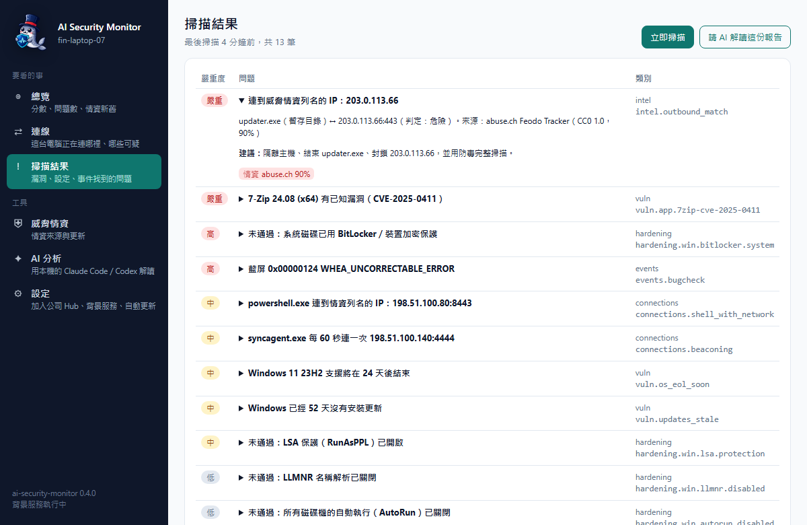
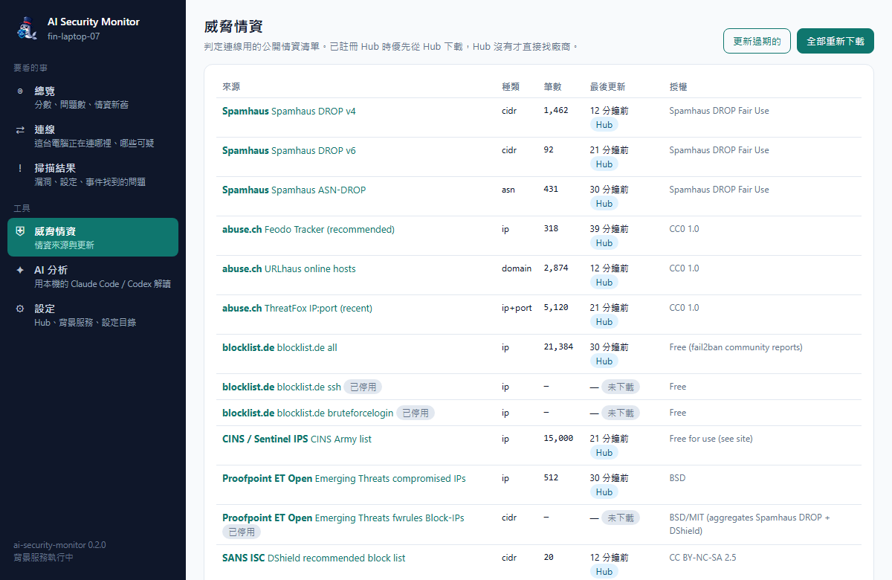
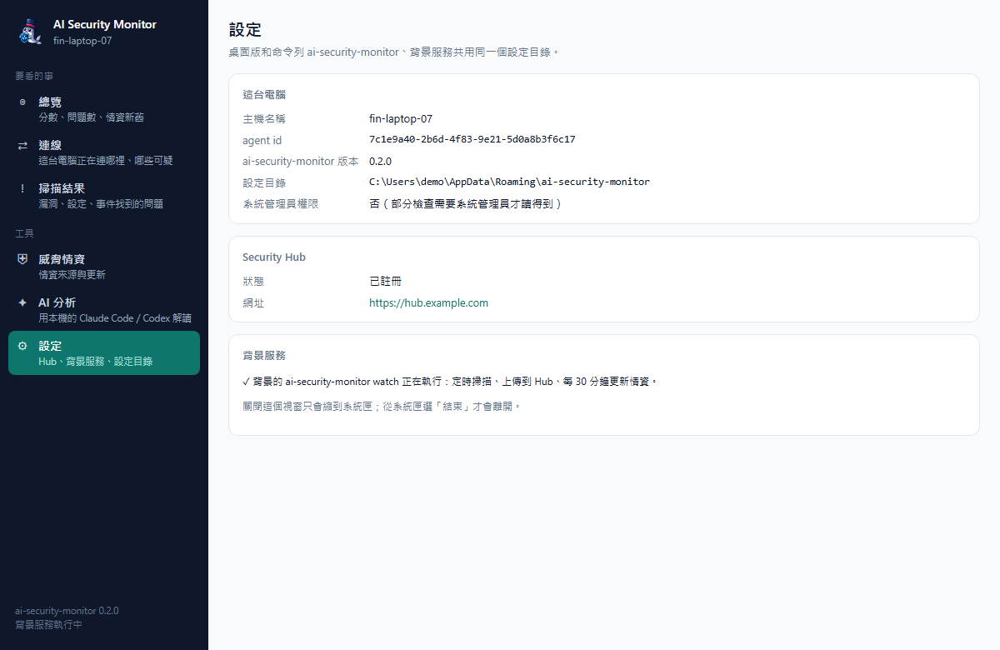
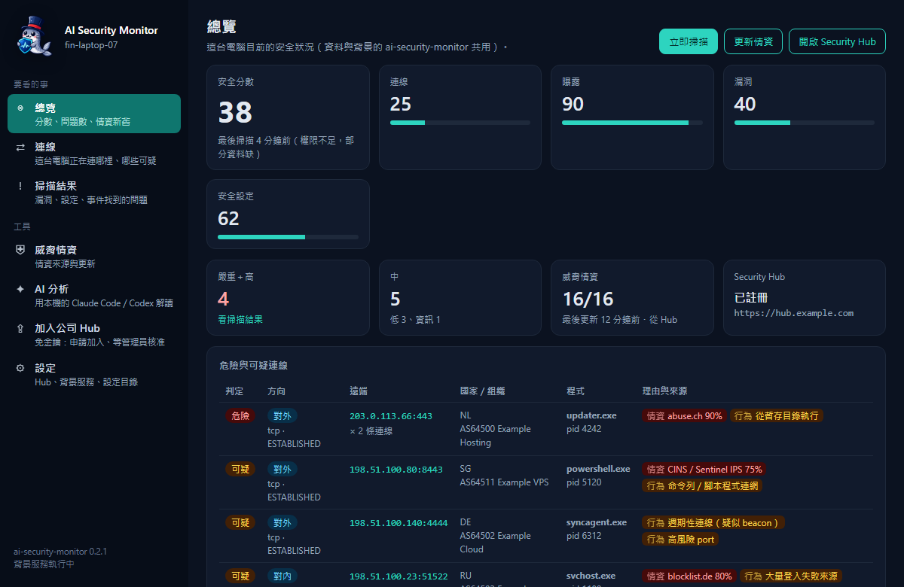

# Desktop app

English | [繁體中文](desktop.md)

`ai-security-monitor` itself is a CLI and a background service; the desktop app **AI Security Monitor** (`desktop/`, Tauri 2) is a windowed client that calls the same ai-security-monitor library directly.

## Install

Download from [Releases](https://github.com/markku636/ai-security-monitor/releases/latest) (current version v0.3.0):

| Platform | File | First launch (the installers are not code-signed) |
|---|---|---|
| Windows 10/11 | `AI-Security-Monitor-<version>-windows-x64-setup.exe`, double-click; installs for the current user | "Windows protected your PC" → "More info" → "Run anyway" |
| macOS Apple Silicon / Intel | `…-macos-arm64.dmg` / `…-macos-x64.dmg`, drag to Applications | Right-click → Open → Open, or `xattr -dr com.apple.quarantine "/Applications/AI Security Monitor.app"` |
| Linux | `…-linux-x64.AppImage` (`chmod +x`, then run) or `…-linux-amd64.deb` (`sudo apt install ./<file>.deb`) | Just start it |

After installing, the window opens on "Overview" and the AI Security Monitor icon appears in the system tray (menu bar on macOS).
`ai-security-monitor-<version>-windows-x64.exe` is the command-line tool, not the desktop app; double-clicking it only shows a help message.

## Screenshots

The screenshots use demo data (fictional host fin-laptop-07, documentation IP ranges) and are produced by `node scripts/capture-desktop-screenshots.mjs`:
it serves `desktop/ui` from a local static server, injects fake Tauri command responses and captures the pages with headless Chrome / Edge, without reading any real config, running a scan or calling an AI.
The UI itself is in Traditional Chinese.

| | |
|---|---|
|  Overview: scores, finding counts, intel freshness, dangerous and suspicious connections |  Connections: verdicts, direction filters, reasons and intel sources, with IP analysis on the right |
|  Scan results: sorted by severity, expand for detail and advice |  Threat intel: entries, last update, whether it came from the Hub, license |
|  AI analysis: tool calls and the answer stream in live |  Settings: agent id, config directory, Hub, background service |
|  Dark mode follows the Windows color setting | |

With `--frame windows` the script instead writes versions wrapped in a Windows 11-style window frame (`windows-desktop-*.png`), plus a hero shot with the window on a desktop above a taskbar showing the tray icon (`windows-desktop-hero.png` / `windows-desktop-hero-dark.png`). The frame, wallpaper and taskbar are drawn by the script as an illustration; they are not real screen captures.


## Pages

| Page | What it shows |
|---|---|
| Overview | Security score (connections / exposure / vulnerabilities / hardening), critical + high count, intel freshness, Hub enrollment, dangerous and suspicious connections; Scan now, Update intel, Open Security Hub |
| Connections | Every current connection, filtered by verdict and direction with search; the same program talking to the same remote is merged into one row; reasons are labeled Intel (click to open the source list) or Behavior (ai-security-monitor's own heuristic); optional 10-second auto refresh |
| IP analysis | Click an IP: country / ASN, which intel sources list it, which local programs talk to it, VirusTotal / AbuseIPDB links, and "Ask AI about this IP" |
| Scan results | Findings from the latest report, sorted by severity, expandable for detail and advice |
| Threat intel | Per source: entries, last update, whether it came from the Hub; update stale lists or refetch everything |
| AI analysis | Uses the Claude Code or Codex CLI you are signed in to (your subscription) to analyze suspicious connections, the latest report, or a free-form question, streaming answers and tool calls |
| Join company Hub | Keyless enrollment: find your company's Security Hub (company DNS, local network broadcast), show its fingerprint, *Request to join*, then wait for an administrator to approve (keeps waiting in the background if you close the window). On first start with no Hub it opens this page automatically (unless you clicked *Not now*). See [enrollment.en.md](enrollment.en.md) |
| Settings | **Company Security Hub**: URL field, *Test connection* (version and fingerprint), *Find your company's Hub*, *Request to join*, *I have an enroll key*, *Leave this Hub* (deletes only this computer's settings and key; the host record on the Hub stays until an administrator deletes it). Switching to a Hub with a different fingerprint shows a clear warning and needs confirmation. **Start automatically**: *Report in the background after startup/sign-in* (= `ai-security-monitor service install --yes`, installed for the current user, no UAC; it also replaces an old asa start-at-login entry and moves its settings) and *Open the desktop app at sign-in* (tray only, no window). Plus agent id and config directory |

Closing the window minimizes it to the system tray; the tray menu has Open, Open Security Hub and Quit. Only one instance runs at a time.

## Upgrading from the "AI Security Agent" desktop app

From 0.2.0 the desktop app is called **AI Security Monitor** and its application identifier changed from `dev.asa.desktop` to
`dev.ai-security-monitor.desktop`, so the new installer installs a separate app and does **not** replace or remove the old one:

1. Quit the old app (tray icon → Quit).
2. Settings → Apps → Installed apps → "AI Security Agent" → Uninstall (this also removes its Start menu shortcut).
3. Install the new `AI-Security-Monitor-<version>-windows-x64-setup.exe`.
4. (Optional) Delete the old WebView cache `%LOCALAPPDATA%\dev.asa.desktop`; the new app uses `%LOCALAPPDATA%\dev.ai-security-monitor.desktop`.

Scan reports, threat intel, Hub enrollment and keys live in the agent's config directory, not in those folders: the first 0.2.0 command-line run
moves `%APPDATA%\ai-security-agent` to `%APPDATA%\ai-security-monitor`, and the new desktop app picks it up without re-enrolling.

## How it relates to the CLI and service

- It shares the config directory (`%APPDATA%\ai-security-monitor` etc.), so it sees the background `ai-security-monitor watch`'s latest report, intel and Hub enrollment.
- The Connections page takes a read-only snapshot: it does **not** append to the connection history, so frequent refreshes don't skew the service's beacon detection.
- AI analysis mounts ai-security-monitor's read-only MCP tools; the MCP server is the desktop executable itself — started with command-line arguments (e.g. `ai-security-monitor-desktop.exe mcp --tools …`) it runs as the ai-security-monitor CLI.
- *Report in the background* registers **the desktop executable itself** (`…\AI Security Monitor\ai-security-monitor-desktop.exe watch --service`; on Windows the `ai-security-monitor` value under `HKCU\…\Run`, a LaunchAgent on macOS, systemd --user or XDG autostart on Linux). The installed path does not change on updates, so nothing needs to be redone; a Linux AppImage registers the AppImage file itself (`APPIMAGE`), not the per-run temporary mount. If the command-line service was installed before, turning the switch on points it at the desktop executable.
- *Open the desktop app at sign-in* starts `ai-security-monitor-desktop --tray`: tray icon only, no window (on Windows the "AI Security Monitor" value under `HKCU\…\Run`).
- No administrator rights needed; some checks (Security event log, minidumps) need an administrator and are marked as such in the report.

## Build

```bash
cd desktop
npm ci                 # just @tauri-apps/cli
npm run icon           # (optional) regenerate every icon size from src-tauri/icons/source.png (the project logo)
npx tauri build        # Windows: src-tauri/target/release/bundle/nsis/*-setup.exe
```

The UI lives in `desktop/ui/` as plain HTML/CSS/JS with no frontend build step. The installer is per-user (no administrator needed).
