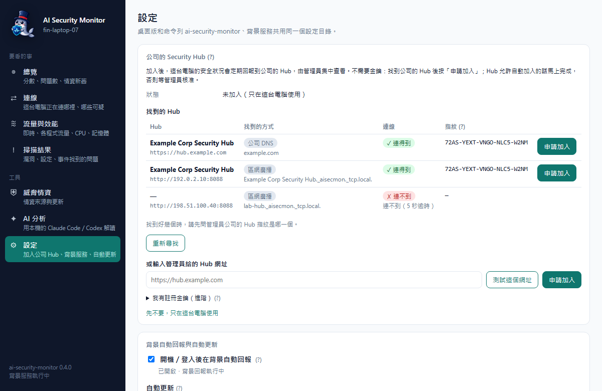
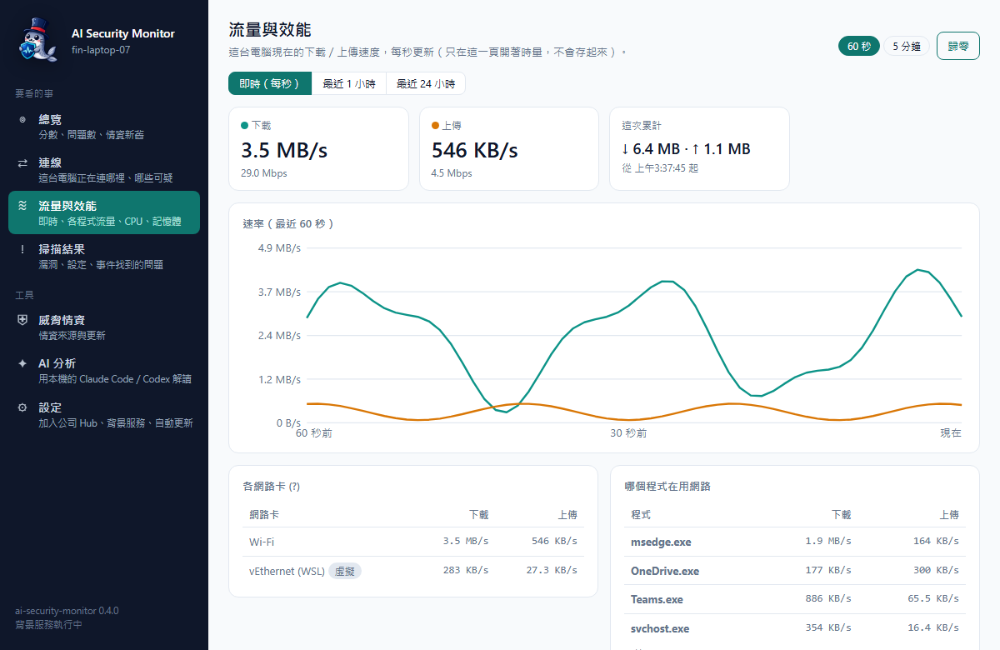
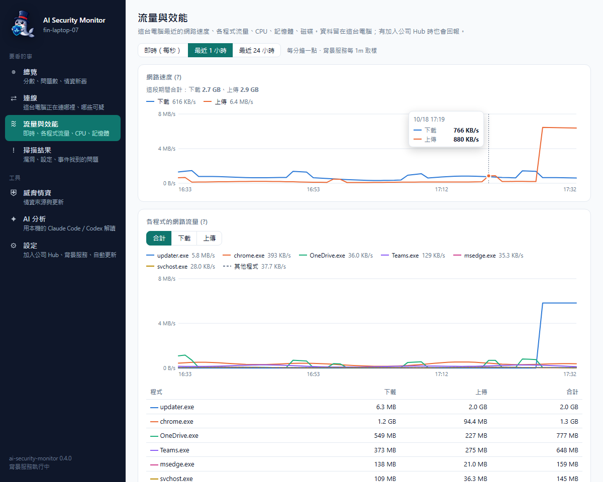
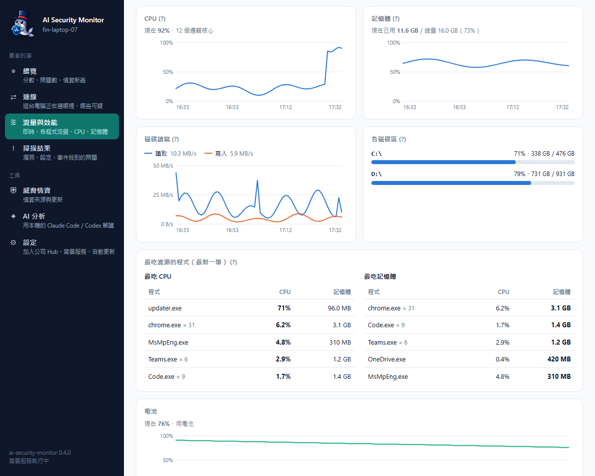
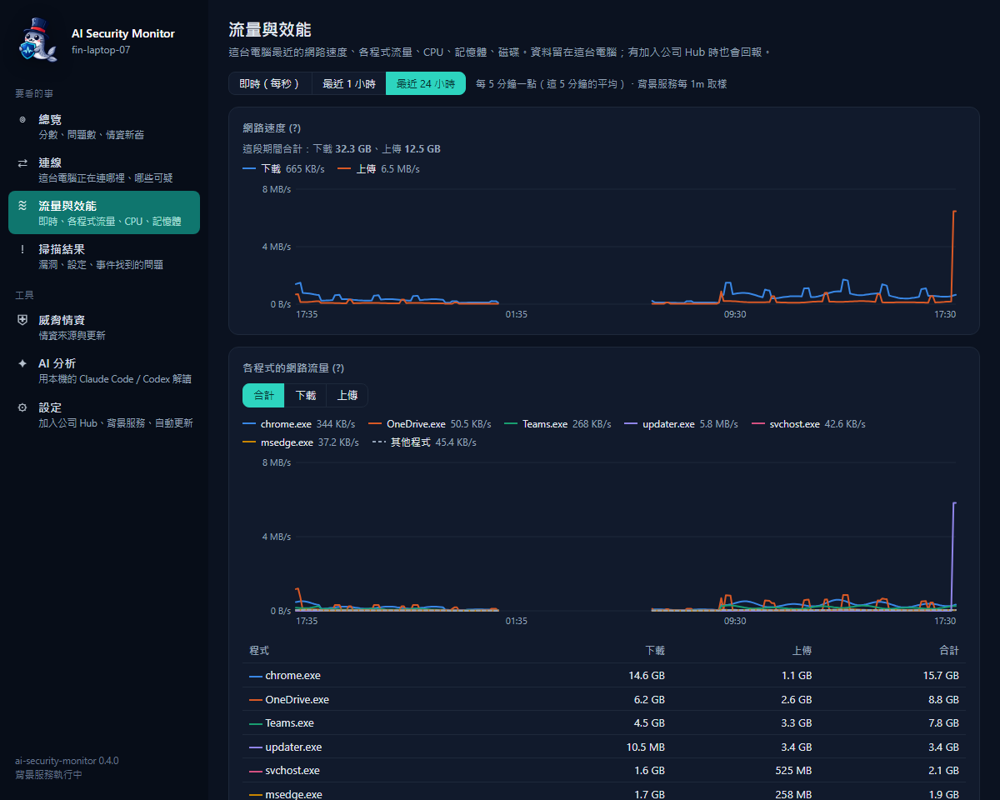
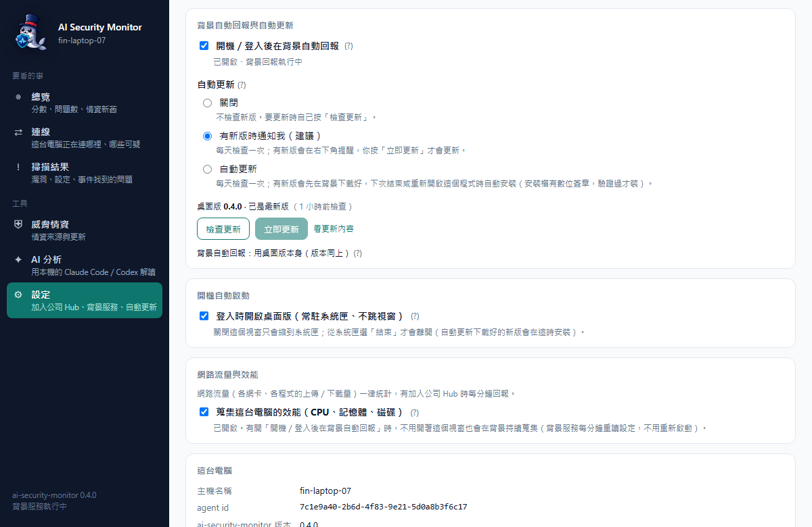

# 桌面版

[English](desktop.en.md) | 繁體中文

`ai-security-monitor` 本身是命令列和背景服務；桌面版 **AI Security Monitor**（`desktop/`，Tauri 2）是給用戶端看的視窗介面，直接呼叫同一份 ai-security-monitor 程式庫。

## 安裝

從 [Releases](https://github.com/markku636/ai-security-monitor/releases/latest) 下載（目前版本 v0.5.0）：

| 平台 | 檔案 | 第一次開啟（安裝檔沒有程式碼簽章） |
|---|---|---|
| Windows 10／11 | `AI-Security-Monitor-<版本>-windows-x64-setup.exe`，雙擊安裝到目前使用者 | 「Windows 已保護您的電腦」→「其他資訊」→「仍要執行」 |
| macOS Apple Silicon／Intel | `…-macos-arm64.dmg`／`…-macos-x64.dmg`，拖到「應用程式」 | 右鍵 →「打開」→「打開」，或 `xattr -dr com.apple.quarantine "/Applications/AI Security Monitor.app"` |
| Linux | `…-linux-x64.AppImage`（`chmod +x` 後執行）或 `…-linux-amd64.deb`（`sudo apt install ./檔名.deb`） | 直接開啟 |

裝好後視窗會開在「總覽」，系統匣（macOS 是選單列）出現 AI Security Monitor 圖示。
`ai-security-monitor-<版本>-windows-x64.exe` 是命令列版，不是桌面版，雙擊只會顯示說明。

## 畫面

截圖用的是示範資料（虛構主機 fin-laptop-07、文件保留網段 IP），由 `node scripts/capture-desktop-screenshots.mjs` 產生：
它用本機靜態伺服器提供 `desktop/ui`，注入假的 Tauri 指令回應，再用無頭 Chrome／Edge 擷取，不讀真實設定、不跑掃描、不呼叫 AI。

| | |
|---|---|
|  總覽：分數、問題數、情資新舊、網路速率與效能小圖、危險與可疑連線 |  連線：判定、方向篩選、理由與情資來源，右邊是 IP 分析 |
|  掃描結果：依嚴重度排序，展開看細節與建議 |  威脅情資：每個來源的筆數、最後更新、是否從 Hub、授權 |
|  AI 分析：工具呼叫與回答即時顯示 |  設定：公司的 Security Hub（已加入：網址、指紋、更換或離開）、背景自動回報與自動更新、開機自動啟動、效能蒐集開關 |
|  設定 → 公司的 Security Hub（還沒加入時）：自動找到的 Hub、找到的方式、連不連得到、指紋，按「申請加入」 |  深色模式：跟著 Windows 的深色設定 |
|  流量與效能 → 即時（每秒）：下載／上傳速度、最近 60 秒折線、各網卡與各程式 |  流量與效能 → 最近 1 小時：網路速度（滑過看各時間點的值）、各程式的網路流量 |
|  開啟效能蒐集時：CPU、記憶體、磁碟讀寫、各磁碟區、最吃資源的程式、電池 |  最近 24 小時（每 5 分鐘一點）：筆電睡著的時段沒有資料、圖上斷開 |

加上 `--frame windows` 會改輸出套上 Windows 11 風格視窗外框的版本（`windows-desktop-*.png`），以及放在桌面上、下方有工作列與系統匣圖示的主視覺 `windows-desktop-hero.png`／`windows-desktop-hero-dark.png`。外框、桌布和工作列都是腳本自己畫的示意圖，不是真的螢幕截圖。


## 功能

| 頁面 | 內容 |
|---|---|
| 總覽 | 安全分數（連線／曝露／漏洞／安全設定）、嚴重＋高問題數、情資新舊、是否註冊 Hub、危險與可疑連線；「立即掃描」「更新情資」「開啟 Security Hub」。網路（現在的下載／上傳速率＋最近 1 小時小圖）；開啟效能蒐集時另有 CPU、記憶體、最滿的磁碟區（≥ 90% 標紅），沒開時顯示「未開啟」並連到設定。背景服務在跑就用它每分鐘的樣本，沒有時桌面版開著（含縮到系統匣）就自己量（最近 1 小時在記憶體，24 小時歷史寫進設定目錄）。小走勢圖點下去到「流量與效能 → 最近 1 小時」。見 [metrics.md](metrics.md) |
| 連線 | 目前所有連線，同一程式連到同一遠端合併成一列；點表頭排序（判定、方向、遠端、條數、國家／組織、程式、理由，再點反向）；篩選：判定、方向、協定、連線狀態、理由類型（情資／行為／沒有理由）、程式、國家、port、只看公網位址、隱藏本機迴路、關鍵字，一鍵清除；理由分「情資」（可點開原始清單）與「行為」（ai-security-monitor 自己的判斷）；可每 10 秒自動更新 |
| 流量與效能 | 三個分頁，見下方「[流量與效能](#流量與效能)」。**即時（每秒）**：每秒更新的下載／上傳速率（大字＋Mbps）、最近 60 秒或 5 分鐘的折線圖、這次累計；各網路卡速率（虛擬網卡標示、不算進總量）；哪個程式在用網路（Windows 要以系統管理員執行、macOS 用 nettop，Linux 沒有時引導看「連線」頁）。只在這個分頁開著時量、不存檔，視窗縮到系統匣時暫停。**最近 1 小時／最近 24 小時**：網路速度、各程式的網路流量（前 6 名＋其他，可切換合計／下載／上傳）；開啟效能蒐集時還有 CPU、記憶體、磁碟讀寫、各磁碟區、最吃資源的程式、電池。總覽的小走勢圖點下去會到「最近 1 小時」 |
| IP 分析 | 點連線上的 IP：國家／ASN、哪些情資來源列名、本機哪些程式連它、VirusTotal／AbuseIPDB 連結、「請 AI 分析這個 IP」 |
| 掃描結果 | 最新報告的問題，依嚴重度排序、展開看細節與建議 |
| 威脅情資 | 每個來源的筆數、最後更新、是否從 Hub 下載；更新過期的或全部重抓 |
| AI 分析 | 用本機已登入的 Claude Code 或 Codex CLI（你的訂閱）分析可疑連線、最新報告或自由提問；即時顯示回答與工具呼叫。下方「AI 帳號」顯示兩個程式的登入狀態，可登入（開終端機跑官方登入指令）與登出，見 [ai-login.md](ai-login.md) |
| 設定 | **公司的 Security Hub**（加入、等候核准、更換、離開都在這裡，見下方「[加入公司的 Hub](#加入公司的-hub)」）：還沒加入時自動尋找（不擋其他設定）、列出找到的 Hub、手動輸入網址「測試這個網址」「申請加入」、「我有註冊金鑰」；加入中顯示 Hub 指紋與核對碼並自動確認；已加入時顯示網址與指紋、「開啟 Security Hub」「測試連線」「離開這個 Hub」（只刪這台的設定與金鑰，Hub 上的主機紀錄要管理員刪）與「更換 Hub 或重新加入」；要換到指紋不同的 Hub 會先清楚警告並要求確認。**開機自動啟動**：「開機／登入後在背景自動回報」（＝`ai-security-monitor service install --yes`，裝在目前使用者底下、不跳 UAC；會一併換掉舊版 asa 的登入啟動項目並搬設定）、「登入時開啟桌面版」（常駐系統匣、不跳視窗）。**網路流量與效能**：「蒐集這台電腦的效能（CPU、記憶體、磁碟）」（＝`metrics.performance`，預設關；只送到這台加入的 Hub，Hub 無法從遠端開；開了背景自動回報就不用開著視窗，背景服務每分鐘重讀設定）。另有 agent id、設定目錄等 |

關閉視窗只會縮到系統匣；系統匣選單有「開啟主視窗」「開啟 Security Hub」「結束」。同時只會開一個實例。

## 流量與效能

側欄「流量與效能」用圖表看這台電腦，頁內分三個分頁（網址 `#traffic`、`#traffic/1h`、`#traffic/24h`）：


- **即時（每秒）**：現在的速度，只在這個分頁開著時量，不存檔（原本的「即時流量」頁）。
- **最近 1 小時**（每分鐘一點）、**最近 24 小時**（每 5 分鐘一點，這 5 分鐘的平均）：
  - **網路速度**：下載／上傳速率，以及這段期間的合計。
  - **各程式的網路流量**：依整段期間的合計量取前 6 名各一條線（顏色固定跟著程式，切換「合計／下載／上傳」不會換色），其餘合成灰色虛線「其他程式」；下面列出這段期間前 10 名的下載、上傳、合計。
    Windows 要以系統管理員執行背景服務才量得到（系統管理員 PowerShell 執行 `ai-security-monitor service install --system --yes`），macOS 用系統內建的 nettop，Linux 量不到；量不到時頁面會用白話說明。
  - **開啟效能蒐集時**：CPU（24 小時圖另有每 5 分鐘裡最高的一次，虛線）、記憶體（％，附已用／總量）、磁碟讀寫速率、各磁碟區用量（≥ 90% 標紅）、最吃 CPU／記憶體的程式（最新一筆）、筆電的電池。沒開時只有網路的圖，並附說明與開關（和「設定」裡的是同一個）。
- 圖表是純 SVG：滑過（或用 Tab 聚焦後按左右鍵）顯示十字線與每條線在那個時間的值；兩條線以上有文字圖例；附一份給螢幕閱讀器的表格；深淺色各自調過顏色。沒有資料的時段（例如電腦睡著）圖上斷開。
- **資料從哪來**：背景自動回報在跑時用它每分鐘的樣本；沒在跑時，桌面版開著（含縮到系統匣）就自己每分鐘取樣。24 小時歷史存在這台電腦（`<設定目錄>/metrics/history.jsonl`，每 5 分鐘一行、約 300 KB），沒加入 Hub 也會記，見 [metrics.md](metrics.md#本機的-24-小時歷史)。


## 從「AI Security Agent」桌面版升級

0.2.0 起桌面版改名 **AI Security Monitor**，應用程式識別碼也從 `dev.asa.desktop` 改成 `dev.ai-security-monitor.desktop`，
所以新版安裝檔會裝成另一個應用程式，**不會**覆蓋或移除舊版：

1. 先結束舊版（系統匣圖示 → 結束）。
2. 設定 → 應用程式 → 已安裝的應用程式 → 「AI Security Agent」→ 解除安裝（舊版的開始功能表捷徑一併移除）。
3. 安裝新版 `AI-Security-Monitor-<版本>-windows-x64-setup.exe`。
4. （選用）刪除舊版留下的 WebView 快取 `%LOCALAPPDATA%\dev.asa.desktop`；新版用 `%LOCALAPPDATA%\dev.ai-security-monitor.desktop`。

掃描報告、情資、Hub 註冊與金鑰都放在 agent 的設定目錄，不在上面的資料夾：命令列第一次執行 0.2.0 時會把 `%APPDATA%\ai-security-agent`
搬到 `%APPDATA%\ai-security-monitor`，新版桌面版直接沿用，不用重新註冊。

## 自動更新

「設定 → 背景自動回報與自動更新」：



- **自動更新**：「關閉」「有新版時通知我（建議，預設）」「自動更新」。每天檢查一次（啟動後約 30 秒第一次）。通知時右下角會出現「有新版 0.x.y」的提示，按「立即更新」或關掉都可以；自動更新會先在背景下載好，下次從系統匣「結束」或重新開啟時安裝（登入時以系統匣啟動、還沒開過視窗的話就直接安裝）。
- **檢查更新／立即更新**：不管設定是什麼，隨時可以手動檢查與更新；顯示目前版本、最新版本與「看更新內容」（GitHub Release 說明）。
- 更新檔有 minisign 數位簽章，App 內建公鑰驗過才安裝；Windows 用安裝程式的被動模式（只有進度列），裝完自動重新開啟。
- **背景自動回報一起更新**：背景回報用的就是桌面版執行檔，更新時會一起換成新版（Windows 的安裝程式裝完會依 `HKCU\…\Run` 把它重新啟動；macOS／Linux 由桌面版重新啟動）。另外裝的命令列版背景服務會列在同一區，照它自己的 `update.mode` 更新，也可以按「更新命令列版」。
- 用 .deb 安裝的：自動更新會先下載，要你按「立即更新」並輸入系統管理員密碼才會安裝。開發版（從原始碼建置）不更新。
- 設定和命令列版共用（`config.json` 的 `update.mode`），細節見 [安裝與更新](install.md#更新)。

## 立即上傳到 Hub

加入 Hub 之後，總覽頁多一張「上傳到 Security Hub」卡片：上次上傳是多久以前、有幾份報告在等重送（Hub 連不上時先暫存），以及「立即掃描並上傳到 Hub」——補送暫存的報告、上傳連線快照、跑一次完整掃描並上傳、送心跳，完成後顯示「已上傳，Hub 收到 N 筆」。命令列對應 `ai-security-monitor upload`。

## 讓區網裡的電腦找到這台的 Hub

這台電腦上有在跑 Security Hub（例如用 Docker Desktop 跑單機版）時，設定頁會多一區「讓區網裡的電腦找到這台的 Hub」：打開並填區網要連的網址（會自動帶這台的區網 IP，例如 `http://192.168.1.10:8088`），背景自動回報就會在區網廣播它（mDNS，TXT 帶 Hub 指紋），同事按「尋找公司的 Hub」就找得到。Hub 連不到時會自動暫停廣播、恢復後自動繼續。

- 開之前會先確認這個網址連得到、而且是這台電腦上的同一個 Hub。單機版的 Hub 預設只綁 127.0.0.1，區網連不到——要先在 Hub 的 `.env` 設 `AI_SECURITY_MONITOR_HUB_BIND=0.0.0.0`（見 [自動尋找 Hub](enrollment.md#mdns-廣播)）。
- 要開著「開機／登入後在背景自動回報」才會一直廣播。命令列對應 `ai-security-monitor config set hub.advertise_url <網址>`。

## 加入公司的 Hub

加入公司的 Security Hub 全部在「設定 → 公司的 Security Hub」（以前側欄的「加入公司 Hub」頁已經併進來，舊連結 `#join` 會自動帶到這裡）。第一次開啟、還沒加入 Hub 時會自動帶到這一區（按「先不要，只在這台電腦使用」就不再帶）。


- **還沒加入**：自動尋找（公司 DNS、區網廣播，約 3–10 秒，在背景跑、不擋設定頁其他區塊；2 分鐘內回來不重找）。每個找到的 Hub 列出找到的方式（滑鼠移上去有說明）、連不連得到（連不到會顯示原因）、指紋，按「申請加入」；按「重新尋找」再查一次。一個都沒找到時會說明三種常見原因：直接問管理員要 Hub 網址、Hub 要讓區網連得到、Hub 在 Docker Desktop 裡要有人幫忙廣播。也可以在「或輸入管理員給的 Hub 網址」填網址，按「測試這個網址」或「申請加入」；有註冊金鑰的話展開「我有註冊金鑰（進階）」。
- **加入中**：Hub 允許自動加入的話馬上完成；否則顯示「等候管理員核准」、Hub 指紋與這台電腦的核對碼，自動確認（離開設定頁就停，回來再繼續；關掉視窗也沒關係，背景服務會繼續等），可以「現在確認」或「取消申請」。被拒絕時顯示原因與「重新尋找」。
- **已加入**：顯示 Hub 網址與指紋，「開啟 Security Hub」「測試連線」「離開這個 Hub」；要換到別的 Hub 或重新加入，展開「更換 Hub 或重新加入」（同樣的尋找、網址、註冊金鑰）。

## 和命令列、背景服務的關係

- 共用同一個設定目錄（`%APPDATA%\ai-security-monitor` 等），所以看得到背景 `ai-security-monitor watch` 的最新報告、情資與 Hub 註冊。
- 連線頁是唯讀快照：**不寫入**連線歷史，避免頻繁重新整理干擾背景服務的週期性連線（beacon）判斷。
- AI 分析掛的是 ai-security-monitor 的唯讀 MCP 工具；MCP server 就是桌面版執行檔本身——帶命令列參數啟動時（例如 `ai-security-monitor-desktop.exe mcp --tools …`）它會當 ai-security-monitor CLI 執行。
- 「開機／登入後在背景自動回報」登記的是**桌面版執行檔本身**（`…\AI Security Monitor\ai-security-monitor-desktop.exe watch --service`；Windows 是 `HKCU\…\Run` 的 `ai-security-monitor`、macOS 是 LaunchAgent、Linux 是 systemd --user 或 XDG autostart）。安裝檔更新時路徑不變，所以更新後不用重設；Linux AppImage 會改用 AppImage 檔本身的路徑（`APPIMAGE`），不是每次都不同的暫時掛載點。已經另外裝了命令列版服務的話，打開開關會改成用桌面版執行檔。
- 「登入時開啟桌面版」用 `ai-security-monitor-desktop --tray` 啟動：只放到系統匣、不開視窗（Windows 是 `HKCU\…\Run` 的「AI Security Monitor」）。
- 桌面版不需要系統管理員；部分檢查（Security 事件記錄、minidump）需要系統管理員才讀得到，會在報告裡標示。

## 建置

```bash
cd desktop
npm ci                 # 只有 @tauri-apps/cli
npm run icon           # （選用）由 src-tauri/icons/source.png（專案 logo）重新產生各尺寸圖示
npx tauri build        # Windows：src-tauri/target/release/bundle/nsis/*-setup.exe
```

介面在 `desktop/ui/`，是純 HTML／CSS／JS，沒有前端建置步驟。安裝檔是目前使用者層（不需要系統管理員）。
