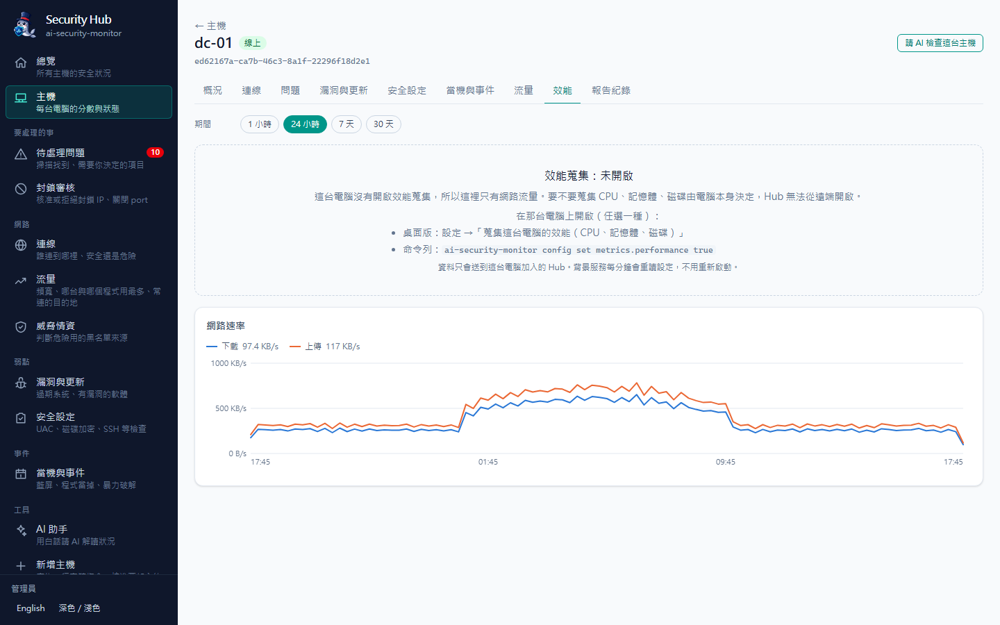

# Network traffic statistics and performance

English | [繁體中文](metrics.md)

Every minute `ai-security-monitor` records **how much network this computer uses** (upload/download per network card and per program) and,
when the computer has joined a Security Hub, reports it so the Hub can chart bandwidth and show which hosts and programs use the most.
**Performance** (CPU, memory, disk, top processes, battery) is **optional** and off by default: it is turned on on the computer itself;
the Hub cannot turn it on remotely.

| | Network traffic | Performance |
|---|---|---|
| Default | On (cheap: reads network card counters) | **Off** |
| How to turn on | — | Desktop app "Settings → Collect this computer's performance (CPU, memory, disk)", or `ai-security-monitor config set metrics.performance true` |
| Where it goes | The Hub this computer joined (without a Hub it only stays on this computer, last hour) | Same |
| Frequency | `metrics.interval` (default `1m`, minimum `30s`) | Same |

The background service (`watch --service`) re-reads the setting every round, so switching it from the desktop app or the command line
needs **no restart**. With "Report in the background after boot / sign-in" on, collection continues even when the desktop window is closed.


| | |
|---|---|
|  Host "Performance" tab: CPU, memory, disk, network rate, battery, top programs |  A host without performance collection: how to turn it on, network rate still shown |

## What is collected (per OS)

| Item | Windows (incl. Server, Server Core) | macOS | Linux |
|---|---|---|---|
| Bytes per network card | ✓ (`GetIfTable2`; filter layers stacked on a card are skipped) | ✓ | ✓ (`/sys/class/net`) |
| Virtual adapter detection | Name (vEthernet/Hyper-V, WSL, VPN, VirtualBox, VMware…) | Name (utun, awdl, llw, bridge…) | `/sys/class/net/<name>` under `devices/virtual`, or name (docker, veth, br-, tun, wg…) |
| Bytes per program | ✓ needs **administrator** (TCP extended statistics `GetPerTcpConnectionEStats`; the system service has it) | ✓ (built-in `nettop`) | ✗ (needs eBPF; the Hub shows per-process connection counts instead) |
| CPU (overall, cores) | ✓ | ✓ | ✓ |
| Memory, swap | ✓ | ✓ | ✓ |
| Usage per volume | ✓ | ✓ (`/` only; APFS `/System/Volumes/*` share the same container) | ✓ (skips squashfs, overlay, tmpfs, `/snap`, `/boot/efi`) |
| Disk read/write bytes | ✓ (`IOCTL_DISK_PERFORMANCE`; missing when `diskperf` is off) | ✓ | ✓ |
| Uptime | ✓ | ✓ | ✓ |
| Load (1/5/15 min) | ✗ | ✓ | ✓ |
| Top 5 processes by CPU / memory | ✓ (same name merged, e.g. chrome.exe ×31) | ✓ | ✓ |
| Battery | ✓ (`GetSystemPowerStatus`; not sent on desktops/servers) | ✓ (`pmset -g batt`) | ✓ (`/sys/class/power_supply`, skips mice and other peripherals) |

- **Totals count physical cards only**: VPN, Docker, WSL and Hyper-V traffic also passes through a physical card, so adding it would double count;
  virtual adapters are still listed and marked "virtual". Only when a machine has nothing but virtual adapters (e.g. inside a container) are those counted.
  Loopback (`lo`) is never listed.
- **Counter resets and wrap**: two readings are subtracted. When a counter goes down, it is treated as a 32-bit wrap if the previous value was near the
  32-bit limit (> 3 GiB) and the new one is small; otherwise as a reset (reboot, adapter reset, resume from sleep) and only the bytes since the reset count.
  A delta above 100 Gbps is clamped.
- **Per program (Windows)**: every sample enables extended statistics on all established TCP connections and reads the cumulative data bytes; two readings
  are subtracted. Without administrator rights nothing is read (connections without statistics return meaningless leftovers). Only TCP payload bytes
  count (no headers, no UDP); bytes of a connection that closes between two samples are missed.
- Sampling runs on a background thread with a 25-second overall timeout (`nettop`/`pmset` have 5–8-second timeouts), so it never blocks `watch`'s scans,
  snapshots or heartbeats.

## Command line

```bash
ai-security-monitor metrics                    # current upload/download rate, per card, per program; performance too when enabled
ai-security-monitor metrics --perf             # measure CPU, memory, disk once even when off (shown locally, never uploaded)
ai-security-monitor --json metrics --duration 5s
ai-security-monitor config set metrics.performance true    # turn performance collection on (false = off)
ai-security-monitor config set metrics.interval 2m          # sampling interval (minimum 30s)
ai-security-monitor config set metrics.process_network false  # do not estimate per-program network usage
```

`metrics` measures once on this computer (2 seconds by default) and never touches the background service's upload queue. `--json` also lists each
card's cumulative counters since boot, whether the process is elevated, the queued sample count and the number of recent samples kept locally.
The MCP tool `get_metrics` returns the same plus a summary of the last hour (peak rates, average/maximum CPU, programs using the most network).

## Sending to the Hub

- Each sample covers the `interval_s` seconds before `ts` (`contract/metrics.v1.json`): `net` (physical total, per card, per program) and `perf`
  (only when enabled). The batch's `performance` flag tells the Hub whether performance collection is on. A sample with performance is about 1–2 KB.
- `POST /api/v1/ingest/metrics`, up to 240 samples per batch (the agent sends 120 per batch, gzip above 16 KB).
- **Offline**: samples are queued in `<config dir>/metrics/queue.jsonl` (up to 1440, about a day; the oldest are dropped), and up to 3 batches are sent
  per round once the Hub is back. If the Hub is too old to have the endpoint (404) the samples are kept and retried after 30 minutes, then sent
  automatically once the Hub is upgraded. A rejected batch (400/413/422) is dropped.
- Re-sending never double counts: the Hub keys samples by (host, sample time).
- The last 60 samples are also kept locally (`metrics/recent.json`) for the desktop sparklines and `get_metrics`.

## Hub

- **Tables**: `host_metrics` (one row per sample) and `host_metrics_hourly` (hourly rollups: totals, per card, top 10 programs, CPU average/peak,
  memory, fullest disk, disk I/O, battery). `agents.metrics_at`, `agents.perf_enabled` (`null` = never sent a sample).
- **Retention**: raw samples `AI_SECURITY_MONITOR_HUB_METRICS_RAW_DAYS` (default 7, 1–90), hourly rollups `AI_SECURITY_MONITOR_HUB_METRICS_HOURLY_DAYS`
  (default 90); the legacy `ASA_HUB_*` names work too. Samples older than the raw retention are ignored on arrival.
- **Rollup**: every 10 minutes (and within a minute after samples arrive) the Hub recomputes only the hours that received new samples. It is
  idempotent and guarded by a PostgreSQL advisory lock, so with several Hub processes only one does the work; the same run deletes expired data.
- **Pages**:
  - Traffic: ranges 1 hour / 24 hours / 7 days / 30 days (1 h and 24 h from per-minute data, 7 d and 30 d from hourly rollups); fleet bandwidth chart
    (download/upload, hover for each time slot), hosts with the most traffic (24 h and 7 days), per network card (virtual ones marked), traffic per
    program (hosts that cannot measure it are noted). The device filter narrows it to one host.
  - Host page "Performance" tab: current CPU, memory, fullest volume and battery or uptime; charts of CPU (average and peak), memory, disk usage,
    disk I/O, network rate and battery; top programs by CPU and memory; volumes. When the host has not turned it on, an "off" notice explains how,
    and the network rate chart is still shown. The host's "Traffic" tab also gets its bandwidth and per-card breakdown.
  - Overview: traffic in the last 24 hours (all hosts) and "Hosts running hot" (CPU, memory or any disk ≥ 90% in the latest minute).
- **Findings** (only hosts with performance collection on, severity "low", rules `metrics.*`):
  - `metrics.disk_full`: any volume ≥ 90%;
  - `metrics.cpu_sustained`: every sample in the last 15 minutes has CPU ≥ 90% (at least 3 samples); cleared once the last 5 minutes average below 80%.
  They are resolved automatically when the condition no longer holds or the host turns performance collection off.
- **MCP** (read-only): `fleet_traffic` (totals and peaks, host ranking, per card, per program) and `host_performance` (one host's performance summary
  and latest values; without a host it lists hosts at ≥ 90%). "Ask AI to interpret traffic" also looks at upload/download volume.

## Privacy

- Data goes only to the Hub this computer joined; without a Hub it stays on the computer (last hour).
- No packet contents, URLs or file names: network data is byte counts, card names and program names; performance data is numbers plus program name, pid and memory.
- Performance is off by default and decided on the computer itself; the Hub has no way to turn it on. When it is turned off, the Hub resolves open performance findings.

## Limitations

- Linux has no per-program network usage (not without eBPF); the Hub's traffic page shows "Current connections per process" instead.
- Per-program usage on Windows needs administrator rights and counts TCP payload bytes only; the per-user sign-in variant does not have it.
- macOS `nettop` may be unavailable on some managed machines (MDM restrictions, CI machines); only the per-program figures are missing then.
- Disk I/O depends on the platform: Windows has none when disk performance counters are off (`diskperf -n`); network drives and tmpfs are not listed.
- If the computer sleeps or shuts down within an interval, that time's bytes are counted in the first sample after waking (rates use the real elapsed time).
