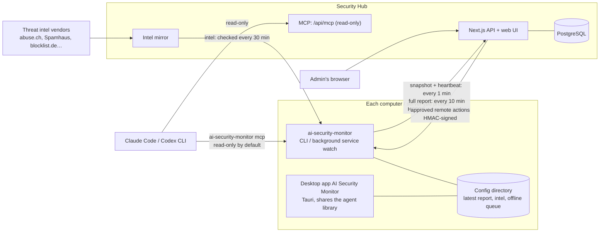

# Technical details

For people who want to know how it works or build it from source. Most users only need the [README](../README.en.md).

## Feature details

- **Connections and threat intel**: every connection gets a direction (outbound / inbound / listening / local) and is checked against public lists such as Spamhaus DROP, abuse.ch (Feodo, URLhaus, ThreatFox), blocklist.de, CINS, ET, DShield, Tor, IPsum and FireHOL,
  plus behavior checks (programs running from a temp folder, command shells talking to the internet, risky ports, regular "beacon" connections, new destinations), and is rated safe / unknown / suspicious / dangerous; every hit carries vendor, confidence, license and source URL. Optional AbuseIPDB / GreyNoise / CrowdSec online lookups (your own keys).
- **Firewall and exposure**: reads Windows Firewall, macOS pf / application firewall and Linux nftables / firewalld / ufw / iptables, and works out whether each listening port is actually reachable from the network;
  `fw block` and `fw sync-blocklist` turn high-confidence bad IPs into block rules (preview first, apply only when confirmed, reversible; sources with non-commercial licenses only alert by default).
- **Vulnerabilities and updates**: installed software, OS support dates (including Windows Server 2008 to 2025), how long Windows has gone without updates, pending Linux security updates, known vulnerable versions of common software (WinRAR, 7-Zip, Chrome, …), OSV lookups for Linux packages; anything in CISA KEV (actively exploited) is raised to critical.
- **Security settings (hardening)**: 60 cross-platform checks (UAC, Defender, BitLocker, SMBv1, Remote Desktop NLA, SSH, kernel parameters, AppArmor / SELinux, FileVault, Gatekeeper, …), aware of Windows client, Server, Server Core and domain controllers, customisable in YAML.
- **Traffic**: see where each program connects without capturing packets; analyze pcap / pcapng files from Wireshark / tcpdump (DNS, TLS SNI, cleartext protocols, large uploads, periodic connections).
- **Traffic statistics and performance**: upload/download per network card and per program every minute, charted on the Hub (bandwidth, which hosts and programs use the most); CPU, memory, disk and battery are **opt-in**, off by default and turned on on the computer itself (desktop Settings or `config set metrics.performance true`; the Hub cannot turn it on); a nearly full disk or a long-maxed-out CPU becomes a finding. The desktop app's *Traffic & performance* page charts this computer: live (every second), the last hour and the last 24 hours (the 24 hours are kept locally even without a Hub).
- **DNS defense** ([docs](dns.en.md)): each computer records which domains it looks up and which program asked (Windows ETW, packet capture on Linux / macOS), and detects threat-intel domains, DNS tunnels, generated domains, NXDOMAIN bursts and programs switching to their own encrypted DNS; it also catches changed DNS servers, tampered hosts files, WPAD and NXDOMAIN redirection; `fw dns-lock` stops programs from talking to outside DNS directly. Add your own DNS blocklists and allowlists (subdomains included; the Hub's apply company-wide, each computer can add its own); any computer looking up a blocklisted domain raises an alert. Domain intel now includes CERT Polska, HaGeZi and Phishing.Database.
- **Protective DNS server** (optional, off by default, [docs](dns-server.en.md)): a DNS for the whole LAN that blocks threat-intel domains, uses encrypted upstream DNS and caches (about 120k QPS, ~0.3 µs lookups in a 2-million-entry blocklist); switched on, paused and corrected from the Hub's "Protective DNS" page; runs on any always-on computer or in the Hub's compose; `dns use-hub` points single computers at it and switches back automatically if it stops answering.
- **Events and crashes**: Windows event logs, bugcheck minidumps, Linux journal and macOS crash reports, summarised into likely causes and what to do; also brute-force attempts, account lockouts, Remote Desktop logons from the internet, new accounts, new services and cleared audit logs.
- **AI and MCP**: `ai ask` / `ai analyze` hand things to Claude Code or Codex CLI (read-only tools only); `mcp` lets Claude Code / Codex / Cursor / VS Code query this computer directly; the Hub has a fleet-wide MCP and an AI assistant in the web UI.
- **Security report**: "Security report" on the Hub overview summarises a period (last 7/30/90 days or custom, optionally one host): security scores, new and resolved findings, threat-intel hits, risky IPs (with IP notes), DNS, events, blocks and MITRE ATT&CK; print it, save it as PDF or download Markdown.
- **Hub**: overview, hosts, connections, findings, vulnerabilities, hardening, traffic, events, intel, block approvals (signed, pinned host identity), keyless join requests with approval (found via DNS SRV or LAN mDNS), enroll keys, read-only API tokens, audit log, CSV export, Chinese and English, dark mode, mobile layout.
- **Deployment and updates**: start at boot (Windows service / systemd / launchd or at login), `self-update` (checks SHA256SUMS), one-line install scripts, Hub Docker image (amd64 / arm64).

## How it works



- **Periodic reports**: the background service `ai-security-monitor watch` takes a connection snapshot and sends a heartbeat every minute, and runs a full scan every 10 minutes (tune with `config set scan.snapshot_interval` / `scan.interval`).
  Uploads use HTTPS (plain http only for localhost or private networks) with the key from enrollment and this host's own token; the Hub pins it on first sight, so another machine can't impersonate it.
- **Joining a Hub**: computers find the Hub via an SRV record in the company DNS or LAN mDNS; the Hub proves its identity by signing with its own key (Ed25519), the computer pins the Hub fingerprint and refuses to upload if it ever changes; only after an admin approves does the computer get a key of its own.
- **Offline queue**: when the Hub is down or the network drops, full reports wait in the config directory's `outbox/` (up to 50) and are sent in order once it is reachable.
- **Remote actions**: after an admin requests and approves a block in the Hub, the agent picks it up; every action carries an HMAC-SHA256 signature, and the agent checks the signature, expiry and guardrails before running it. Hosts enrolled without `--accept-remote-actions` never pick up actions.
- **Intel**: the Hub downloads and caches the lists in `feeds/registry.json`; agents check every 30 minutes, getting lists from the Hub first when enrolled and from the vendors only for what the Hub doesn't have.
- **Desktop app**: links the agent's Rust library directly and reads the same config directory, so it sees the background service's latest report and Hub enrollment; reporting to the Hub is still the background service's job.
- **AI**: `ai-security-monitor mcp` (stdio or `--http`) exposes read-only tools by default; actions like blocking only appear with `--allow-actions`. The Hub's `/api/mcp` is entirely read-only.
  AI analysis in the CLI, the desktop app and the Hub web UI all call the Claude Code / Codex CLI you are signed in to, with these read-only tools attached.

## Command-line cheat sheet

```bash
ai-security-monitor doctor                       # environment check: permissions, intel freshness, external tools, Hub connection
ai-security-monitor intel update                 # download threat intel (the background service keeps it fresh afterwards)
ai-security-monitor connections --intel          # current connections and verdicts
ai-security-monitor scan                         # full scan (connections, intel, firewall, ports, events, vulnerabilities, hardening)
ai-security-monitor fw sync-blocklist --dry-run  # preview which high-confidence bad IPs would be blocked
ai-security-monitor ai ask "Is this computer talking to anything dangerous?"   # let Claude Code / Codex explain
ai-security-monitor enroll --auto               # find the company Hub, send a join request and wait for approval (with a key: enroll <url> --key asa_ek_…)
ai-security-monitor service install --yes        # report automatically after login (add --system on servers)
```

| Command | Purpose |
|---|---|
| `scan`, `connections`, `ports` | Full scan, connection verdicts, port reachability |
| `intel` | Intel updates, sources and licenses, look up an IP / domain |
| `fw` | Firewall status, audit, block / unblock, intel sync |
| `vuln`, `harden` | Vulnerabilities and updates, security settings |
| `traffic`, `events` | Traffic watching and pcap analysis, events and crash causes |
| `dns`, `dns-server` | Which domains this computer looks up (`--follow` for live), blocklist/allowlist (`dns block` / `allow` / `blocklist`), tamper baselines, `dns use-hub` / `restore`; the protective DNS server |
| `metrics` | Current upload/download rate (per card, per program); with performance collection on also CPU, memory and disk |
| `ai`, `mcp` | Claude Code / Codex analysis, MCP server and one-step client setup |
| `enroll`, `discover`, `unenroll`, `status`, `watch`, `service` | Find a Hub, join it, keep reporting, start at boot |
| `self-update`, `version`, `doctor` | Updates and environment check (`config set update.mode off\|notify\|auto` sets automatic updates) |
| `upload` | Scan now and upload to the Hub (resends queued reports first) |
| `allowlist`, `baseline`, `config` | Allowlist, baseline (only show what's new), settings |

`ai-security-monitor --help` and `ai-security-monitor <command> --help` list every option; `--lang en` switches to English, `--json` gives machine-readable output.

## Upgrading from asa / ai-security-agent

From 0.2.0 the project is called ai-security-monitor (the `asa` executable is now `ai-security-monitor`; the old GitHub URL redirects). No need to re-enroll:

- **Migrated automatically**: on first run the config directory `…/ai-security-agent` moves to `…/ai-security-monitor` (agent id, Hub enrollment, allowlist, baseline and intel included) and the `asa` keychain entry is copied to the new name.
  While an old resident watch is still running the old directory is used in place and moved when `service install` replaces the old service; `service install` removes the old `asa` service and `mcp install` replaces the old MCP entry.
- **Environment variables**: the new prefix is `AI_SECURITY_MONITOR_*` (`AI_SECURITY_MONITOR_HUB_*` for the Hub); the old `ASA_*` / `ASA_HUB_*` names still work.
- **Intentionally unchanged**: firewall object names (Windows group `ASA`, nft `table inet asa`, ipsets `asa_*`, pf anchor `com.asa`), the `x-asa-*` headers, the `asa_` / `asa_ek_` token prefixes and the `asa_hub` database, so existing rules and data are still recognised.
- **Desktop app**: its application identifier changed; uninstall "AI Security Agent" first, then install the new version (see [docs/desktop.en.md](desktop.en.md)).
- **Hub image**: now `ghcr.io/markku636/ai-security-monitor-hub`; the old `ghcr.io/markku636/ai-security-agent-hub` keeps being published for a transition period.

See [docs/install.en.md](install.en.md#upgrading-from-asa-01x), [docs/service.en.md](service.en.md#upgrading-from-asa-01x) and the [changelog](../CHANGELOG.md).

## Repository layout

```text
ai-security-monitor/
├── agent/                 Rust agent: the ai-security-monitor binary + library (the desktop app links this library too)
│   ├── src/               commands (cli/), scanners (scan/, connections/, intel/, firewall/, ports/, vuln/, hardening/, events/, traffic/),
│   │                      Hub client (hub/), actions (actions/), MCP (mcp/), AI (ai/), start at boot (service/), self-update (update/)
│   ├── prompts/           prompts for AI analysis
│   └── tests/fixtures/    test data
├── hub/                   Security Hub (Next.js + Tailwind): pages and API (app/), components, queries and logic (lib/), PostgreSQL migrations (drizzle/), tests
├── desktop/               Desktop app AI Security Monitor (Tauri 2): Rust shell (src-tauri/) + plain HTML / CSS / JS UI (ui/)
├── contract/              JSON Schemas between agent and Hub (enrollment, reports, snapshots, remote actions)
├── feeds/                 data embedded in the binary: intel source list, known-good services, hardening rules (YAML), vulnerability and bugcheck notes
├── docker/                Hub Dockerfile and compose files (standalone and server, each also with protective DNS; dev database)
├── scripts/               one-line installers, demo data, screenshots, version and changelog checks
├── docs/                  topic docs and README screenshots (docs/images)
└── .github/workflows/     CI and release pipelines
```

## Build from source

```bash
# agent (Rust 1.85+)
cd agent && cargo build --release && ./target/release/ai-security-monitor doctor

# Hub (Node 22+)
cd hub && npm ci && npm run dev:db && npm run dev    # http://localhost:3000
npm run verify                                        # typecheck, i18n, tests, build

# Desktop app (Tauri 2; the UI in desktop/ui is plain HTML/JS)
cd desktop && npm ci && npx tauri build              # builds the NSIS installer
```

Demo data: `node scripts/demo-seed.mjs --hub http://127.0.0.1:3000 --admin <admin secret>`; screenshots: `node scripts/capture-screenshots.mjs --hub http://127.0.0.1:3000 --admin <admin secret>`; desktop screenshots: `node scripts/capture-desktop-screenshots.mjs` (no Hub needed; add `--frame windows` for the Windows-framed versions).
