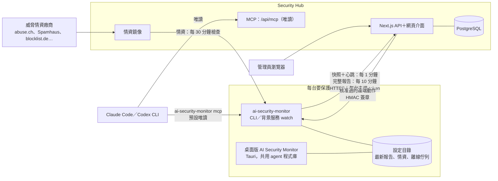

# 技術說明

給想知道它怎麼運作、或要從原始碼建置的人。一般使用者看 [README](../README.md) 就夠了。

## 功能細節

- **連線與威脅情資**：每條連線分方向（對外／對內／監聽／本機），比對 Spamhaus DROP、abuse.ch（Feodo、URLhaus、ThreatFox）、blocklist.de、CINS、ET、DShield、Tor、IPsum、FireHOL 等公開名單，
  再加上行為判斷（從暫存資料夾執行的程式、命令列程式直接連外、高風險 port、規律的定時連線、新目的地），判定安全／未知／可疑／危險；每個命中都附廠商、信心、授權與來源網址。可選 AbuseIPDB／GreyNoise／CrowdSec 線上查詢（自備金鑰）。
- **防火牆與曝露**：讀 Windows 防火牆、macOS pf／應用程式防火牆、Linux nftables／firewalld／ufw／iptables，算出每個監聽 port 實際能不能從外面連進來；
  `fw block`、`fw sync-blocklist` 可以把高信心的壞 IP 變成封鎖規則（先預演、確認後才做、可以撤銷；非商用授權的來源預設只告警）。
- **漏洞與更新**：已安裝軟體、作業系統支援期限（含 Windows Server 2008 到 2025）、Windows 多久沒更新、Linux 待裝的安全性更新、常見軟體的已知漏洞版本（WinRAR、7-Zip、Chrome…），Linux 套件查 OSV，已被實際利用的（CISA KEV）升為嚴重。
- **系統安全設定（硬化）**：60 條跨平台檢查（UAC、Defender、BitLocker、SMBv1、遠端桌面 NLA、SSH、核心參數、AppArmor／SELinux、FileVault、Gatekeeper…），自動分辨 Windows 用戶端、Server、Server Core 與網域控制站，可用 YAML 自訂。
- **流量**：不抓封包也能看各程式連到哪裡；也能分析 Wireshark／tcpdump 存的 pcap／pcapng（DNS、TLS SNI、明文協定、大量上傳、定時連線）。
- **流量統計與效能**：每分鐘記錄各網卡、各程式的上傳／下載量，Hub 畫出頻寬圖、哪台與哪個程式用最多；CPU、記憶體、磁碟、電池是**選用**的，預設關，要在那台電腦上自己開（桌面版設定或 `config set metrics.performance true`，Hub 無法從遠端開），磁碟快滿、CPU 長時間滿載會列成待處理問題。桌面版「流量與效能」頁用圖表看這台電腦：即時（每秒）、最近 1 小時、最近 24 小時（沒加入 Hub 也會在本機記 24 小時）。
- **DNS 防禦**（[說明](dns.md)）：每台電腦即時記錄查了哪些網域、是哪個程式查的（Windows ETW、Linux／macOS 封包監聽），偵測情資網域、DNS 通道、亂數產生的網域、大量查無此網域、程式自己改走加密 DNS；也抓 DNS 伺服器被改、hosts 檔被動手腳、WPAD、NXDOMAIN 被導走；`fw dns-lock` 擋程式直接連外部 DNS。可以自己加 DNS 黑白名單（含子網域；Hub 的全公司共用、每台也能自己加），黑名單上的網域任何一台查到都會告警。網域情資擴充了 CERT Polska、HaGeZi、Phishing.Database。
- **防護 DNS 伺服器**（選用，預設不開，[說明](dns-server.md)）：給整個區網用的 DNS，擋威脅情資列名的網域、上游走加密 DNS、有快取（約 12 萬 QPS、200 萬筆封鎖清單比對約 0.3 微秒）；由 Hub 的「防護 DNS」頁開關、暫停、放行；可以跑在任一台常開的電腦或 Hub 的 compose 裡；`dns use-hub` 把個別電腦指過去，連不上時自動改回。
- **事件與當機**：Windows 事件記錄、藍屏 minidump、Linux journal、macOS 當機報告，整理出可能原因與處理方式；也抓暴力破解、帳號鎖定、從公網登入遠端桌面、新帳號、新服務、清除稽核記錄等資安事件。
- **AI 與 MCP**：`ai ask`、`ai analyze` 交給 Claude Code 或 Codex CLI 解讀（只給唯讀工具）；`mcp` 讓 Claude Code／Codex／Cursor／VS Code 直接查這台電腦；Hub 也有全部主機層級的 MCP 和網頁上的 AI 助手。
- **資安報告**：Hub 總覽「產生資安報告」，選一段期間（最近 7／30／90 天或自訂、可限定一台主機）整理安全分數、新增與處理的問題、威脅情資命中、危險 IP（含 IP 備註）、DNS、事件、封鎖與 MITRE ATT&CK，可以列印、存成 PDF 或下載 Markdown。
- **Hub**：總覽、主機、連線、待處理問題、漏洞、安全設定、流量、事件、情資、封鎖審核（簽章、主機身分綁定）、免金鑰加入申請與核准（DNS SRV、區網 mDNS 自動尋找）、註冊金鑰、唯讀 API token、稽核、CSV 匯出、中英文、深色模式、手機版面。
- **部署與更新**：開機自動啟動（Windows 服務／systemd／launchd 或登入時啟動）、`self-update`（比對 SHA256SUMS）、一行安裝腳本、Hub Docker 映像（amd64／arm64）。

## 運作方式



- **定時回報**：背景服務 `ai-security-monitor watch` 每 1 分鐘拍一次連線快照並送心跳，每 10 分鐘跑一次完整掃描（間隔可用 `config set scan.snapshot_interval`／`scan.interval` 調）。
  上傳走 HTTPS（http 只允許本機或私網），帶註冊時拿到的金鑰和這台主機自己的 token；Hub 第一次看到就綁定，別台冒用會被擋。
- **加入 Hub**：電腦用公司 DNS 的 SRV 紀錄或區網 mDNS 找 Hub，Hub 用自己的金鑰（Ed25519）簽章證明身分，電腦記下 Hub 指紋，之後指紋不符就拒絕上傳；管理員核准後才發給這台專屬的金鑰。
- **離線佇列**：Hub 停機或斷線時，完整報告先存在設定目錄的 `outbox/`（最多 50 份），連得上再依序補送。
- **遠端動作**：管理員在 Hub 送出封鎖並核准後，agent 才去領取；每個動作都有 HMAC-SHA256 簽章，agent 驗章、檢查期限與護欄後才執行。註冊時沒加 `--accept-remote-actions` 的主機完全不領取。
- **情資**：Hub 依 `feeds/registry.json` 向各廠商下載並快取，agent 每 30 分鐘檢查一次，已註冊就先向 Hub 拿，Hub 沒有的才直接找廠商。
- **桌面版**：直接連結 agent 的 Rust 程式庫、讀同一個設定目錄，所以看得到背景服務的最新報告和 Hub 註冊；回報 Hub 仍由背景服務負責。
- **AI**：`ai-security-monitor mcp`（stdio 或 `--http`）預設只有唯讀工具，封鎖等動作要加 `--allow-actions` 才會出現；Hub 的 `/api/mcp` 全部唯讀。
  命令列、桌面版和 Hub 網頁上的 AI 分析，都是呼叫你已登入的 Claude Code／Codex CLI 並掛上這些唯讀工具。

## 命令列速查

```bash
ai-security-monitor doctor                       # 環境檢查：權限、情資新鮮度、外部工具、Hub 連線
ai-security-monitor intel update                 # 下載威脅情資（之後背景服務會自動更新）
ai-security-monitor connections --intel          # 目前連線與判定
ai-security-monitor scan                         # 完整掃描（連線、情資、防火牆、port、事件、漏洞、安全設定）
ai-security-monitor fw sync-blocklist --dry-run  # 預覽會封鎖哪些高信心的壞 IP
ai-security-monitor ai ask "這台電腦有沒有連到危險的地方？"   # 交給 Claude Code／Codex 解讀
ai-security-monitor enroll --auto               # 自動找公司的 Hub、送出加入申請等核准（有金鑰：enroll <網址> --key asa_ek_…）
ai-security-monitor service install --yes        # 登入後自動回報（伺服器加 --system）
```

| 命令 | 用途 |
|---|---|
| `scan`、`connections`、`ports` | 完整掃描、連線判定、port 可達性 |
| `intel` | 情資更新、來源與授權、查 IP／網域 |
| `fw` | 防火牆狀態、稽核、封鎖／解除、情資同步 |
| `vuln`、`harden` | 漏洞與更新、系統安全設定 |
| `traffic`、`events` | 流量觀察與 pcap 分析、事件與當機原因 |
| `dns`、`dns-server` | 這台查了哪些網域（`--follow` 即時看）、黑白名單（`dns block`／`allow`／`blocklist`）、竄改基準、`dns use-hub`／`restore`；防護 DNS 伺服器 |
| `metrics` | 現在的上傳／下載速率（各網卡、各程式），開啟效能蒐集時另有 CPU、記憶體、磁碟 |
| `ai`、`mcp` | Claude Code／Codex 分析、MCP server 與一鍵設定 |
| `enroll`、`discover`、`unenroll`、`status`、`watch`、`service` | 找 Hub、加入 Hub、常駐回報、開機自動啟動 |
| `self-update`、`version`、`doctor` | 更新與環境檢查（`config set update.mode off\|notify\|auto` 設定自動更新） |
| `upload` | 立即掃描並上傳到 Hub（先補送暫存的報告） |
| `allowlist`、`baseline`、`config` | 白名單、基準線（只看新增）、設定 |

`ai-security-monitor --help`、`ai-security-monitor <命令> --help` 看完整參數；`--lang en` 切英文、`--json` 給程式讀。

## 從 asa／ai-security-agent 升級

0.2.0 起專案改名為 ai-security-monitor（執行檔 `asa` → `ai-security-monitor`，GitHub 舊網址會自動轉址），不用重新註冊：

- **自動沿用**：第一次執行新版時，設定目錄 `…/ai-security-agent` 會搬到 `…/ai-security-monitor`（agent id、Hub 註冊、白名單、基準線、情資都在），鑰匙圈的 `asa` 項目複製到新名。
  舊版的常駐 watch 還在跑時先沿用舊目錄，等 `service install` 換掉舊服務時才搬；`service install` 會移除舊的 `asa` 服務，`mcp install` 會換掉舊的 MCP 設定。
- **環境變數**：新前綴 `AI_SECURITY_MONITOR_*`（Hub 是 `AI_SECURITY_MONITOR_HUB_*`），舊的 `ASA_*`／`ASA_HUB_*` 照樣有效。
- **刻意不改**：防火牆物件名（Windows 群組 `ASA`、nft `table inet asa`、ipset `asa_*`、pf anchor `com.asa`）、通訊標頭 `x-asa-*`、token 前綴 `asa_`／`asa_ek_`、資料庫 `asa_hub`，舊規則與資料都認得。
- **桌面版**：應用程式識別碼改了，請先解除安裝舊的「AI Security Agent」再裝新版（見 [docs/desktop.md](desktop.md)）。
- **Hub 映像**：改名 `ghcr.io/markku636/ai-security-monitor-hub`；舊名 `ghcr.io/markku636/ai-security-agent-hub` 過渡期內照樣發佈。

細節見 [docs/install.md](install.md#從-asa01x升級)、[docs/service.md](service.md#從-asa01x升級) 與 [變更紀錄](../CHANGELOG.md)。

## 資料夾結構

```text
ai-security-monitor/
├── agent/                 Rust agent：ai-security-monitor 執行檔＋程式庫（桌面版也連結這份程式庫）
│   ├── src/               各命令（cli/）、掃描（scan/、connections/、intel/、firewall/、ports/、vuln/、hardening/、events/、traffic/）、
│   │                      Hub 客戶端（hub/）、動作（actions/）、MCP（mcp/）、AI（ai/）、開機自動啟動（service/）、self-update（update/）
│   ├── prompts/           AI 分析用的提示詞
│   └── tests/fixtures/    測試資料
├── hub/                   Security Hub（Next.js＋Tailwind）：頁面與 API（app/）、元件、資料庫查詢與業務邏輯（lib/）、PostgreSQL migration（drizzle/）、測試
├── desktop/               桌面版 AI Security Monitor（Tauri 2）：Rust 殼（src-tauri/）＋純 HTML／CSS／JS 介面（ui/）
├── contract/              agent ↔ Hub 的 JSON Schema（註冊、報告、快照、遠端動作）
├── feeds/                 隨執行檔內嵌的資料：情資來源清單、已知良好服務、硬化規則（YAML）、漏洞與藍屏說明
├── docker/                Hub 的 Dockerfile 與 compose（單機版、伺服器版，各有含防護 DNS 的版本；開發用資料庫）
├── scripts/               一行安裝腳本、示範資料、截圖、版本與變更紀錄檢查
├── docs/                  各主題文件與 README 截圖（docs/images）
└── .github/workflows/     CI 與發佈流程
```

## 從原始碼建置

```bash
# agent（Rust 1.85+）
cd agent && cargo build --release && ./target/release/ai-security-monitor doctor

# Hub（Node 22+）
cd hub && npm ci && npm run dev:db && npm run dev    # http://localhost:3000
npm run verify                                        # typecheck、i18n、測試、build

# 桌面版（Tauri 2，介面是 desktop/ui 的純 HTML／JS）
cd desktop && npm ci && npx tauri build              # 產生 NSIS 安裝檔
```

示範資料：`node scripts/demo-seed.mjs --hub http://127.0.0.1:3000 --admin <管理員金鑰>`；截圖：`node scripts/capture-screenshots.mjs --hub http://127.0.0.1:3000 --admin <管理員金鑰>`；桌面版截圖：`node scripts/capture-desktop-screenshots.mjs`（不需要 Hub；加 `--frame windows` 產生套上 Windows 視窗外框的版本）。
