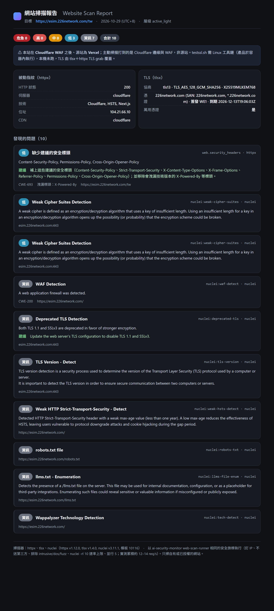

# 網站掃描

[English](webscan.en.md) | 繁體中文

Security Hub 的「網站掃描」掃**你自己的網站**：手動交給多個開源掃描器找已知漏洞、憑證與設定問題，
結果併成同一份「發現的問題」清單，下一次掃描自動比對哪些修好了、哪些又出現。
**選用、預設不開**：`compose.yml`／`compose.standalone.yml` 沒有掃描端，要用含網站掃描的 `compose.webscan.yml`／`compose.standalone.webscan.yml`。

> 只掃你擁有、或已取得書面授權的網站。對別人的系統做主動探測可能觸法；掃描由管理員手動發起。

| | 預設 | 說明 |
|---|---|---|
| 掃描端（webscan runner） | 不起 | 另外一個容器，向 Hub 領工作、執行掃描器、把原始輸出與結果傳回來 |
| 被動檢查 | 手動執行 | 跟一般瀏覽器差不多的幾個請求：憑證、標頭、用了哪些技術 |
| 主動掃描 | 手動執行，不需要所有權驗證 | 送出探測請求找已知漏洞與設定問題；不做注入、不做 DoS、不做模糊測試 |
| 內網網站 | 一律擋 | 管理員在「設定與金鑰 → 網站掃描」把網段加進白名單才放行 |

## 運作方式

```
管理員 ── 新增網址 ──▶ Hub：只做 DNS 解析，檢查位址（永遠禁止的網段、內網白名單）
                       │ 建立掃描工作：把「通過檢查的位址」釘進工作內容
                       ▼
掃描端 ── 領工作（只領自己有裝的掃描器）──▶ 再檢查一次範圍 ──▶ 只連釘住的位址執行掃描器
   │                                                         │
   └── 每 40 秒心跳續租 ◀───────────────────────────────────┘
   └── 上傳每個掃描器的原始輸出 ──▶ 回報結束 ──▶ Hub 解析、去重、跟上次比對
```

- **Hub 本身永遠不連你的網站**，也不需要 Docker 權限；所有打到網站的流量都從掃描端發出。
- 工作用租約管理：掃描端 2 分鐘沒心跳，工作回到排隊（最多重試 3 次）；24 小時沒人領就過期。多台掃描端搶同一個工作池也不會重複（PostgreSQL `FOR UPDATE SKIP LOCKED`）。
- 原始輸出（gzip）存在 Hub 資料庫，預設保留 30 天（`AI_SECURITY_MONITOR_HUB_WEBSCAN_ARTIFACT_DAYS`）；解析器改進後可以重新解析。發現的問題不會被清。

## 手動檢查

新增網址後，開啟目標頁面，按「**主動檢查（手動）**」即可排入掃描。不需要 DNS、驗證檔或 meta 所有權證明。只有手動按下按鈕才會建立工作；掃描端離線時先排隊，連線後執行。

## 範圍與安全護欄

| 護欄 | 怎麼做 |
|---|---|
| 永遠禁止的位址 | loopback、link-local、雲端 metadata（`169.254.169.254`、`fd00:ec2::254`、`100.100.100.200`…）、群播、保留／文件用網段、內嵌 IPv4 的轉譯網段（6to4、NAT64、Teredo）、Hub 與掃描端自己的位址；`localhost`、`metadata.google.internal`、`hub`、`postgres` 這類名稱 |
| 內網 | 10/8、172.16/12、192.168/16、100.64/10、fc00::/7 只有在白名單內才放行 |
| 一整組位址都要通過 | 網域解析出多個位址時，任何一個不過就整組不准（不挑「可以的那個」） |
| 釘位址 | 建立工作時把檢查過的位址釘進去；掃描端用內建的釘選解析器、`--ip`／`-sni` 讓每個工具只能連那些位址，DNS 之後換掉也打不到別處（擋 DNS rebinding） |
| 參數白名單 | 每個掃描器的選項都有型別、多一個欄位就拒絕；工具的命令列由掃描端從白名單組出來，絕不拼接 Hub 給的字串 |
| 不送資料給第三方 | nuclei 關掉 interactsh（`-ni`）、更新檢查（`-duc`）、redirect（`-dr`），只跑 http／ssl 模板，模板烘進映像、不自動更新；不在 JSON 裡留 request／response 原文（`-or`）|
| 網路隔離 | 掃描端只在 `edge` 網路：連得到 Hub，連不到 PostgreSQL |
| 資源上限 | 每秒請求數、同時連線數、單次掃描最長時間（設定頁可調）；容器唯讀根目錄、`cap_drop: ALL`、記憶體與行程數上限 |

## 掃描器

| 掃描器 | 查什麼 | 層級 | 授權 |
|---|---|---|---|
| [httpx](https://github.com/projectdiscovery/httpx) | 狀態碼、標題、伺服器、用了哪些技術；網站沒用 HTTPS | 被動 | MIT |
| [tlsx](https://github.com/projectdiscovery/tlsx) | 憑證過期／快到期、自簽、名稱不符、協商到的 TLS 版本 | 被動 | MIT |
| [nuclei](https://github.com/projectdiscovery/nuclei) ＋ templates | 已知漏洞（含 CISA KEV 的 CVE）、設定錯誤、外洩的檔案；排除 intrusive／dos／fuzz 模板 | 主動 | MIT |
| [testssl.sh](https://github.com/testssl/testssl.sh) | 伺服器提供的協定與加密套件、TLS 漏洞（Heartbleed、ROBOT…）、HSTS | 主動 | GPL-2.0 |

GPL 不等於不能商用：testssl.sh 以未修改的獨立程式執行，映像裡附授權全文。之後的版本會再加 wafw00f、checkdmarc、naabu、katana、MDN HTTP Observatory、OWASP ZAP 等；條款真的限制商用的工具（例如 WPScan）會跟著「情資使用情境」開關，商用模式自動不排。nmap、sqlmap 的授權把「執行並解析輸出的程式」也視為衍生作品，所以不整合。

### 被動安全標頭檢查（httpx）

httpx 這一步（被動、已登錄就會跑）除了指紋，還會檢查落地頁有沒有建議的安全標頭（Content-Security-Policy、Strict-Transport-Security、X-Content-Type-Options、X-Frame-Options、Referrer-Policy、Permissions-Policy、Cross-Origin-Opener-Policy），缺的併成**一筆** `缺少建議的安全標頭`，並順便指出會洩漏技術版本的標頭（例如 `X-Powered-By`）。只在回傳內容頁（非 3xx 轉址）時判斷。

這一筆會取代 nuclei 的 `http-missing-security-headers`（nuclei 每個缺的標頭各一筆、都是 info，很吵）與 testssl 的 `security_headers`。這是**刻意策展**：以上面這組核心建議標頭為準；nuclei 另外會抓的情境式／舊式標頭（Cross-Origin-Embedder-Policy、Cross-Origin-Resource-Policy、X-Permitted-Cross-Domain-Policies…）多數站台沒有也正常，故不另外列出，以免誤報。nuclei 的 `weak-hsts-detect`（HSTS 有、但偏弱）是另一回事，照留。

擷取回應標頭用 httpx 的 `-irh`，但上傳原始輸出前會先遮掉 `Set-Cookie`、`Authorization` 這類祕密（比照 nuclei 的 `-or`，祕密不進 Hub）。

## 報告範例

下面是對**本專案自有網站** `esim.226network.com` 的一次實測（掃描器用 `web-scan-runner` 相同的安全旗標）整理出的發現清單：被動指紋、TLS 設定，以及各掃描器併好、依嚴重度排序的「發現的問題」。



這個網站在 Cloudflare 之後、源站是 Vercel，所以主動掃描打到的是 Cloudflare 邊緣與 WAF；命中集中在邊緣的 TLS 相容性設定（較弱加密套件、HSTS 偏弱）與資訊揭露（缺安全標頭、`X-Powered-By`），沒有 CVE 類命中——是調 Cloudflare 設定的事項，不是源站弱點。

## 部署

### 跟 Hub 在同一台（Docker）

```sh
# .env 另外設 AI_SECURITY_MONITOR_HUB_WEBSCAN_TOKEN（至少 32 字元，Hub 與掃描端共用，例 openssl rand -hex 24）
docker compose -f docker/compose.standalone.webscan.yml --env-file .env up -d   # 單機版
docker compose -f docker/compose.webscan.yml --env-file .env up -d              # 伺服器版
```

跟不含網站掃描的那份是同一個專案（同名、同一份資料），兩份之間隨時可以換；換回時加 `--remove-orphans` 把掃描端收掉。

### 放在其他主機（例如要掃另一個內網區段）

在 Hub「設定與金鑰 → API token」建一個勾「網站掃描端」的權杖，在那台主機跑：

```sh
docker run -d --init --read-only --tmpfs /work --tmpfs /tmp --cap-drop ALL --security-opt no-new-privileges:true --memory 1g \
  -e AI_SECURITY_MONITOR_WEBSCAN_HUB_URL=https://hub.example:8088 \
  -e AI_SECURITY_MONITOR_HUB_WEBSCAN_TOKEN=<webscan 權杖> \
  ghcr.io/markku636/ai-security-monitor-webscan:latest
```

多台掃描端可以同時接同一個 Hub，各自只領自己有裝的掃描器能跑的工作。

## 跟法規對照

資通安全責任等級分級辦法（115 年 1 月 7 日修正）附表要求的「安全性檢測 → 弱點掃描」：A 級全部核心資通系統每年 2 次、B 級每年 1 次、C 級每 2 年 1 次，各級都要做「資通安全弱點管理」（知悉弱點應適時修補或緩解）。網站掃描的紀錄（掃描時間、目標、掃描器與版本、發現與處理狀態）可以當作自行檢測與弱點管理的佐證；報告寫的是「對應」某項要求，不代表通過驗證。

## API

格式見 [Agent ↔ Hub 契約](hub-contract.md#網站掃描端web-scan-runner)。管理員端點：`/api/v1/admin/webscan`（總覽）、`…/settings`、`…/targets`、`…/jobs`、`…/jobs/{id}`、`…/artifacts/{id}`、`…/findings`。
